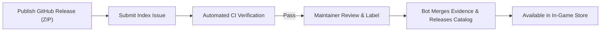

# Phinix Rework Plugin Development Guide

This document is the official technical reference for developing managed plugins for Phinix Rework. It aligns strictly with current codebase architecture and verified runtime practices.

> **Note**: Phinix plugin skill authoring is blocked until local sideloading and the [developer foundations](branch-local/dev/Developer-Foundation-Delivery-Plan.md) pass acceptance. No usable skill link is available yet.

---

## 1. Architecture Overview & Parity Principles

### 1.1 Plugin Parity
In Phinix Rework, built-in features (Chat, Trade, Virtual Inventory, Plugin Store) and third-party extensions share identical runtime lifecycles and privileges:
- **Unified Discovery**: Discovered dynamically by scanning assemblies for classes annotated with `[PhinixExtension]`.
- **Unified Registration & Composition**: Exposed via `IExtensionBuilder` APIs (`RegisterApi<T>`) or modern dependency injection scopes (`IClientCompositionScope`).
- **Unified Lifecycle Management**: Passive instantiation, explicit main-thread activation (`Activate`), and deterministic teardown (`Shutdown`).

### 1.2 Dependency Boundaries
- **Host Does Not Depend on Plugins**: The client host (`Phinix-Rework`) references only the neutral shared contracts (`ClientExtensionAbstractions`). It strictly forbids referencing any plugin or plugin Contracts project.
- **Loose Coupling Between Plugins**: Inter-plugin interaction is mediated directly through public Contracts interfaces and discovered via the host API registry (`ExtensionHostContext.TryResolveApi<T>`). The host never acts as a domain broker.
- **Explicit Dependencies**: Declared using `[PhinixExtension("your.package.id", DependsOn = new[] { "builtin.inventory" })]`. The host registry topologically sorts modules, ensuring prerequisites activate before dependent modules.

---

## 2. Public API Overview

### 2.1 Host Infrastructure Services
Obtained during the activation phase via `ExtensionHostContext.GetRequiredService<T>()`:

| Interface | Namespace | Capability |
| :--- | :--- | :--- |
| `IClientSessionContext` | `PhinixClient.Framework` | Authentication/login state, session ID and local user UUID; no server-address member |
| `IClientUserDirectory` | `PhinixClient.Framework` | Online/offline user queries, display names, profile metadata |
| `IClientUserEventStream` | `PhinixClient.Framework` | Disconnected, UsersChanged, UserDisplayNameChanged and BlockedUsersChanged events |
| `IClientMainThreadDispatcher` | `PhinixClient.Framework` | Marshals background callbacks to the RimWorld main thread (`Enqueue(Action)`) |
| `IClientSettingsContext` | `PhinixClient.Framework` | Shared persistent keys (`Get<T>`, `Set<T>`); prefix keys with your module ID because the host does not isolate them automatically |
| `IClientLocalizationService` | `PhinixClient.Framework` | Provides module-scoped localization (`ForModule(this)` -> `IClientLocalizer`) |
| `IClientWindowService` | `PhinixClient.Framework` | Host window management (opening dialogs, toggling windows) |
| `IClientSoundService` | `PhinixClient.Framework` | Native UI sound playback |
| `IClientExtensionManagementWindowService` | `PhinixClient.Framework` | Opens the extension manager window |

### 2.2 UI Extension Points
Registered during the registration phase via `builder.RegisterApi<T>(instance)`:

- **Main Tab (`IMainTabProvider` / `IResponsiveMainTabProvider`)**:
  Registers top-level tabs in the Phinix window (`TabLabel`, `TabOrder`, `Draw(Rect inRect)`).
- **Sidebar Drawer (`IServerSidebarProvider` / `IResponsiveSidebarProvider`)**:
  Provides right-hand sidebar panels or collapsible drawers.
- **Tab Badge (`IBadgeProvider`)**:
  Renders unread counters or badge notifications (`BadgeText`).
- **Settings Panel (`IClientSettingsPanelProvider`)**:
  Renders plugin-specific settings sub-panels within the main Phinix Settings window.
- **Notice Banner (`INoticeBannerProvider`)**:
  Renders interactive alert banners at the top of the window.
- **Key Interception (`IUiAcceptKeyHandler`)**:
  Handles Enter / Return keyboard inputs.

### 2.3 Responsive Layout Utilities
Available in namespace `PhinixClient` (sources under `Client/ClientExtensionAbstractions/UI`):
- `UiScreenSafeArea.ClampWindow`: Clamps windows to the screen. `Normalize` is internal, not a callable public plugin API.
- `ResponsiveFormLayout`: Adaptive single-line vs. vertically stacked form layouts.
- `ResponsiveSplitLayout`: Multi-pane layouts that degrade gracefully to vertical stacks or SinglePane tabs when width is constrained.
- `ResponsiveToolbarLayout`: Computes visible-action and overflow-button geometry; the caller draws controls and creates the FloatMenu.
- `VirtualListLayout`: Viewport virtualization for high-volume scroll lists.

### 2.4 Command Execution and Client Relay

Use server Commands when the server owns authoritative state, storage, or business validation. Trade creation/offers/confirmation/cancellation and Chat history requests remain server operations. Use explicit Relay when the target client plugin executes the operation. An absent `CommandRoute` defaults to `Server`; unknown ordinary Commands are never automatically relayed.

| Public service | Namespace | Purpose |
| --- | --- | --- |
| `IClientCommandCapabilities` | `Utils.Framework` | `Declare(ownerId, pluginId, commandType, version)` returns an independently owned disposable handle |
| `IClientCommandRelay` | `Utils.Framework` | `SendRelay` returns `Task<RelayResult>`; exposes `SyncState` and `SyncError` |

Register the receiver with `builder.AddClientCommandHandler(this)` during `Compose`. Borrow services and declare capabilities during `Activate`; dispose owned declaration handles during `Shutdown`. Use the module's `ExtensionId` as ownerId. Declarations and Handlers are independent: registering a Handler does not declare a capability, and missing/throwing Handlers do not automatically revoke declarations.

```csharp
// Activate: retain the handle. Shutdown: dispose it, not the borrowed Host services.
declaration = host.GetRequiredService<IClientCommandCapabilities>()
    .Declare(ExtensionId, "author.research", "request", version: 1);
var relay = host.GetRequiredService<IClientCommandRelay>();

// From an async operation; the receiver declares this exact namespace/type/version.
RelayResult result = await relay.SendRelay(
    "author.research", "request", payloadJson,
    targetPlayerUuid: targetUuid, version: 1);
```

An omitted/null target broadcasts to matching capabilities and excludes the sending connection. Player unicast reaches each eligible connection of that player once. Declare `request` and `announcement` separately; versions are positive integers matched exactly. PluginId/CommandType use lowercase ASCII letters, digits, dots, underscores and hyphens, start with a letter or digit, and are limited to 128 characters each. `core`, `builtin`, `framework` and their dotted subnamespaces are reserved. PluginId is a routing namespace, not authentication.

Wait for the first snapshot ACK (`Synced`) before sending; otherwise the initial send returns `CapabilitiesNotSynced`. Declaration changes resynchronize, disconnect preserves local handles, and reconnect restores the full snapshot under a new epoch. Duplicate declarations have independent ownership; only releasing the final handle revokes reception. Module rollback/shutdown also revokes its declarations.

Inspect `Status`, `Error`, and every entry in `Deliveries`. `Submitted` means network submission; define a plugin business ACK for actual success. Empty broadcasts return `NoRecipients`; unicast may return `NoCapability`, `TargetOffline`, or `UnsupportedRelay`. Limits produce `RateLimited`/`PayloadTooLarge`. Disconnect, result timeout, or uncertain handoff may yield `Unknown`; Framework never automatically replays business commands. Operations affecting items/assets need business idempotency and deduplication; routing results cannot authorize item delivery.

Dispatch Task continuations and incoming business callbacks through `IClientMainThreadDispatcher.Enqueue` before accessing Verse/Unity objects. Reject late callbacks with a module generation or stopped flag. Use `SendRelay` rather than stamping authentication fields or bypassing it through the ordinary Command transport.

See the [compilable lifecycle sample](../Samples/CommandRelay/README.md) and [Relay API/protocol reference](Command-Capability-Relay.md) for limits, errors, and compatibility. Build against a Host containing these new contracts and install the matching full client, with only one Host enabled. An API major range alone does not prove that additive types exist. `Could not load type 'Utils.Framework.RelayResult'` indicates missing/mismatched loaded Host contracts, not the sample's deliberate Handler fault injection. Do not bundle Host/Common, game, or Harmony DLLs in the plugin.

---

## 3. Lifecycle & Dependency Injection (DI)

### 3.1 Standard Lifecycle
1. **Construction**: Must be **entirely passive**. Only initialize immutable fields. Never start threads, make network requests, or touch RimWorld game state in constructors.
2. **Registration / Composition**:
   - Invoked after host infrastructure is ready.
   - Used to publish APIs, register UI providers, and configure dependency scopes.
3. **Activation**:
   - Called on the main game thread (`Activate(ExtensionHostContext hostContext)`).
   - Resolve borrowed services, subscribe to event streams, load settings, and launch background tasks.
4. **Shutdown**:
   - Called when the host extension runtime stops (`Shutdown(ExtensionHostContext hostContext)`). Disconnection is an event, not module Shutdown; enable/disable saves next-start intent, and loading a save does not rebuild all modules.
   - Must perform **symmetrical teardown**: unsubscribe all events, terminate background tasks, and dispose owned resources.

### 3.2 Two Authoring Paradigms

#### Option A: Modern DI Composition (Recommended for New Plugins)
Derive from `ClientExtensionModule` and override `Compose`:

```csharp
using System;
using PhinixClient;
using PhinixClient.Framework;
using UnityEngine;
using Utils;
using Utils.Framework;
using Verse;

[PhinixExtension("my.custom.plugin")]
public sealed class MyCustomPlugin : ClientExtensionModule, IActivatablePhinixExtensionModule
{
    private IClientCompositionScope scope;
    public override string ExtensionId => "my.custom.plugin";

    public override void Compose(IExtensionBuilder builder)
    {
        var log = builder.HostContext.Log ?? ((message, level) => { });
        var candidate = builder.HostContext.GetRequiredService<IClientCompositionFactory>().CreateScope(local =>
        {
            local.Borrow<Action<string, LogLevel>>(log);
            local.Register<IMainTabProvider, MyPluginTab>();
        });
        try
        {
            builder.RegisterApi<IMainTabProvider>(candidate.Resolve<IMainTabProvider>());
            scope = candidate;
        }
        catch
        {
            try { candidate.Dispose(); }
            catch (Exception cleanup)
            {
                try { log("Composition cleanup failed: " + cleanup, LogLevel.ERROR); }
                catch { }
            }
            throw;
        }
    }

    public void Activate(ExtensionHostContext hostContext) { }
    public void Shutdown(ExtensionHostContext hostContext)
    {
        var owned = scope;
        scope = null;
        owned?.Dispose();
    }
}

public sealed class MyPluginTab : IMainTabProvider
{
    private readonly Action<string, LogLevel> log;
    public MyPluginTab(Action<string, LogLevel> log) { this.log = log; }
    public string TabLabel => "Example";
    public float TabOrder => 500;
    public void Draw(Rect rect)
    {
        if (Widgets.ButtonText(rect, "Hello")) log("Example clicked.", LogLevel.INFO);
    }
}
```

> **Note**: The host internally uses Autofac 8.4.0, but the neutral contract layer completely hides container dependencies. Plugins must not reference Autofac directly.

#### Option B: Legacy Module Registration (Transitional Compatibility)
Implement `IPhinixExtensionModule` directly:

```csharp
[PhinixExtension("my.legacy.plugin")]
public sealed class MyLegacyPlugin : IPhinixExtensionModule, IActivatablePhinixExtensionModule
{
    public string ExtensionId => "my.legacy.plugin";

    public void Register(IExtensionBuilder builder)
    {
        builder.RegisterApi<IMainTabProvider>(new MyPluginTab(builder.HostContext.Log ?? ((message, level) => { })));
    }

    public void Activate(ExtensionHostContext hostContext) { /* Startup */ }
    public void Shutdown(ExtensionHostContext hostContext) { /* Teardown */ }
}
```

> **Current Status**: Option B remains fully functional for backwards compatibility, but outputs a single migration advisory at startup. Removal is planned for host 1.0 / abstractions 2.0 after external migrations conclude.

### 3.3 Reality of Existing Managed Plugins
- **Phinix-Example-Plugin** (1.0.2 development revision): Uses modern `ClientExtensionModule.Compose`, owns a DI scope and localizer, and borrows host services. Published 1.0.2 artifacts are unchanged.
- **Phinix-Legacy-RedPacket** (1.0.0): Uses legacy registration.
- **Phinix-Legacy-TalentTrade** (1.0.1): Uses legacy registration.

**Do not claim that all plugins have migrated to DI.** These plugins will migrate in dedicated follow-up iterations.

---

## 4. Threading & Resource Ownership

### 4.1 Main Thread Dispatching
RimWorld engine methods and Unity GUI calls are strictly bound to the main thread:
- Never invoke GUI drawing, text measurement, or `Verse.*` methods from background threads.
- Marshal background results to the main thread via `IClientMainThreadDispatcher.Enqueue(Action)`:

```csharp
mainThreadDispatcher.Enqueue(() =>
{
    // The callback may execute after a save/world change; validate its context again.
    if (Current.Game == null || Find.LetterStack == null) return;
    // Apply only the operation still owned by this session/world.
});
```

### 4.2 Symmetrical Resource Cleanup
- **Owned Resources**: Timers, thread handles, and event handlers instantiated by the plugin must be disposed or unsubscribed (`+=` matches `-=`) in `Shutdown`.
- **Borrowed Services**: Services obtained from `ExtensionHostContext` or borrowed via DI are owned by the host; **plugins must never call `Dispose` on borrowed services**.
- **Localization Binding**: Localizers created with `localizationService.ForModule(this)` must have their `LanguageChanged` event unsubscribed and `localizer.Dispose()` called during `Shutdown`.

### 4.3 Harmony Patching Guidelines
If your plugin uses Harmony to patch RimWorld methods:
1. **Never patch in static constructors**: Reflection scanning alone does not guarantee static constructor execution. Patching during type initialization still bypasses explicit lifecycle control.
2. **Patch in `Activate`, unpatch in `Shutdown`**:
   ```csharp
   private Harmony harmony;

   public void Activate(ExtensionHostContext hostContext)
   {
       harmony = new Harmony("author.plugin.id");
       harmony.PatchAll(Assembly.GetExecutingAssembly());
   }

   public void Shutdown(ExtensionHostContext hostContext)
   {
       harmony?.UnpatchAll("author.plugin.id");
       harmony = null;
   }
   ```

---

## 5. Build & Packaging

### 5.1 Environment Prerequisites

This Relay branch uses API 3 contracts and supports RimWorld 1.6/net472 and 1.7/net10.0. Provide the .NET 10 SDK, restored net472 targeting pack, and verified private game/Harmony compile references for both versions. Pin Host/Common source; do not follow moving branches or edit vendored protobuf SDK pins.

### 5.2 Packaging

The current Example `pack.py` builds both variants in isolation and produces one schema 2 variants ZIP. The Store catalog remains schema 3. Older `--host-assemblies`/`--packager` switches do not apply to this entry point. Other plugins own their build entry points; do not assume identical CLIs across arbitrary repositories. See [dual-runtime Host builds](Building-Dual-RimWorld.md).

```bash
python3 pack.py \
  --phinix-root <Phinix-Rework-containing-Relay-contracts> \
  --game-references <RimWorld-1.6-compile-references> \
  --game17-references <RimWorld-1.7-compile-references> \
  --harmony17 <matching-RimWorld-1.7-0Harmony.dll> \
  --version 0.0.1 \
  --output <fresh-output-directory>/your-package-relay-local.zip
```

`0.0.1` is a local test version, not an official release replacement. If a higher version is installed, uninstall it through plugin management and restart as requested before importing the local candidate. A candidate branch is not an automatic formal release. Validate both variants' reference closure, resources, and ZIP CRC.

```text
manifest.json
1.6/Assemblies/YourPlugin.dll
1.6/Resources/Localization/{en-US,zh-CN}.json
1.7/Assemblies/YourPlugin.dll
1.7/Resources/Localization/{en-US,zh-CN}.json
```

Package only owned plugin assemblies/resources. Never bundle game, Host/Common, or Harmony DLLs. Import through developer-mode **Install local plugin ZIP** and restart; extraction alone does not register a managed plugin. See [Local Plugin Quickstart](Local-Plugin-Quickstart.md) for installation and digest checks.

---

## 6. Testing & Validation

1. **Automated Headless Tests**:
   Write .NET 10 console test harnesses for domain logic and state transitions to verify boundary handling without game overhead.
2. **Local Game Testing**:
   - Store installation uses a managed transaction to write package files, installation receipts and desired state. Extracting a ZIP alone does not register a plugin.
   - For a private candidate, enable RimWorld developer mode and use Store → Install local plugin ZIP, review the digest, then restart. Follow [Local Plugin Quickstart](Local-Plugin-Quickstart.md); extracting a ZIP or copying a test bundle does not create managed installation records.
   - Managed paths use the actual SaveDataRoot and a sourceId/packageId-derived `pkg-<hash>`, not `<package-id>/<version>`.
   - Test next-start toggles, restart, save loading, disconnect and host exit separately; module, connection, save and operation lifetimes differ.

---

## 7. Submission & Index Admission



1. **Publish GitHub Release**:
   Publish a GitHub Release in your public repository containing the immutable release ZIP.
2. **Submit Candidate Issue**:
   Open a **Plugin submission** Issue on [Phinix-Plugin-Index](https://github.com/HunYuan2333/Phinix-Plugin-Index) with the complete candidate JSON from `examples/managed-submission.json`, including fixed repository/Release/asset/sourceCommit identities, digests and manifest. Workshop listings use `examples/workshop-submission.json` and require no managed ZIP.
3. **Automated Static Checks**:
   Intake workflows automatically inspect candidate schema, PE metadata, dependency closures, and SHA-256 integrity.
4. **Maintainer Approval**:
   A maintainer reviews the submission and applies the `plugin-approved` label.
5. **Immutable Publication**:
   Automation creates and merges an evidence PR, publishes `catalog-v3-<commit>`, and updates `stable.json`.
6. **Client Store Sync**:
   The plugin becomes installable and upgradeable directly in the game client.

---

## 8. Current Limitations & Known Issues

- **Phinix-Example-Plugin**:
  Demonstrates UI tabs, persistent settings, dual-language translation, and responsive layout hints. Does not implement complex item transactions or networking.
- **Phinix-Legacy-RedPacket**:
  - Depends on Trade and Inventory.
  - **Known Issue 1**: Sending ordinary steel across multiple physical stacks can trigger an incompatible-stacks exception. Grouping and selection alignment are planned in a separate plugin update.
  - **Known Issue 2**: A claim summary NullReferenceException was observed in a Root_Entry call chain. Its root cause remains unconfirmed; review notification scheduling and domain commit boundaries before attributing it to missing world context.
- **Phinix-Legacy-TalentTrade**:
  - Uses Harmony patches for pawn transfer interception.
  - **Persistence Boundary**: Active listings and rental records reside in a save-local `GameComponent`. Uninstalling while transactions are in-flight can corrupt save data.
- **Actions Automated Compilation**:
  Automated compilation workflows for the three standalone plugin repositories remain scheduled work under F7 (main/dev branch setup, compile-on-main, game reference provisioning). They are not yet implemented.
