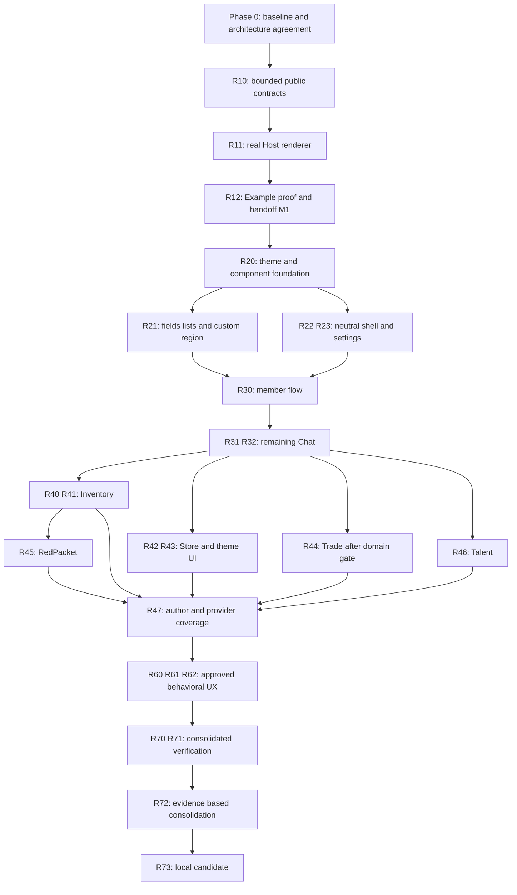

# Phinix Rework UX/UI 重设计 Roadmap

日期：2026-10-11，Asia/Singapore。状态：**用户已授权 API/Host renderer 基础实施；B1 基础与 B2 壳层/字段列表/首个成员流程源码及编译闭环已完成，游戏验收待测，完整业务迁移继续推进。后续 UI 重构按本文件分工接续，部署与发布继续延期。**

依据：[UX/UI/theme 审计报告](/home/hunyuan2333/Phinix/Phinix-Rework/docs/branch-local/audits/UI-UX-Redesign-Audit-2026-10-11.md)、[在线 Figma frame 1:4](https://www.figma.com/design/Mqxq3scgyAjpLFXbGJv78n/Phinix-Rework-Redesign?node-id=1-4)、[本地 .fig](</home/hunyuan2333/下载/Phinix Rework Redesign.fig>)。源码定位与完整主题 key 清单见审计 E01–E16 与附录 A。

## 1. 执行摘要

采用增量迁移：**行为与交互架构基线 → 最小公共呈现契约、真实 Host renderer 与 Example → 共享组件/中立壳层 → 完整 Chat 切片 → 逐个业务模块 → 跨模块兼容、性能与本地候选验收。**

Host 负责导航、布局、通用控件/列表/表单/状态、确认/选择容器；插件提供只读投影、校验与操作意图绑定，保留业务权威。特殊游戏内容使用受控自绘区域。built-in 与第三方消费同一公共能力；不先写私有官方框架，再在最后补 SDK。

兼容连续进入每批。后期兼容阶段只汇总覆盖，不首次处理旧主题或插件。保留现有 `UiTheme`/registry/catalog/package、当前 providers、历史输入/恢复 readers 与维护插件内部 1.9 adapters。新 UI 不判断主题 schema/旧 API/协议模式。服务器、消息 wire、物品账本和交易确认规则默认不变。

T5 本地主题 ZIP 导出、安装/更新/卸载与恢复后处理**已经有实现**，安排验证和视图接入，不重新建系统。线上主题准入、投稿、上传、Index/publication 改造与新在线发行继续延期；现有在线功能保持。

不估算日历工期：实际游戏基线、renderer proof 与高风险 Trade 状态验证尚未完成。以下以可检查的交付边界排序，避免把未知量变成承诺日期。

## 2. 当前基线与推荐交互架构

### 2.1 已有、缺失、未验证

审计时的主题、typed actions、ApiDirectory、Task、Lifetime 与 Example 1.0.6 已在上一批提交并推送。2026-10-11 本批新增通用 page/section summary/status/actions/confirmation renderer 与 Example 接入；列表、表单与 custom region 尚未实现。审计报告保留为原始证据，本文件第 16 节记录实施后的差异。B2 已增加公共 field/list/passive region 与壳层、首个成员流程，最新支持集和未完成项见 16.5；此处的缺失描述属于 B1。

`IMainTabProvider` 目前只有 TabLabel、TabOrder、Draw；sidebar 类似，没有稳定 page ID。ApiDirectory 有 registration identity 与可用性重验，但没有状态变化订阅。typed action collection不是业务 view 已接入，更不是内容 renderer。RimWorld 1.6/目标 net472 是源码声明，实际 Unity/Mono patch 和游戏内效果仍待基线记录。

T5/Example 文档的“已编译/打包”保留为历史记录，不能表述为本次测试通过。现有审计已列出的恢复/Trade 风险继续跟踪，不通过新外观掩盖。

### 2.2 信息架构：先作出建议，再拆组件

| 表面 | 推荐决策（待确认） | 保留用户流程 / 插件规则 |
| --- | --- | --- |
| 主导航 | 顶部 provider 驱动的 pill tabs + 通用 overflow；Chat 仍是公共聊天入口，不建立频道树 | numeric Order + owner/stable identity 确定顺序；第三方可添加，长文案/小窗仍可访问 |
| 设置 utility | Host 常驻“设置”，进入连接/快捷设置，并提供明确“完整客户端设置”“主题”“插件管理”入口 | 初期保留现有两个设置范围和保存时机；不假装已经统一所有设置页；Chat/Store 不启用也能进主题编辑 |
| 主内容/侧栏 | 双区域宽屏，窄屏沿用可访问 drawer；sidebar 仍是 provider 集合而非固定成员区 | Chat 提供成员页；Notice/第三方侧栏有独立入口、排序/溢出；0 provider 隐去区域 |
| 公告/状态 | banner placement 由 Host，内容与状态由 owner | 多条可滚动/收起且能再展开；系统状态不占据 composer；失败只隔离对应区域 |
| Chat | 保留消息流、回复、提及、URL/图像、发送失败草稿；成员搜索优先 | Enter/焦点/虚拟列表规则保留；无头像/私信/附件/消息全文搜索 |
| 成员操作 | 可发现的行操作入口+菜单；消息姓名处消费同一 owner-defined action point | trade/block 仍由业务拥有，第三方贡献公开；缺 Trade 不阻止其他动作 |
| Trade/Inventory/Store | 先迁移列表/状态/详情容器，再迁移高风险输入/确认部分，每部分交付闭环 | 不把更新报价/确认报价合并；不把安装、启用意图、运行、待重启合成成功 |
| 主题编辑/包管理 | 主题窗口维持选择、draft、preview、apply、export；本地 ZIP 管理维持 Store 入口 | “编辑中/使用中/安装完成/已应用”分开；无 Store 的 Host 安装 UI 是独立产品选择，不默认扩范围 |
| 特殊内容 | 当前 notice/image/reply 样式迁移；Figma 新 item/trade/battle 卡仅作为组件参考 | 没有真实业务 projection/integration 的卡不进入产品；不伪造字段或消息状态 |
| 窗口/在线信息 | 保持 Verse 打开、关闭、拖动、resize；在线数使用真实目录口径 | 不复制无语义的 OS 最小化/最大化；无真实来源不显示 idle/away/“通讯已加密” |

每个页面状态要区分：正常、真空列表、零命中、未连接、未登录、缺可选能力、加载中、插件失败、输入校验、已提交/等待、拒绝、结果未知、真实确认。只显示 owning API 真正能给的状态；不是要求给所有服务新增统一业务状态机。

### 2.3 需要确认的产品决策及默认建议

- D1：同意上述导航/设置结构；默认不合并保存规则，保留全部 provider。
- D2：同意“有界描述+共享组件+受控自绘”模型，以及首批 Example 计数/操作 proof；不用通用 UI 语言。
- D3：radius/spacing/control heights/Verse typography 初期固定受控 metrics；保留当前 color/float customization，不开放所有布局维度。
- D4：item/trade/battle 聊天卡及 presence 没真实能力时不排实施；保留 rich-text 昵称与配色偏好。
- D5：是否为无 Store 提供 Host ZIP 管理视图；默认维持现有能力边界，仅独立主题编辑入口必保留。
- D6：跨关窗重开保存 composer 草稿、成员 filter 等是否持久到 session；默认只保留现有行为，新增保持规则在 client-logic 批单审。

D1–D3 是相关架构/首批范围确认；D4 默认不新增行为；D5/D6 不阻塞 renderer proof。已有主题永久能力、插件同级、旧 adapter 边界及线上延期不需重新讨论。

## 3. 任务分类、文件区域与通用验收

类型：V Visual；U UX；C Client logic；T Theme system；P Plugin system；S Protocol/server；B Compatibility；I Testing/infrastructure。风险标记为 Low/Medium/High。独立性表示可在前置完成后独立评审，不代表允许并发编辑同一文件。

文件区域缩写（均相对当前 `Phinix-Rework`）：

| 区域 | 实际位置 / 归属 |
| --- | --- |
| A | `Client/ClientExtensionAbstractions/UI`、`Framework`；公共中立契约 |
| H | `Client/Source/UI`、`Framework`、`Client.cs`；Host 服务/启动/容器 |
| W | `Client/ClientExtensionAbstractions/UI/ClientWidgets.cs`、Responsive*、VirtualListLayout；公共 helper |
| SH | `Client/Source/GUI/Windows and panels/ServerTab.cs`、`ServerTabButtonWorker.cs`、`SettingsWindow.cs` |
| TH | `UiTheme.cs`、`ThemeInputAdapter.cs`、`ThemeLoader.cs`、`ThemeSettingsWindow.cs`、`ThemePackageExportWindow.cs`、`ClientThemePackageService.cs`及 theme XML |
| CH | `Extensions/Chat/Client` 与 `Contracts/ClientChatContracts.cs` |
| TR | `Extensions/Trade/Client` 与 `Contracts/ClientTradeContracts.cs` |
| IN | `Extensions/Inventory/Client` 与 `Contracts/InventoryContracts.cs` |
| ST | `Extensions/PluginStore/Client`；LocalThemePackagesWindow、ManagedPluginStoreView等 |
| CO | `Dependencies/Phinix.Common/Common/Utils/Framework/Themes`、ManagedExtensions；数据包/事务，非绘制代码 |
| EX | 同级 `Phinix-Example-Plugin/example`、`Api-Semantics-Example.md` |
| LP | 同级 `Phinix-Legacy-RedPacket/Client` 与 `Phinix-Legacy-TalentTrade/Client`、各内部 Compatibility |
| QA | `Tests` 对应现有 suites、`Client/Languages`、localizer资源、branch-local文档/本地候选 |

**所有迁移任务的公共门槛 G：** partial/旧主题、explicit inherit、unknown保留、plugin keys及热应用；缺/disabled/failed provider、贡献排序/overflow/长翻译/窄窗；actual-module lifetime、close/stop/stale guard、借用API不Dispose；measure/draw/collect无业务副作用；真实业务结果不被 callback/task 完成替代；保存数据/协议规则不变；受影响路径实机证据或明确未验证。下表的测试栏在 G 基础上增加任务专项，不能省掉 G。

## 4. 分阶段路线与任务明细

阶段验收按证据推进，不按日期。每个 task 都写目标/范围、模块、前置、分类风险、兼容、专项测试、独立性、产品决定、顺序。新文件/接口名只是工作范围，未声称存在。

### Phase 0 — 基线、安全与架构确认

| ID/顺序 | 目标与范围；文件 | 前置 / 风险类型 | 兼容影响与专项测试 | 独立 / 产品决定 |
| --- | --- | --- | --- | --- |
| R00 / 1 | 保存当前构建/dirty清单、程序集批次、游戏版本、当前flow截图与失败状态；QA，所有受影响views | 无；Low I/B | 不修改默认行为；记录发送/回复/@、名单、报价/确认/关窗、库存恢复、Store/T5、LP、Example；核对实际DLL | 可独立；无 |
| R01 / 2 | 形成信息架构/Host责任、各模块状态与能力保留表；SH/A/文档 | R00；Low U/P/B | 检查每个现provider可达，0/多provider/narrow、双设置范围；状态文案无假确认 | 可独立设计评审；D1–D4 |
| R02 / 3 | 冻结“下一批足够”的契约与验收清单，记录renderer proof范围、版本/测试组合；A/H/EX/QA | R01；Medium P/I/B | 冻结是证据快照，不做永久API稳定承诺；旧1.9、主题v1/v2/v3/package边界不混用 | 可独立评审；D2 |

出口 M0：架构与首批范围可确认，关键行为有游戏基线/明确缺证据；审计遗留标为阻断或另案，不能用截图代替业务安全测试。

### Phase 1 — 公共契约 + 最小 Host renderer 的可运行证明

| ID/顺序 | 目标与范围；文件 | 前置 / 风险类型 | 兼容影响与专项测试 | 独立 / 产品决定 |
| --- | --- | --- | --- | --- |
| R10 / 4 | 定义最小 presentation：稳定page/section/action ID、只读summary/status、revision、action绑定、确认request/view session；A，EX context沿用 | R02；Medium P/C/B | additive API，保留Draw；action语义继续IClientActionSet，不新建operation registry；draft/list暂不加入proof | 契约可单审但不算完成；D2 |
| R11 / 5 | 实现同一个Host renderer：summary、action toolbar、status、确认shell、窄窗布局、theme snapshot、view ownership、failure边界；H/W/启动wiring | R10；Medium C/P/T/B | 任意插件借用service，actual-module owned session；复用现registry/task/lifetime，缺provider/stop/repaint不可触发动作 | 不脱离R12交付；无额外产品决定 |
| R12 / 6 | Example现有计数/增量/重置确认通过公共模型由真实Host绘制；保留task示例“callback完成”；EX | R11；Medium P/C/I/B | 不改计数权威/保存语义、不造远端成功；关闭确认后stop、stale、主题热切、语言、窄窗、跨插件贡献 | 可独立proof包评审；D2范围内 |

出口 M1：**接口+真实renderer+Example+文档+检查证据同批交付**；不能仅声明interfaces就交接。renderer不用最终Figma全套外观，但必须真用theme、layout、state、lifetime。第一批可只使用已有ui.*与Example keys，新增role留R20。

### Phase 2 — 设计系统与中立壳层

| ID/顺序 | 目标与范围；文件 | 前置 / 风险类型 | 兼容影响与专项测试 | 独立 / 产品决定 |
| --- | --- | --- | --- | --- |
| R20 / 7 | 映射Figma semantic roles到现registry，增加必要keys/fallback；固定metrics/缓存rounded素材、button/field/row/card/state；TH/W/H/Languages | M1；Medium V/T/P/B | 不重写resolver、不rename旧keys；explicit values优先；primary accent不重定义success；旧主题+contrast/cache失效 | 角色与metrics可单审；D3 |
| R21 / 8 | 增补下一Chat切片需要的text field/virtual list、可控custom region、公共projection/session与input intents；A/H/W | R20；Medium C/P/B | row/field稳定ID、只读数据、draft/selection/scroll归Host；验证/commit归plugin；保留oldDraw | 与R22避开共享文件后可拆审；D2模型内 |
| R22 / 9 | 可选导航metadata与shell迁移：稳定identity、overflow、所有sidebar/banner、Host settings常驻、失败区域；A/SH/H | R20，R01；Medium V/U/C/P/B | 不按translated label识别；legacy providers有绑定adapter；registration失效选中安全回退；0/32tab、多sidebars、language/narrow测 | 可独立壳层批，R21不阻塞旧Draw页；D1 |
| R23 / 10 | 设置容器与主题/插件独立入口、连接状态文案；保留quick/full provider呈现和保存；SH/H/TH | R22；Medium U/C/P/T/B | 不假造server/room管理、不删Catalog Import/Export；禁Chat/Store后theme/edit/export可达，provider measure异常隔离 | 可独立；D5仅涉及额外Host安装页，不默认做 |

出口 M2：新壳层同时承载旧Draw和公共renderer；第三方页/侧栏/设置不丢失，主题编辑/导出仍独立可达。共享层已经足够下一真实flow，不等待所有API。

### Phase 3 — Core Chat：先完成一条真实切片，再扩展

| ID/顺序 | 目标与范围；文件 | 前置 / 风险类型 | 兼容影响与专项测试 | 独立 / 产品决定 |
| --- | --- | --- | --- | --- |
| R30 / 11 | 第一完整Chat切片：浏览成员→现子串搜索→row/menu→屏蔽/取消；由Chat投影名单，Host field/list/action画面；CH/A/H | R21–R23；Medium V/U/C/P/B | Member typed context在Chat Contracts，block保持原authority；第三方contribute，缺Trade解释；zero/offline/blocked/longname/lifecycle | 可独立评审；保留过滤口径，无新增presence |
| R31 / 12 | 消息rows+composer→发送→现pending/denied、回复/@/跳转、URL/image；Chat projection/受控specialregion；CH/W/H | R30；Medium V/U/C/P/B | 控件ID/焦点边界保留；accepted submission≠confirmed；原发送/协议adapter不替换；新增屏内反馈明确C/U | 可按rows/composer两个完整行为批分审；D6新增跨关窗草稿另R61 |
| R32 / 13 | message/name typed action integration与现notice/image/reply cards、load/fail fallback；CH Contracts/client；不新增item/trade/battle payload | R31；Medium V/U/P/C/B | collect/close释放，同member action语义复用；旧message形状fallback可读；图像owner和纹理清理 | 可独立；D4中新能力不安排实现 |

出口 M3：真实公共聊天室完整流程可用；主窗、消息、成员、filter、composer、nav、settings和已存在特殊内容迁移可评估。无新协议或socialfeatures。组件与公共契约若需调整，只扩展同一个M1 foundation，先审再扩大。

### Phase 4 — Secondary Modules：逐流迁移，按本地状态复杂度排序

默认顺序 Inventory → Store/主题 → Trade → RedPacket → Talent → 其余providers。相对原提示把Trade放后，是因其view持托管状态、Reset顺序和确认边界影响高；Trade的语义梳理R44可先开展但不能并发改同sharedcontract。每个模块内部先补所需contract/renderer，再交一条完整flow。

| ID/顺序 | 目标与范围；文件 | 前置 / 风险类型 | 兼容影响与专项测试 | 独立 / 产品决定 |
| --- | --- | --- | --- | --- |
| R40 / 14 | Inventory分组/可用量→提取表单→plugin校验→真实结果；public numeric field/field error/选择；IN/A/H | M3；Medium V/U/C/P/B | quantities long、不溢出、预留/codec由Inventory；entry stale不retarget；all-or-nothing提取/关窗/故障 | 独立垂直slice；无新增权威规则 |
| R41 / 15 | Inventory日计划/delivery choice、恢复/只读状态；公共form/selection/confirmation；IN/SH | R40；High C/U/P/B（数据敏感） | tick显示映射不改执行时间；恢复需原玩家确认、ledger不改；损坏/拒恢复/切存档/预留 | 可独立；新的时间选择行为需产品审阅，默认仅单位解释 |
| R42 / 16 | Store查询→list/detail→plan/confirm→install/update/manage/result；Store projection使用公共renderer；ST/A/H | M3；High V/U/C/P/B（安装事务） | installed/desired/active/restart区分、冻结摘要/来源/取消语义、DevMode DLL规则；optional/failed/inventory unknown | 独立模块批，复杂flow拆可评审slice；无在线流程新增 |
| R43 / 17 | Theme editor/preview/export与Store本地theme包视图迁移；按现T5闭环接入和验证；TH/ST，CO只被消费 | R42、R20/R23；High T/U/P/B/I（恢复敏感） | unknown/inherit/profile/selectedintent、export拒覆盖、uninstall vs loss、update移variant；三端路径+故障注入 | 视图/验证可分别评审；D5额外Host安装页另立项 |
| R44 / 18 | Trade projection/operation/lifetime语义梳理→list→offer selection/update/confirm/cancel；先确认pending owner如何与renderer分离；TR/IN接口边界 | M3；High C/P/U/V/B | 不提前确认/返还；现关窗pendinglistener行为保留；realack/重复/未知/断线/库存预留/整批codec；Reset漏洞判断另案 | R44a语义梳理可提前，R44b迁移依赖其验收；任何恢复规则改动另审 |
| R45 / 19 | RedPacket物品选择→发送/冷却/pending→领取/详情；公共form/list/state+itemcustomregion；LP | R40、M3，必要业务context完成；High V/U/P/C/B | 内部1.9adapter、新旧单包、relayaccept不等HTTPqueued、库存托管、迟到/重复回调；旧能力不隐藏 | 独立插件批；不改红包业务/relay历史核对 |
| R46 / 20 | Talent直接交易/市场/租赁的列表、表单、详情、确认；pawncustomregion；LP | M3，customregion完成；High V/U/P/C/B | 旧1.9adapter、pawnledger/归还ownership、optional modules/转场；完整3subflow独立验收 | 可按3flow拆审；不改租赁/结算规则 |
| R47 / 21 | 其他provider/设置/第三方access验证，更新作者指南与migration inventory；A/H/EX/QA，各实际consumer | 相关R40–R46完成；Medium P/B/I | 页面/section/form/action/theme/optional/close都可公开接入；未迁Draw继续可达；renderer失败仅局部 | 可逐consumer独立；没有无限API清单前置 |

出口 M4：每个选定模块的样式、状态、API开放、生命周期一起验收，不能仅证明Host外框变化。业务风险未解决时允许保留该旧区域，不宣布全模块迁移完成；缺口记录阻断该slice，其他module继续。

### Phase 5 — 明确的行为型 UX 改进

安全呈现改善在R20–R47随对应flow实施；这里专门安排需改变client/plugin逻辑的项，不把所有UX思考推迟到末尾。

| ID/顺序 | 目标与范围；文件 | 前置 / 风险类型 | 兼容影响与专项测试 | 独立 / 产品决定 |
| --- | --- | --- | --- | --- |
| R60 / 22 | 字段草稿与有效设置分离、空白发送禁用、非法数量/数字反馈、动作旁disabled reason；CH/IN/各settings及sharedform | 相应slice已迁；Medium U/C/P/B | 不改变persisted keys/ranges，按owner提交；非法临时输入不写0；repaint/locale/取消/保存 | 可按字段族独立；改变保存时机需先确认 |
| R61 / 23 | 按批准范围保留focus、filter/selection/scroll/draft，stale消失解释及转页返回；各plugin adapter/Hostsession | 相应slice与D6；Medium U/C/P/B | view/session状态不变业务authority；restart持久草稿默认不做；switchsave/disconnect/stop清理 | 独立；D6 |
| R62 / 24 | 通用action overflow/order/缺能力reason与快捷/完整设置discoverability一致化；A/H/EX/对应view | 各typed point完成；Medium U/C/P/B | 不扩权限/删贡献；缺点容忍、重复ID拒绝、stale不执行、longlocale/narrow | 可独立；无新增productfeature |

出口 M5：行为型 UX 改动逐项有 before/after、持久化/输入/结果语义差异及测试，不夹在“换配色”提交里。服务器/协议候选不计入M5完成。

### Phase 6 — 兼容汇总、Polish、测试与本地交付

| ID/顺序 | 目标与范围；文件 | 前置 / 风险类型 | 兼容影响与专项测试 | 独立 / 产品决定 |
| --- | --- | --- | --- | --- |
| R70 / 25 | 汇总旧主题/新role、optional providers、maintained1.9/current、数据reader与wire不变矩阵；QA/TH/LP/CO | 各slice已有局部证据；High B/I | 兼容不可首次到此才测；T5恢复故障注入、update/uninstall、profiles、oldreader与联机组合 | 可逐cell提前；无 |
| R71 / 26 | 跨模块scale/localization/state/长内容/performance+最终roundedstates校对；QA/W/H/pluginviews | M3起可持续，最终依赖M4/M5 | 1080p/1440p/4K、低分辨率fallback、中文/英文长文本、IMGUI多pass、虚拟化/资源回收 | 可分测试类别；无 |
| R72 / 27 | 根据实际consumer清单合并冗余helper/绘制路径；保留必要Drawadapter与内部1.9adapter；A/H/W/pluginviews | R70/R71及对应迁移证据；High P/B/C | 先查消费者、反编译/引用或静态build验证；未迁第三方不盲删publicAPI；旧数据reader不删除 | 独立清理批；breakingchange只转未来major |
| R73 / 28 | 同批Host/Contracts/plugins/Example本地candidate、验收记录、回退说明/knownissues；QA/打包文档 | R70/R71，R72可按必须清理项判 | 不混早期T3 SDK/currentHost；恢复数据先核对，不rollback抹unknownledger；游戏最终制品验证 | 独立交付；公开发行继续等待明确授权 |

出口 M6：本地候选可评审，矩阵有通过/失败/阻断/未测四种状态；没有隐含在线发布。路线实施完毕也不自动恢复线上工作。

## 5. 有界 API 依赖评估

| flow/surface | 已有public / actual implementation | 下一批缺口与归属 | 只消费还是扩展 / 阻断时点 |
| --- | --- | --- | --- |
| Example summary/actions/confirm | IClientPresentationService/Session/Page/Section、真实 ClientPresentationService；复用 typed actions、Task/Lifetime | 本批 R10–R12 源码及编译完成；Example 专用普通 typed point 复用 ExampleActionContext；不新增 business API | 游戏验收待测；实现支持集和限制见第 16 节 |
| shell page/sidebar/order | IMainTab/Sidebar/banner/hints与ServerTab | optional stablemetadata Host；owner绑定/legacy provider映射/刷新属于Host | R22前置；旧Draw不要求实现新接口 |
| member search/list/block | userDirectory、UserList.Filter、ChatUI context | general text/virtualrow Host；Member typedcontext/actionpoint属于CH Contracts/client | R30前补齐；不需要serversearchAPI，block仍原动作 |
| composer/message | Chat current sender/service/submission与acceptkey | Host field/customregion/session；Chat projection/Message typedcontexts/points在CH | R31/R32按需补；旧image/replycustom保留；新消息card不阻断 |
| settings/connection | full/quickproviders、SettingsWindow、Clientsession/window APIs | sharedsection/state Host；plugin field descriptors由各owner；session-stage query仅必要时补Host | R23可先包旧callbacks，R60字段才需formadapter |
| Inventory extract/plan/recovery | IInventoryReadApi/ReservationApi及currentInventory service/contracts | bounded numeric/field errors Host；库存readprojection/intent/outcome在IN | R40/R41前足够；现API有语义就仅适配，缺状态query才补Contracts |
| Trade list/offer/results | currentTrade contracts/service、Inventory reservation；pending尚部分在window | Trade-owned readonlyoperationprojection/closeownership，actioncontext在TR；Host不拿Thing | 高风险R44前必须补/验证，通用renderer不能代替domainrepair |
| Store install/detail | existingcontroller/snapshots/management API | Storepresentationadapter；Host通用list/detail/status/confirm | R42补对应renderer，planning/recovery不迁Host |
| theme editor/localpackages | ThemeReader/Registry/Catalog/Window/PackageService/Exporter及UiTheme/Common实际实现 | Viewadapter+componentpreview；error可读映射，交易层无新需求 | R43是消费/验证，不能排成“新建T5”；D5可后加 |
| RedPacket/Talent | ordinarytabs/settings、内部1.9binding/themeadapters与pluginbusiness | ownerprojection/actioncontexts、ownercustomitem/pawn；Host只contractualregion | R45/R46前按flow补，1.9旧路径不需newrenderer |
| thirdpartysection/content | main/sidebar/settings Draw；typedactions基础 | generalownedsectioncomposition/slots只覆盖真实needs；typedcontext在定义point插件 | 基础page/section R10/R22，贡献section在R47实际需求前补；不是action即content |
| resources/storage | LifetimeOwn、guardedsubscribe已有 | module-file/assets/storageAPI并未全实现 | rendererproof不用磁盘pluginasset，不阻断；特殊asset需求出现再立boundedAPI |

**准入规则：** 每批记录“已有方法与实际语义→missing→owner→consumer adapter→test”。公共contract需coherentownership/threading/result/failure，即使首个consumer是Example；真正迁businessflow必须另核其viewintegration。业务不把wireDTO提供给Host，不强求每个新增API都有built-inconsumer，也不建立无限API完工前置。

### 5.1 稳定identity的最小扩展建议

保留原IMainTab/Sidebar签名，优先独立optionalmetadata接口（最终名在R10/R22审），提供局部稳定presentationID、可读label/可选icon引用。Host结合actualOwnerId与局部ID唯一定位；label不参与identity。

没有metadata的当前Drawprovider由Host绑定adapter使用owner+exactregistration+同owner贡献序号维持本次绑定；不承诺跨注册/跨运行稳定restore。新增metadata重复ID可读报错并隔离，不能默默覆盖。相同order再按明确stableidentity排序；旧providers的原排序在baseline验证，改变tie-break属于C/P而非仅V。

## 6. 公共 renderer 的责任与作者接入

### 6.1 一套基础、多种受控呈现路径

| 插件提供 | Host负责 | 永远属于业务owner |
| --- | --- | --- |
| page/section/row/field/action稳定ID、readonlysnapshot/revision、localizedlabel、semanticrole、ownedthemekey、field约束及disabledreason | layout/measure、virtualization、控件、hover/focus/disabled/selected、commonstate、dialog/菜单/overflow | 库存/报价/物品/pawn/权限、authoritativevalidation、wire、持久账本、实际operationoutcome |
| typedcontext与用户intenthandler，回调结果/实际状态投影 | inputevent路由与guard、status呈现；不在render/collect执行命令 | 重试/取消是否可行，Unknown如何核对、确认如何生效 |
| specializedownedrenderer与assetlease | 测量合同、分配Rect/clip、theme snapshot、GUI恢复、失败占位 | 游戏对象/preview生成、安全引用与asset实际生命周期 |

Host view session保存focus/controlidentity、selection、scrollanchor、输入draft。plugin保存权威值与命令状态。revision、themeversion、locale、width/metrics改变失效cache；snapshot不每pass整份重建。列表row不存在时显示stale/安全关editor，不把未确认动作指到另条记录。

视图registration/scope在实际Activate绑定。关闭/替换/ownerstop释放actionset、viewsubscriptions、cache与ownedassets；ApiDirectory取得业务API为借用，每次操作重验registration/availability。关view不停止已经发生的businessoperation，task取消不undo。confirmation再验证owner/context/generation与值版本。

### 6.2 第三方作者完成哪些动作

1. 通过ordinaryCompose/Activate注册page或原mainprovider，并取得公共renderer借用service；无需Host新增自己的module名称。
2. 提供owner-boundpresentationidentity、section与snapshot；以公共field/list/action/status模型呈现commondata。首批只有summary/actions，form/list在R21扩展，作者文档准确注明当前支持集。
3. 通过现ThemeRegistry注册自己的namespace、fallback/labels/groups，再以theme reader/semanticrole使用颜色；缺optionalkey回退，热应用触发cache失效。
4. 对已定义typedpoint贡献action，context属于pointownerContracts；缺point是normaloptionalstate；disabledreason、order、stale guard公开。
5. Capture/TryGet可选provider，缺/registered/unavailable显式降级；不反射Host私有registry，borrowedAPI不Own。
6. Close/Stop释放ownedviews/sets/subscriptions；主线程执行userintent，状态由实际结果映射，不假confirmed。

contentsection贡献仅在实际页面需要时定义boundedslot，沿用同owner/lifecycle/ordering规则；不把actionfactory强行变成任意UI引擎。

### 6.3 旧 Draw 和 specialized custom 的过渡

`ServerTab`继续分配Rect承载ChatMainTab、TradeMainTab、InventoryTab、StoreMainTab、RedPacketTab、TalentTradeTab、Example及第三方。shell添加guard/isolation只能限制调用与GUI边界，不能自动转描述或控制callback内部所有逻辑。

迁移清单必须逐消费者写：旧entry→newprojectionadapter→publicrenderer支持范围→保留customregion→可移除privatehelper→未验证。当前legacyDisplayable、menus、modulewrappers只有对应consumer全迁/adapter替代且兼容边界验证后才删。不默认永久维护两套完整UI；也不立即删除publicDraw或内部1.9adapter。

custom区域规范：mainthread measure/draw、boundedsize、Rect clip、inputownership、theme reader、revision、assetownership、failure及dispose。render不得文件扫描/业务操作/重复订阅；GUI color/enabled/font/anchor/wrap以及group/scroll/clip均需finally恢复。R21先支持Chat现图像/特殊文本需要的边界，pawn专用需求到R46再扩同机制。

## 7. Theme loader 演进与兼容计划

### 7.1 保留与新增

保留审计附录全部canonical keys：`ui.text.primary/secondary`、`ui.background/surface/separator/hover/accent/pending/error/success/warning`、现button/input/disabled、`ext.*`、`chat.*`、`trade.*`、`inventory.*`、Store来源badge及第三方namespace。保留当前nameColorfloat，不以新设计重置用户偏好。

候选新keys由**R20统一拥有**，只在有consumer及测试时注册；名称待契约评审，不是已实现：

| 候选canonicalkey | 缺省fallback | 首个consumer / 目的 |
| --- | --- | --- |
| `ui.border` | `ui.separator` | rounded control/card边界与divider可分 |
| `ui.surface.selected` | `ui.hover` | navigation/list selection不固定官方颜色 |
| `ui.surface.elevated` | `ui.surface` | commondialog/card层次；若R20无需区分就不新增 |
| `ui.text.muted` | `ui.text.secondary` | 时间/辅助状态；对比度不足时仍可编辑 |
| `ui.button.primary.background` | `ui.accent` | filledprimary；normal/success/error语义保持 |
| `ui.button.primary.text` | `ui.text.primary` | text-on-accent；现代主题显式深文字，旧主题保可读并检查对比 |
| `chat.composer.background` | `ui.surface` | composercontainer；不是inputReplyBg |
| `chat.members.background` | `ui.surface` | Chat-ownedmembers面板；不是blockedBg |

card初期复用ui.surface及模块现有panel/editor keys，不并行引入camelCase `cardBackground`系统。基础proof使用现roles即可，新键不阻断R10–R12。

### 7.2 fallback、schema、编辑与导出

1. 使用现ResolveColor顺序：显式useroverride→theme值→built-inbaseline→declaredfallback→registrationdefault；explicitinherit影响跳过路径。新role不覆盖旧显式module值。
2. 新key在baseline缺省**保持省略或明确inherit**，避免baseline显式色先于fallback、遮掉旧用户surface/accent。现代视觉主题可显式填新值；测试要同时覆盖baseline、新主题、旧部分主题。
3. fallback只指Host或同owner已注册key，循环/未注册/跨optionalplugin依赖拒绝。不新增任意混色resolver；alphaoverlay先明确合成，不平均RGBA。
4. 保留unknownkeys、explicitvalues/inherit、per-themeoverrides；导出保留源的显式层而非铺平runtime有效值。插件暂缺时数据不丢。
5. 继续ThemeInputAdapter历史v1/v2/v3、canonicalmanagedv2/v3及公共Catalog XMLImport/Export；选择器import按钮移除不等于删除输入契约。
6. additivecolor/float不需要默认升XML版本。若将来增字体/asset/computedcolor/新元素，单独schema方案，不混产品0.9.7、SDK2.0、CLR1.9、package/catalog/receipt版本。
7. radius/spacing/heights/borderwidth/Versefontscale为initialfixedmetrics；主题仍可改已有colors/floats。不因GetFloat存在宣称任意layout主题化。animation初期即时反馈/必要最小效果，非主题能力前置。
8. renderer/helper/custompath都Capture同一palette；version/locale/metrics失效，注册只Activate一次，callbackexception隔离，不第二个loader。

### 7.3 T5保留与验证

R43测试editorZIPmetadata/path反馈、文件已存在拒覆盖、copy/openfolder失败不抹导出、本地theme非DevMode、DLL侧载仍DevMode、同版本不同digest允许/重复及降级拒绝、expectedartifact变化拒绝、整包卸载全部variants。

显式卸载选中包→default+保留profile；丢失/损坏/更新移variant→保留selectionintent+fallbackdisplay。存储/来源/recovery/settingspost-processing继续Host/Common职责；UI不可直接解压/删ownedfiles。故障注入安排R70汇总但R43开始：preparing/committing、文件写入、removalpostprocess与用户后续selection；不声称跨目录原子。slowdisk同步耗时需测，有问题再在原service边界评估，不把I/O挪进render。

## 8. UX 工作的五类分离

| 类别 | 排入哪些任务 | 具体范围 / 排除 |
| --- | --- | --- |
| 无业务行为变化 | R20–R23、各R30–R47 | placeholder、层级/文案、动作可发现、现state/disabledreason、设置入口；导航layout本身仍有C/P测试 |
| 客户端逻辑变化 | R22、R31、R60/R61 | stableproviderselection、focus/draft/filter保持、字段draft/非法输入；每项单独before/after，不混visualcommit |
| 插件变化 | R30/R32、R40–R47/R62 | 投影adapter、typedcontexts/points、真实viewintegrations；businessowner继续authority，不等于serverchange |
| server/protocol依赖 | 候选F01–F03（下表） | 未进入默认phase/M0–M6；先能力证明再另同意scope |
| future-only | richernewcontent、advancedlayouttheme、majorAPI | 只记录，不自动排实施或要求所有API提前完工 |

| Future ID | 候选与涉及owner | 风险/类型 | 进入实施前的证据与决定 |
| --- | --- | --- | --- |
| F01 | delivery/receipt/retry、真实presence；Chat/协议 | High U/C/P/S/B | 当前wire是否可表达、幂等/同名/重试/权限；新能力需明确产品授权，无自动安排 |
| F02 | TradeUnknown核对、Reset/Cancel恢复、跨会话pending；Trade/Inventory/protocol | High C/P/S/B | 不一定全部改server；先重现/证明当前能力边界、精确ack/恢复规则。UI迁移发现必要bug则另列domainfix阻断对应flow |
| F03 | 实际server/room管理；owningplugin/server | High U/P/S/B | 管理API/permission/result能力，用户明确需要；不把localsettings改名冒充 |
| F04 | item/trade/battle聊天内容集成；相应businessplugin/Chat | Medium–High P/C/S? | 数据/source/context/renderfallback已确定；无wire需求可client/plugin实现也须单审；Figma存在不授权 |
| F05 | 可配置density/fonts/assets、breakingpresentationprovider API | High T/P/B | consumer需求、三端/measure/版本退出条件及major计划；当前不开放所有metrics |

Future 候选的前置统一为：对应 owning 能力评估 + 明确产品决定 + 独立范围确认；不依赖 M6 自动启动，均不可作为 UI 完成的必要条件。可独立立项，不可在同一协议/Contracts 文件与迁移批并发。F01 专项验证发送、回执、重复请求及 presence 数据真实性；F02 验证断线/重启/重复或迟到回执与物品守恒；F03 验证权限、拒绝、stale 管理操作；F04 验证真实 payload/projection、旧客户端可读 fallback 与 renderer 缺失；F05 验证旧主题/插件迁移、字体资源、测量和版本退出。推荐次序仅在批准后依据必要性确定，目前全部 unscheduled。

无头像/头衔/emoji/reaction/附件/私信/全文搜索/roomhierarchy仍为明确非目标，不把它们列future来变相排队。上传/onlineadmission/publication不是F04的附带工作，继续延期。

## 9. 依赖图与顺序约束

图中branch表示依赖允许分开，不授权同时编辑同sharedfiles。R70/R71验收从首批起持续；终节点只是汇总。R44语义梳理可在其他非重叠批期间进行，renderer不会消除Trade安全gate。R73可在非必要cleanup仍pending时形成候选，但要明确未完成范围，不误宣称R72完成。没有任何通向自动onlinepublication的edge。

## 10. 跨会话责任与交接

负责人是角色；本批已完成 API/renderer 基础实施，不自动创建新会话。用户另开 UI 会话时按第 16 节接管，禁止两个会话同时修改共享文件。

| 角色 / 唯一owner范围 | 拥有任务与文件 | 消费方 / 交接产物 | 并发限制 |
| --- | --- | --- | --- |
| API/renderer基础负责人 | R10/R11及后续A/Hostpresentationservice/session/registration契约 | R12 Example + publicdocs，列实际implemented/unsupported与thread/lifetime/outcome语义 | A、H启动wiring同一时段一个owner；最终UI扩同renderer，不新建框架 |
| Theme/components负责人 | R20，THresolver扩展（必要时）、W/metrics/roundedassets/新keys | 映射表、fallback tests、snapshot/measureinvalidations、preview组件 | UiTheme/ClientWidgets/ThemeInputAdapter由单owner；其他会话提出需求不同时改 |
| Host shell负责人 | R22/R23，SH、provideradapter/sectionnavigation | main/sidebar/banner/settingsempty/failed/overflow/reference状态 | 新metadata需先API评审；Client.cs服务注册与APIowner预约串行 |
| Business view负责人 | R30–R46各pluginContracts/projection/viewadapter | 每flow状态/intent/result、typedpoints/customregions与gameevidence | 同moduleContracts/依赖接口不交叉修改；Host不吸收business |
| QA/兼容负责人 | R00/R70/R71/R73，fixtures/playtest/候选记录 | oldtheme/optional/LP1.9/current/wire/lifecycle/perf矩阵 | commontransaction/adapter故障fix另由相应owner；QA不私改业务来过测 |

交接节奏：架构确认→**当前批足够的contract+workingrenderer+Example proof**→theme/shell→真实pluginflow→consolidation。每次交接记录文件/接口与版本、实际Example行为、支持组件、newkeys/fallback、deferredsurfaces、当前gameunverifiedcases及exactcandidate批次。不能等全部API做完或全部UI做完才交接。

API扩展中需要修正：consumer给具体不足和flow；APIowner评审同contract的additive修订；renderer/Example/相关adapter一起更新并跑受影响tests。否决在UI会话私建service/registry/palette解决公共缺口。非重叠资源/文档/独立API可继续，但先核文件与dependency overlap；本计划不派发并行agent任务。

## 11. 风险矩阵

| 风险 | 级别 / 任务 | 回归信号 | 防护 / 不通过时处理 |
| --- | --- | --- | --- |
| task/action完成被当业务confirmed | High，所有操作slice | 发送/报价未ack却成功；取消就返还 | owner投影，精确result tests；阻断该flow，不用UI补假确认 |
| Trade托管/Reset规则误改 | High R44 | 关窗listener丢失、未知自动返还、duplicateack双交付 | domaingate、真实服务/adapter测试；保留旧区域/另案fix |
| owned/borrrowed混淆、staleprovider | High R11/R22/各slice | stop后还能execute、borrowedAPI被dispose、latecallback复活 | actualmodule scope/exactregistration/generation；close/stop/部分激活失败测试 |
| 新rolebaseline遮住旧主题 | Medium R20/R43/R70 | 旧accent/surface被default覆盖、unknown/inherit导出丢失 | 缺省inherit、省略baseline新值、goldenfixtures/roundtrip；修同resolver映射 |
| shell只留官方内容 | High R22/R47 | 新插件须改Host、多sidebar/settings消失 | thirdpartyExample与多provider测试；blocked评审，不发布候选 |
| renderer变另一套业务/主题引擎 | High R10–R21 | Host引用Chat/TradeContracts、重复registry/loader | 编译依赖检查、publicExample、scope裁剪；合并到同foundation |
| T5视觉改动侵入recovery | High R43/R70 | UI直接ZIPextract/delete；卸载/损坏selection混同 | service消费+故障注入；只改view，数据变更另审 |
| 字体/scale/narrow/长中文 | Medium R20/R71 | action不可点击、负Rect、popover offscreen | UIscale矩阵、lengthfixtures、Measure/Draw同源 |
| 每passallocation/重复动作 | Medium R11/R21/R71 | repaint调用command、list每pass排序/texture新建 | input事件guard、revisioncache、profiling；回退单次slice组件，不回滚business结果 |
| 1.9adapter/程序集批次错配 | High R45/R46/R70/R73 | oldHost加载失败、当前Host引用旧SDK；CLR误升 | 版本分离、samepackage矩阵、exactbatch；不改旧reader/CLRidentity |

## 12. 测试策略与验收证据

### 12.1 层级和最小有效检查

- contract/纯几何/主题：有意义的不变量测试（ids/order/stale/ownership/fallback/roundtrip/multi-pass），不为简单配色写镜像测试。
- composition/runtime：复用实际registry/lifetime/action及renderer；Example用publicpath，另个普通contributor加入真实point。mock不能代替publicbinding与stop失效。
- business：现ChatRegression/TradeComposition/LegacyTrade/Inventory/Store等suite按影响运行；新增只补新风险，保留真实adapter/result语义。
- game：每批同批DLL/Example、RimWorld1.6实际版本、操作截图/录制与逐状态结果；net10测试runtime不证明Unity/Mono GUI通过。
- recovery/security边界：T5及已有账本/物品权威按相应owner做faultinjection和restart；不让renderer负责文件事务。
- perf：同机器、同列表/消息与UIscale、相同interaction/主题，比较baseline/new CPU/allocation、draw数量、themeapply/cache失效、texture占用；基线R00/R11测定后确认预算，不捏造绝对ms承诺。

### 12.2 覆盖矩阵

| 维度 | 必测集合 | 通过条件 |
| --- | --- | --- |
| 分辨率/UI scale | 1920×1080、2560×1440、3840×2160；1280×720/1024×768；游戏可用scale的默认与高值 | safearea内，composer/确认/cancel可达，narrowdrawer/overflow，非负Rect |
| 语言/文本 | 简中、英文、长译文/缺译fallback；长用户名/richtext、重名、长消息/URL、多行reply | 必要动作不被文字遮挡；截断有tooltip；nameformat偏好和searchstrip规则保留 |
| providers | 0/1/多，32tab压力，多sidebar/banner；缺/disabled/failed、sameowner多provider、stop/re-register | identity不靠label；全部可达，stalehandle不复活，局部failure不崩窗口 |
| themes | builtin/default、审计旧v1/v2/v3、部分theme、unknown/pluginmissing、explicitinherit/override、invalidfile、热切 | currentresolver结果与期望一致；editing/export不丢用户值；runtimecache更新 |
| interactionstates | hover/pressed/focused/disabled/selected，empty/loading/error/rejected/pending/unknown | 显示依据真实状态，文字可读，不color-only，不callback假confirmed |
| lifecycle | open/close/reopen、确认打开后stop、部分Activate失败、语言/themechange、主菜单/换存档、迟到callback | resources/sets/subscriptions释放，focus不漂移，业务托管不被viewcancel销毁 |
| Chat | send/blank/offline/reject/reply/@/incomingmessage、image加载失败/关闭 | Enter只当前input，失败草稿保留，按原协议降级，不加sendreadreceipt |
| Trade/Inventory | 空报价、真实ack/拒绝/重复/unknown、断线/close、atomiccodec、预留/恢复readonly | 不复制/丢失、不无证据返还，不ordinarysnapshot确认请求 |
| Store/T5 | plan/update/uninstall/restart/DevMode、export/installtheme/updatevariants/corruption、crashstages | 业务/事务现规则、selectionintent+profile保持、UI不直接storage |
| compatibility | current完整client+Example/两LP；preupgrade1.9+维护插件同包；current支持oldserverwire | 内部adapter负责版本；新UI/themeZIP无需/不承诺oldHost可用；wire不变 |
| platforms | Windows/Linux/macOS最终game候选及copy/openfolder/filebrowser | export文件结果与OSlaunch结果分离；未测平台明示不合格项，不假三端通过 |

证据记录：任务ID、源码/候选版本、环境与theme/provider组合、步骤/expected/actual、截图或日志、实际跑的测试、未测原因。Pass/Fail/Blocked/Not-run分开；编译不能代替game/recovery/perf。

## 13. 里程碑、rollout与回退

| 里程碑 | 可评审结果 | rollout边界 |
| --- | --- | --- |
| M0 | 基线+架构/首批范围确认 | 仅计划，没有implementation自动许可 |
| M1 | publiccontract+workingHostrenderer+Example | 本地APIproof候选；不替换allmodules、不宣布最终SDK稳定 |
| M2 | 同一foundation的themecomponents+neutral shell | 本地候选，新shell兼容oldDraw；维持theme/插件入口 |
| M3 | 完整现有Chat flow | 一条真实用户路径确认后再扩模块；unknownnewcards不计scope |
| M4 | 各选定module全flow完成 | 分slice本地候选与evidence；高风险未过的module旧区域可暂留，清单明示 |
| M5 | 逐项同意的behaviorUX | 分开提交与评审；不可夹带protocol变化 |
| M6 | compatibility/perf/lifecycle汇总与最终本地包 | 在线发行延期；任何公开发布是独立授权与gate |

迁移选择应在每个本地候选发布说明中明确：哪些provider走newrenderer、哪些仍imperative/custom。只保留一个业务状态源；过渡的渲染adapter不能双执行command、双订阅或同时打开两个竞争view。是否需要临时开发开关由R00/M1风险决定，不默认给用户永久“双UI设置”。

回退优先更换presentationadapter/同批候选；保留profiles、managedthemes、datareaders与业务ledger。不要覆盖dirtyworktree或降级未知交易/库存记录来回退UI。若candidate涉及新公共契约，Host/Contracts/Example/实际consumer必须整批回退；保持required1.9adapter包兼容。未来若持久format改变，另有独立备份/迁移/退出gate，不能用UIflag代替。

未来在线releasegate仅记录：明确恢复线上授权、当时远端状态复核、当前批客户端/插件/API适配、所有必需矩阵结果、knownissues/回退、主题catalog准入与publication安全审查。**本路线不安排GitHub上传/投稿/Index发布/新账号服务，也不禁用现在线功能。**

### 13.1 未来major版本区（未排实施）

如optionalmetadata/customregion扩展不能满足真实需求，才评估breakingprovidercontract/移除publicDraw、CLRidentity变化、终止1.9adapter。前置是consumerinventory、迁移指南、充分替代能力、真实thirdpartydemo、明确退出承诺与版本计划。仍需保留requiredwire/dataadapter；SDKmajor不等于所有schema统一升级。当前additiveAPI与internaladapter优先，不能把未来major当立即删旧入口依据。

## 14. 现在不改什么

不改协议、server/房间权限、交易/库存确认与返还、托管/codec/ledger格式、现持久keys、主题source/managedowned-file/recovery、CLRidentity、维护插件1.9adapter。发现安全bug可另案评估/阻断相关flow，不能在visualbatch暗改。

不重做T5、不另建loader/registry/私有renderer，不删除unknown/inherit/旧XML/publicCatalog方法。不中途硬编码官方tabs/colors/settings，不认为通用typedaction已覆盖真实viewcontent。不开WebView/CSS/universalUIengine，不加blur或每passasset生成。

不把未经证明的presence/加密/卡片/窗口按钮/socialfeatures当默认目标；不等待无限API扩张才开始UI，也不在全部UI私有实现后才公开接口。

## 15. 推荐首个实施批次：Example 的公共 Host 渲染闭环

**批次 B1 = R10 + R11 + R12。用户已授权本批基础实现；R02 的实际契约快照见第 16 节。R00 游戏基线及 M1 游戏验收仍未补齐，不以编译结果替代。** 可见结果：用户在现Example入口打开一张由Host绘制的计数summary、原有增量/重置动作、重置确认与callbackstatus区域；主题切换/语言/窄窗在同一publicpath生效。Example不自行再画一套相同renderer。

### 精确API前置

- 已有且复用：IClientTheme/Registry、ClientThemeSnapshot、ClientWidgets、ResponsiveToolbar/SafeArea；IClientExtensionPointService及ExampleActionContext/point；ApiDirectory、Task、Lifetime。API2.0/CLR1.9、1.9binding与schema均不改变。
- 新的有界公共presentation契约：owner-boundpage/sectionidentity、readonlysummary/status+revision、通用action metadata绑定、confirmationrequest及ownedviewsession/renderer服务。接口已定稿为 `IClientPresentationService` / `IClientPresentationSession` 和 `ClientPresentationPage/Section/Action/Confirmation/Status`，**契约与实现同批**。
- Hostservice在Clientcomposition启动注册，由单owner维护；actual-module绑定scope。plugin提供intent/actualstate，Host绘制/守卫/布局。summarysnapshot不含mutableExampleState；render/measure/collect不写计数。
- 继续使用现Example同步计数写入/真实guard，callbackstatus说明不是count保存或remote确认；若原操作菜单语义不吻合新actionbar，修改只在Examplepresentationadapter，不扩大genericoperationAPI。
- publicfirst：相同contract允许另一个普通contributor使用typedpoint，缺optionalprovider正常显示；Host不引用Examplebusinesscontext。

### 精确修改范围与排除

本批已实施范围（具体 manifest 见第 16 节）：A中最小presentation文件；H中同一minimalrenderer/session及必要startupwiring；W只在缺helper时最小additive修改；EX的projectionadapter/现窗口entry和docs；QA中的lifecycle/action/thememeaningfultests及中文/英文文案。

首批不修改 `UiTheme` resolver/input/schema、managedpackage/recovery、Chat/Trade/Inventory/Storeviews或Contracts、LPadapters；不改ServerTab全部layout；不新增file/assetsAPI、不做Figma特殊卡或全设计系统。旧Example `IMainTabProvider.Draw`入口仍工作，可以委托publicrenderer打开/承载当前新section；待相关consumer验收后才讨论删除私有重复画法。

### 必需review证据

1. 同批Host/abstractions/Example编译及publiccomposition检查；引用方向证明Host不依赖Example/Chat/TradebusinessContracts，只有一个renderer注册。
2. 游戏截图：正常、零计数disabledreason、确认、callback失败、窄窗/长文案、主题热切；显示计数来自owningstate，成功只指真实动作/callback。
3. 行为测试：Layout/Repaint不重复执行；stalecontext拒绝、actionat-most-once；关闭确认/stop/latecallback不再写；ownedsets/session释放，borrowedservices不dispose。
4. 主题测试：旧/部分主题、Examplekeyfallback/customization、missingoptionalkey、hotapplication；首批不增加schema，也不扁平导出用户主题。
5. 当前imperativeproviders不受影响；缺/停止可选provider只使该区域可读降级。模块stop后re-register旧handle不复活。
6. 交接manifest：实际public接口、renderer支持集、Example行为、文件owner、未支持list/form/customregion、新scope/thread/result语义、已跑/未跑gamecases。缺game条件时可交代码proof，但不标M1游戏验收通过。

**首批完成标准是“一个真实可运行、可公开消费的 Host 渲染闭环”，不是完整框架，也不是全量主聊天重写。下一批在该基础上扩theme/controls与shell，并补真实成员列表flow所需的field/list能力。**

## 16. 2026-10-11 实施更新与 UI 会话交接

本节更新第 2/4/5/10/15 节的实施状态；审计报告中的“当时未实现”保留历史含义。用户要求先完成本会话负责的基础，再交给新会话做 UI/UX 重构。本批只补首个有界呈现闭环，不以“全量 API 扩完”为 UI 开工前置。

### 16.1 谁做什么，做到哪里交接

| 工作 | 当前 API/Host 基础会话 | 新 UI/UX 重构会话 | 当前状态 / 边界 |
| --- | --- | --- | --- |
| R02 首批契约范围 | 定稿本节支持集、所有权、版本、检查与待测清单 | 后续各切片继续记录不足及 additive 修订 | 本批快照完成；不是永久 API 冻结 |
| R10 公共呈现契约 | page/section/action 稳定 ID、revision、summary/status、确认、owned session | 消费同一公共契约，不复制到私有 UI 层 | 源码完成 |
| R11 真实 Host renderer | 布局/滚动/状态/动作/确认、theme snapshot、GUI 恢复、生命周期、失败边界及服务注册 | 在同一实现上替换最终控件外观与 metrics | 源码、编译完成；游戏验收待测 |
| R12 Example | 普通插件 Compose/Activate 接入、真实 Host 绘制、typed action point、复用计数/任务权威 | 保留为公共接入和主题/生命周期回归样例 | 源码、编译完成；跨插件实际贡献待测 |
| R00/R01 | 文档/源码边界依据已记录，不捏造当前游戏基线 | 开工时补入口、状态、DLL 批次和行为证据；确认导航/设置细节 | 游戏基线待补；Trade/T5 高风险门槛持续有效 |
| R20 | 保留当前 resolver、keys、热应用与兼容 adapter | 设计系统、semantic roles、圆角素材、层级、metrics、控件全部状态和必要新 keys | 新 UI 会话主责；在现 registry 上扩，不另建 loader |
| R21 | 本批明确 list/form/custom region 未实现 | 根据成员列表等首个 flow，在同一公共契约及 renderer 中补 field/list/custom region 并更新 Example | 后续 UI 切片的公共能力实现任务，不能悄悄改成仅官方可用 helper |
| R22/R23 | 当前没有改变 provider 接口或 shell 布局 | optional stable metadata、导航/overflow/sidebar/banner、设置/主题/插件入口与失败区域 | 新 UI 会话主责；必须覆盖任意插件 provider |
| R30–R47 | 本批未改变业务 views/Contracts、协议、账本或维护插件 adapters | 逐业务 flow 提供 owner projection/intent，使用同一 renderer；必要 typed context 留在插件 Contracts | 新 UI 会话主责；业务高风险修复另案，不由视觉改动替代 |
| R60–R62 | 首批只有 view scroll 和 action/confirm 生命周期 | 按 flow 补 draft/focus/selection/disabled reason/overflow 与获准的 UX 行为 | 保存语义变化单列，不能凭设计图改变业务 |
| R70–R73 | 本批只提供编译与源码检查记录 | 游戏、兼容、恢复、性能和最终候选验证 | 未验收项保留“待测”；不自动上线 |

**交接点：新 UI 会话先补 R00 基线和 R01 信息架构/能力保留表，然后开始 R20 设计系统及 R22/R23 壳层重构，不需要再等待无界 API 扩张。** R21 要在首个成员列表切片前同步补齐，随后再进入 R30。新 UI 会话接管后可串行修改同一 presentation 实现及其公共契约；若当前会话再次补 API，先明确文件所有权，避免同时编辑。每次扩展契约都配真实 renderer 与 Example，不能只留接口。

D2 的有界模型与 Example proof 按用户本次实施授权执行；D1 的具体导航/设置安排和 D3 的视觉 metrics 留给 UI 会话结合设计确认。D5 额外 Host ZIP 管理页、D6 跨关窗草稿不在本批实施。M1 状态为“代码闭环与编译完成，游戏验收待测”，不是全部验收通过。

任务编号说明：当前路线没有 `R09`。表中 `R22 / 9` 指任务 R22、执行顺序第 9 项，它属于新 UI 会话；`R01 / 2` 同理。R01 未由本批替代，新 UI 会话仍需补齐并维护能力保留表。

### 16.2 R02/R10–R12 的实际交付 manifest

| 位置 | 实际作用 |
| --- | --- |
| `Client/ClientExtensionAbstractions/UI/IClientPresentationService.cs` | 唯一公共呈现服务及 session、immutable page/section/status/confirmation、typed contributed action 绑定 |
| `Client/Source/UI/ClientPresentationService.cs` | 唯一 Host renderer；actual-module lifetime、owned action sets、布局缓存、滚动、确认窗口、上下文重验、GUI/failure 边界 |
| `Client/Source/Client.cs` 与两个 csproj | 在 composition 启动注册公共服务；Host 只引用中立 abstractions，没有 Example/Chat/Trade Contracts 引用 |
| `Client/Languages/{English,ChineseSimplified (简体中文)}/Keyed/Presentation.xml` | stale 与 failure 的普通用户文案；具体诊断 code 放在 tooltip |
| 同级 `Phinix-Example-Plugin/example/ExamplePresentation.cs` | 普通插件投影/窗口生命周期 adapter；现 Example 入口打开由 Host 绘制的计数、动作、task status 和重置确认 |
| ExampleExtension.cs / Example.csproj / 两种 localization | Compose 借用 renderer；Activate 注册 typed point；插件仍独占计数 settings 和动作，旧示例入口/设置仍可用 |

Example 的新窗口 `DoWindowContents` 只有 `session.Draw(rect)`；插件在 `WindowUpdate` 中比较 count、showHints、locale、task status、activation generation、contribution revision、action callback result identity，仅变化时重建/发布投影与 action set。动作回调返回后即使计数/状态文本没变，也会更新 action set，让玩家后续显式操作可用；不会自动重试失败动作或把回调结果升级成业务确认。初次创建也只读取状态/收集动作，不写计数。Host 不认识 `ExampleState` 或 `ExampleActionContext`。

### 16.3 作者接入规范与兼容边界

1. 在 Compose 借用 `IClientPresentationService`，不要 Dispose 借用服务。在实际 activation 后或用户显式打开窗口时 `Open(thisModule, localPageId)`；同 owner+page ID 同时只允许一个 session，关闭后可新建。
2. `ClientPresentationPage/Section` defensively copy 集合；page/section/action ID 不依赖 label 或 locale。revision 非负且每次 Publish 严格增加；同 session 不换 page ID。
3. 使用现有 `IClientActionPoint<TContext>.Collect` 取得新 set，将其中 exact action reference 包装为 `ClientPresentationAction`。Publish 成功后该 set 的所有权转给 session；失败由 caller Dispose。每次带动作的 Publish 使用新 set；无 action bindings 的纯只读页允许传 null，不要求另建空 action point。session 在替换/关闭/模块停止时释放旧 set。
4. `isCurrent` 必须是只读的当前值/registration/activation guard，不执行命令、扫描文件或订阅事件。Host 在操作入口及确认后执行前重验，现 contributed action 也保留自己的 guard。已经关闭/替换/停止的 handle 不复活。
5. Confirm 的 title/body/accept/cancel 文案与含义由 owner 给出，Host 只渲染和守卫。关闭确认不触发业务取消/退款。Publish 新 projection 会关闭旧确认；外部 count/locale/task/contributions 改变时旧确认不会继续执行。
6. `LastActionResult.Completed` 仍只表示 action callback 完成；不会生成“服务端确认”或自动 success 状态。Status text/tone 完全由插件投影给出；Example 的 task 状态明确指 callback。
7. 所有 Open/Publish/Draw/Dispose 在游戏主线程。session 复用 `IClientLifetimeService.ForModule` 验证实际模块实例；owner stop 自动释放，窗口 adapter 的 PostClose 释放 session。关闭 view 不撤销已派发的业务操作。
8. renderer 使用当前 theme snapshot；theme version 或 snapshot/width 变化使测量缓存失效。可选 surface/summaryColor key 未注册时分别 fallback 到 `ui.surface`/当前文字 role；没有 schema、旧 API 或协议判断。复用现 canonical `ui.*` 与 Example 自有 key，没有新主题格式或 loader。
9. 当前有界限制：每 page 最多 16 sections、全 page 最多 32 actions；ID 最多 256 字符（字母数字与 `._-`）、模型文本最多 4096 字符；重复/null items、重复 action ID/reference、绑定不属于 transferred set、旧 revision 都拒绝。全部动作在可滚动区域可达，不静默截掉贡献；数量超过支持集需要拆页或下一批扩展，不能把失败改成假空列表。action 自身仍受现 registry 的更小 label/ID 限制。
10. 当前是纵向 wrapping action toolbar，窄窗可滚动；没有 pill/rounded 最终样式、field/draft、virtual list、custom region、content slot、shell metadata/icon 或资产 API。不要把 section primitive 声称为已经完整迁移第三方内容。
11. API/file 2.0、CLR 1.9 绑定身份维持现状。本批新 Example 仅与本批 Host/abstractions 同批使用，不承诺任意较早的 API2.0 二进制拥有新类型/service。红包、人才贸易的 1.9 内部 adapters、旧 Draw providers、主题输入 readers、公共 Catalog import/export、本地包事务都未改；新 renderer 不要求旧 1.9 客户端实现新能力。
12. UI 会话后续补 field/list/custom region 时沿用这些 owner/thread/result/theme 规则，保持公共接入与真实 renderer 一起交付。Host 不取得 Thing/Pawn/报价托管所有权，不新建另一套 action registry 或私有官方 renderer。

跨插件接入的真实 point 是 `phinix.example.basic.presentation.actions`，context 是公开 `ExampleActionContext`，注册方式仍为 `scope.ContributeActions<ExampleActionContext>(pointId, factory, order)`。普通 contributor 返回自己的 `ClientActionDefinition`，Host 通过现 collect 顺序显示，无须 Host 添加模块名称。Example 自有 reset 由 adapter 增加 Host confirmation；其他 owner 动作的具体业务确认仍由其意图语义负责，不由 Host 猜测。

### 16.4 本批证据与明确待测

- 已完成：RimWorld 1.6 / net472 的 `dotnet build PhinixClient.sln -c 'Release 1.6' --no-restore -m:1 -p:BuildInParallel=false`；Example 公共 DLL 引用构建，使用本地版本参数 `1.0.7/1.0.7.0`，没有改写已发布制品。编译保留现有 protobuf 旧 target/NuGet vulnerability source 等 warnings。
- 已完成源码核对：唯一服务注册、Host 中立依赖、revision/owned set 校验、main-thread 检查、close/stop 清理、Layout/Repaint 不执行 action、主题 Capture 与 GUI/group/scroll 的 finally 恢复。源码核对不是运行时测试。
- 本地测试包：`/home/hunyuan2333/Phinix/local-plugin-packages/2026-10-11-renderer/example-1.0.7.zip`，16195 bytes，SHA256 `ec1e3b325bf5dbf66509bb3f0a548f83680d7dc1d9e8a1420747918602ef46b8`；打包工具 static validation/host references 检查通过。必须配本批 `Output/phinix-rework` 的 Host/abstractions 安装后重启，不能只给旧客户端安装新 Example 包。该检查不替代加载/游戏验证。
- 未运行：自动化 tests、public composition runtime、第二个插件实际贡献、游戏内 GUI、1.9 维护插件矩阵、存档/网络/包恢复与性能场景。本批没有以这些未跑场景宣称 M1/M6 通过。
- UI 会话/用户优先验收：打开新窗口→增量→重置取消/接受→同 count/settings→关闭后重开；零计数 disabled；callback 取消/失败；确认期间外部改计数/语言/任务状态使旧动作失效；关闭父 view/停止插件使确认与旧动作不可执行；主题热切（包括 Example 自有 keys 与缺 key fallback）、中文/英文长文字、窄窗滚动；普通第二插件贡献显示/移除后旧动作拒绝。
- Host 原有 shell/providers 没有迁移。Example 原入口的 Host proof 按钮放在顶部，避免窄窗被其旧示例控件挤掉；全部旧控件的最终布局整改仍属 UI 会话。首批确认窗口采用固定 accept/cancel 底部区域并提供完整文字 tooltip，极长按钮文案与多 UI scale 仍须实机核对。
- 本批源码尚未另行 commit/push，未部署、未创建 Release、未发布 Index 或在线主题流程。下一次提交时应同时捕获 Host 与 Example 改动，以免 DLL 批次混用。

### 16.5 UI 会话 B2：R00/R01、公共控件/壳层与首个成员流程

本节是本会话接管后的最新状态；16.2–16.4 描述 B1 的历史交付。没有重置原 dirty，没有重新实现 B1，没有 commit/push、部署、Release、Index/publication 或更新旧 Example ZIP。

**文件所有权**：应用列表核对旧 API/主题会话及审计会话均 idle；本会话串行修改公共 contract、ClientWidgets、UiTheme、唯一 Host renderer、shell/settings、Chat、Example 和 roadmap。无其他代理/会话并发写共享文件。

| ID | 本批源码结果 | 编译 / 非游戏检查 | 游戏通过 | 待做 / 门槛 |
| --- | --- | --- | --- | --- |
| R00 | 源码入口、HEAD/dirty、构建前 DLL SHA256/大小批次记录 | 基线 JSON 已保存；不等于实际装载批次 | 无 | 实际游戏 patch/Unity/Mono、当前加载 DLL、网络/存档/T5/维护插件流程与截图待测 |
| R01 | 信息架构/能力保留表完成；默认采用 provider 导航、常驻 utility、quick/full 分开、主题/插件独立入口 | 与源码交叉核对 | 无 | 0/32 tabs、多 sidebar/banner、窄窗和语言可达性待测 |
| R20 | 共享固定 metrics、无纹理分配的 stepped rounded surfaces/navigation pills；Primary 使用新 action role；新增 navigation selected role | ThemeRuntimeTests 新 fallback/explicit/inherit/unknown 断言；35 项通过 | 无 | 是首批控件基础，不是所有控件最终视觉验收；精细圆角素材、contrast/多 scale/所有组件状态待补 |
| R21 | 同一公共模型 + renderer 的文本字段、revision 输入队列、cached prefix-offset 虚拟列表、稳定 row ID/selection、受控**只读**自绘区域；Example 同批消费 | PresentationRuntimeTests 19 项通过，实际 renderer 源码 + stub GUI；不是真实 Verse UI | 无 | numeric/多字段复杂表单及交互式 item/Pawn 区域仍按后续实际 flow 扩展；不声称已经支持这些类别 |
| R22 | optional metadata + 生命周期 adapter；API directory exact registration 重验；provider 排序/overflow；所有 sidebar 窄窗 drawer；多公告滚动/收起；失败占位 | Client Release 1.6 编译；draw/menu/accept 入口源代码重验 | 无 | UI scale、长翻译、停止/重新注册、多 provider 游戏待测；没有抹掉旧 Draw providers |
| R23 | 常驻设置菜单：连接/快捷、完整客户端、主题编辑/导出、插件管理；quick/full provider 重验/故障隔离；完整设置复用原 contents + close-time WriteSettings | Client 编译；不合并 quick/full 保存规则 | 无 | 禁 Chat/Store 后完整入口、连接失败、保存边界待测；未新增 Host ZIP 管理页 |
| R30 | 成员浏览→原 invariant-culture 子串搜索→选择→公共 owner/contributed actions→屏蔽/取消；原屏蔽分组折叠、格式昵称/配色保留；成员 display-name 事件使名单投影失效并在 stop 退订；Trade 缺失或本地离线有 disabled reason | 同批 Client/Chat 编译；ChatRegressionTests 17 场景通过（包括完整图 Compose 无副作用） | 无 | 实机验证全过程、中文长昵称、零命中/离线/已屏蔽/第三方贡献、停止/关窗/热主题待测 |
| R31 | 消息流、composer、发送、回复/@、URL/image、pending/denied 本批保持原实现 | 既有 Chat 回归检查通过不能算 migration 完成 | 无 | **下一实施切片**；需保留 control-ID/focus/IME、发送失败草稿/adapter 口径，先解决字段输入与键盘意图边界，不能直接把旧 composer 装进只读 region |
| R32 | 姓名入口已复用 R30 同一公开 member action point 和 Host presentation 窗口；其余 message actions/cards 保留 | Client/Chat 编译 | 无 | message actions、notice/image/reply cards 及资源生命周期仍待迁移；R32 未整体完成 |
| R40–R43 | 未迁移，Inventory/Store/T5/Theme 原完整功能保留、独立主题入口已补 | 本批没有把全客户端编译当这些业务验收 | 无 | M3 后依次 Inventory → Store/主题；恢复/包事务单列验收 |
| R44–R46 | Trade、红包、人才贸易原 providers/内部 adapters 保留 | 未改变协议、Thing/Pawn、报价托管、库存预留、中继或账本 | 无 | Trade 先 R44a 语义门槛；Reset/结果未知/关窗托管未解决，不宣布视觉迁移完成；随后红包、人才贸易 |

R00/R01 细表：[UI-UX-Capability-Baseline-2026-10-11.md](UI-UX-Capability-Baseline-2026-10-11.md)。原始批次：[UI-UX-Baseline-2026-10-11.json](UI-UX-Baseline-2026-10-11.json)。**M2 尚待完整视觉与游戏验证，M3 尚未完成，M4–M6 不宣称完成。**

#### B2 公共契约与所有权补充

- `ClientPresentationTextField`：稳定 ID、value/placeholder/maxLength、owner validation text、disabled reason；owner update 读取 `TryDequeueInput`，验证后 Publish。Host 不解析 quantity、不写 settings。未消费字段输入时 action 暂不可执行，防止旧投影参数被提交。
- `ClientPresentationList`：最多 10000 rows/page，defensive copy，row ID 唯一，selected ID 必须存在。字段最多 32/page；内容 ID 不重复；输入队列最多 32，满队列显式 failure。所有业务动作仍来自 transferred `IClientActionSet`，没有第二 registry。
- Host 拥有本次 view 的 draft/scroll/control names；Publish 接受 owner 回写值并清除旧输入。新 row selection 发布后滚动回控件区，使选择后的动作可见；这是窗口内 UX 行为，不增加跨关窗或存档保存规则。
- `IClientPresentationRegion`：borrowed passive content + pure main-thread Measure/Draw；Host clip、禁输入、GUI finally 恢复、region failure 隔离，height 有界。资源由 owner lifetime 管理；不是交互式旧业务 Draw 包装器，不允许命令、重复订阅或扫描文件。
- `IClientNavigationMetadata` 是 optional local identity，Host 组合 actual owner；旧接口保留，用 registration ID adapter，不按 label 身份识别。元数据故障留有 provider 占位，不删除入口。
- `IClientViewLifecycle` 是 shell 的 view adapter，Opened/Update/Closed 不等于业务启动/取消/退款；Update 在 WindowUpdate 执行，关闭/注册失效释放 session。Draw 只调用 `session.Draw`；没有在 Repaint 上重建成员 projection 或 collect。
- 新公开 `ChatMemberActionContext.PointId = phinix.chat.member.actions` 在 Chat Contracts。`HasSelection=false` 时没有 UUID，贡献者须检查；`Online` 只表示**本地 session**，不表示对方 presence。消息姓名与成员侧栏消费同一个 point；Host 不引用 Chat Contracts。
- Example 增加动作标签 field/filter、virtual list selection 与 passive count progress；选择不执行动作。Example `NavigationId=example`。文档和 localization 同批；原 task/counter/confirmation 权威保持。

#### B2 验收记录与下一批可操作检查

已运行：Client `dotnet build PhinixClient.sln -c 'Release 1.6' --no-restore -m:1 -p:BuildInParallel=false`；Example `dotnet build example/Example.csproj -c Release --no-restore -p:Version=1.0.7 -p:AssemblyVersion=1.0.7.0`。warning 保留旧 protobuf target、NuGet vulnerability source、既有 obsolete 边界；无发布。最终候选 DLL manifest 另存 `UI-UX-B2-Build-2026-10-11.json`，不能与 B1 ZIP 的 digest 混称。

已运行非游戏验证：

1. `ThemeRuntimeTests`：35 assertions；补齐历史 test harness 遗漏的主题包契约/ThemeSource/Host 版本 stub，新增 fallback、explicit role、inherit、unknown keys 保留；生产 resolver 无修改。
2. `PresentationRuntimeTests`：19 checks，编译实际 contract/renderer/widget 源码，GUI/lifetime/action 为测试替身；覆盖新字段输入、未消费 draft 禁动作、Publish 清队列、旧 revision/foreign set/reused set 拒绝、owned set 释放、Layout 无命令、stop/close/confirmation、region 非法 measure 隔离、row defensive copy/missing selection。
3. `ChatRegressionTests`：17 scenarios；使用真实 Client/Chat/composition DLL 在 net10 runtime 运行 net472 非 GUI 场景，Compose 新 borrowed services 的 mock 保证不提前开视图/启动 action points。不是新成员界面的游戏点击证明。

游戏验收全部待测，优先：

1. 本批 Host/abstractions/Chat/Example 同批安装后重启；核对实际 DLL，勿仅装 B1 Example ZIP。
2. 主按钮→设置→四入口；禁 Chat 与 Store 后仍进入主题选择/编辑/导出和插件管理；quick/full 保存时机保持。
3. 0/32 main providers、多个 sidebars/公告、长中文/英文、窄屏 drawer/overflow，停止与重新注册时不执行旧 handle，单个失败不阻断其他入口。
4. 成员搜索→选择他人→屏蔽→展开屏蔽组→搜索→取消屏蔽；self、零命中、离线、缺 Trade、rich text/hash color、语言/主题热切；消息姓名打开同组公共动作。
5. 第二普通插件贡献 `ChatMemberActionContext`：显示、disabled、执行与移除后旧动作拒绝；贡献数量超限显式失败而非静默截断。
6. Example 筛选→选择（不执行）→显式 increment/reset cancel/accept；主题 fallback/custom keys、窄窗、region failure、关窗/stop 清理；callback 完成仍不是业务确认。
7. 剩余 Chat R31/R32、Inventory、Store/T5、Trade 高风险语义、维护插件 1.9、游戏性能按原 roadmap 顺序继续，不以本批 shell/code tests 替代。

### 16.6 UI 会话 B3：Figma 基础视觉与公共 composer（最新状态）

本节更新 16.5 的 R20/R21/R31 状态。B2 并未直接读取 Figma；B3 已读取设计文件 `Mqxq3scgyAjpLFXbGJv78n` 的主窗口 `1:4`、composer `1:169` 的完整设计上下文及截图，再实施共享暖灰深色基础、琥珀 primary、圆角与发送栏。设计中的 presence、加密说明、虚构卡片/回执没有成为产品能力。消息流、完整侧栏/头部视觉和 R32 卡片仍待迁移，不能称整页已经还原。

| ID | 源码完成范围 | 编译 / 非游戏通过 | 游戏通过 | 待测 / 后续 |
| --- | --- | --- | --- | --- |
| R20 | 共享圆角改为按半径计算的 scanline surface；默认主题使用设计的暖灰/琥珀角色；沿用原 resolver、keys、inherit/fallback/custom 规则 | Client Release 1.6；ThemeRuntimeTests 35 assertions | 无 | contrast、边框、多 scale、热应用、自定义配色游戏待测；其他组件视觉未全完成 |
| R21 | 公共 ClientPresentationComposer、draft/focus/submit intents；唯一 renderer 的输入、primary/icon/贡献 overflow；同一 owned action set 执行 | PresentationRuntimeTests 25 checks（实际源码 + stub GUI） | 无 | 真正 Unity/Verse focus、IME、FloatMenu 及图标位置待测；复杂 Inventory 数量字段/交互区域尚待实际流程扩展 |
| R31 | Chat 输入→Enter/点击发送→原 SendChatMessage；保留回复、@、本地失败草稿；字段/提交先由 owner update 消费验证再重发投影，GUI 不派发业务 | Client/Chat 编译；ChatRegressionTests 17 非 GUI scenarios | 无 | 实机中文输入法、Enter 不误发、发送失败、回复/@、关窗草稿、连接变更；消息流仍是原实现，R31/M3 未整体完成 |
| Example | 同一 composer 输入便笺→显式 add，继续计数/筛选/列表/任务/重置确认；新 1.0.8 本地 ZIP | Example 编译、packager 静态及 Host references 校验通过 | 无 | 游戏加载、贡献 overflow、取消/确认、关窗/stop 与主题切换待测 |

#### B3 公共契约及业务边界

- `ClientPresentationPage.Composer` 可选；包含稳定 text field、exact submit action、借用 icon 与其他贡献动作。所有动作仍来自已有 transferred `IClientActionSet`，总量仍最多 32，不引入第二动作系统。
- session 提供 `ComposerDraft`、`ComposerControlName`、`ComposerFocused`、`SetComposerDraft`、`RequestComposerFocus` 与 `InvokeAction`。`SubmitRequested` 只记录显式提交意图，Enter 必须 focused、无 IME composition、无 FloatMenu；owner 必须先 drain 最新输入、验证并 Publish，随后显式 InvokeAction。同一 Host guard/owned binding 执行，不能将输入事件或 callback 完成当作业务确认。
- Chat owner 才解析 mentions、读取 reply ID 和调用原发送路径。Host 不依赖 Chat Contracts。新增公开 `ChatComposerActionContext.PointId = phinix.chat.composer.actions`，不可变 Text/ReplyToId；第三方贡献进同一个 composer overflow。
- Chat 关闭 view 仅保留原 provider 实例的未发草稿并释放 session，没有新存档/跨重启保存规则；不会取消已派发操作。发送失败保留草稿，成功含义仍为原调用派发结果，不增加服务端确认。
- Figma 原始发送 SVG 存 `docs/branch-local/design-assets/Send.svg`，仅栅格化为 `Client/Textures/UI/Phinix/Send.png`；使用原尺寸 11.875×10，模块持有借用 texture。源码没有临时资产 URL。默认主题保留全部旧键/参数，未新增 schema/兼容判断。

#### B3 验收与候选

编译通过与上述 25/35/17 非游戏检查均不是游戏验收。此批没有协议、报价托管、账本、Thing/Pawn 或保存权威变更；1.9 维护 adapters、未迁移 Draw providers、主题 T5 仍保留。未部署、未发布、未提交/推送。B2 manifest 与 B1 ZIP 不覆盖；B3 manifest 单独记录实际 DLL/资源/包 digest。

请用户使用同批 Host 与 Example 1.0.8 重启游戏，按 `UI-UX-B3-Game-Check-2026-10-11.md` 验证。所有游戏项目当前为**待测**。先收集 Chat 输入/焦点证据，再完成消息流/R32，随后按 Inventory → Store/主题 → Trade（先语义门槛）→ 红包 → 人才贸易推进。

### 16.7 B3 修复：实机 Chat 激活失败（2026-10-11）

用户提供 RimWorld **1.6.4871 rev600** 实机日志：`builtin.chat` 激活时报 `ContributionPointOwnershipConflict`，聊天不可用。根因是 B2/B3 新公开点名 `phinix.chat.member.actions` / `phinix.chat.composer.actions` 不符合 actual module `builtin.chat` 的 ownership 前缀。此为本批实现缺陷，不是用户操作错误。16.5/16.6 的点名为历史失败批次记录；**当前公共常量分别为 `builtin.chat.member.actions` 与 `builtin.chat.composer.actions`**，贡献者使用 Contracts 的 PointId 常量。Host ownership 校验不放宽，不加官方例外/alias。

- 修复源码：两个 Chat 公共 context PointId；Host renderer/主题/业务发送路径未改，Example composer 不需要新实现。
- 新回归：真实 Host `ClientExtensionPointService` + 真实 `BuiltInChatClientExtension` identity，在两个 scope 声明两点、校验 owner、拒绝错误前缀、dispose/stop 后重新注册。**18 Chat 非 GUI scenarios 通过**。该新增测试验证真实 registry 归属/清理，未执行整个 module Activate 或 Verse GUI，不能称游戏激活通过。
- Client Release 1.6 重新编译通过；修复包与 DLL digest 单独保存 `UI-UX-B3-Fix-Build-2026-10-11.json`；旧 B3 包不覆盖。源码/编译通过，用户游戏重启后 Chat 激活、成员与 composer 全流程仍**待复测**。
- 用户日志中的 Example 实际加载批次为 1.0.7，尚非 B3 1.0.8；composer Example 验收需切换同批 1.0.8。日志中 StoreReleaseNoticeFailed 单列为后续排查，不据此归因为 Chat。

### 16.8 B3 fcitx 回归评估（尚未修复）

用户反馈新 Chat 不能配 Workshop 3776312582 的 Fcitx CJK Input 输入。已检查本机 0.0.3 DLL、About、native debug 日志及新旧 Chat：同一 Widgets.TextField 保留；Host 新 composer/fields 的 InputEvent 排除 Layout/Repaint，丢弃桥接在 GUI pass 注入的真实 text 返回值，是已确认源码缺陷与高优先级根因候选。现场日志没有完整 Chat commit 覆盖链，不能声称唯一根因或游戏修复通过。Enter 提前预判、仅检查 Unity compositionString 也有独立风险。细节与修复/测试范围见 `UI-UX-Fcitx-Assessment-2026-10-11.md`。本次仅评估，未改代码/第三方模组，输入法游戏验收维持失败/待修复。

### 16.9 B4：fcitx 源码修复、Chat 消息动作流程与合批候选

用户明确暂时不能复测，要求继续并合批测试。因此不把游戏验收作为本批源码推进的阻塞，也不将未测项写成通过。16.8 的“尚未修复”描述历史评估；**当前源码已修复其已确认文本丢失路径**，实际 fcitx 全部行为仍待游戏复测。

| 范围 | 源码结果 | 已运行检查 | 游戏状态 |
| --- | --- | --- | --- |
| R21/R31 文本桥接 | 同一 Host renderer 的 field/composer 接收 Layout/Repaint 返回的真实文本差异，保留 view draft；重复相同 pass 不重复排队；业务仍由 owner update 验证并显式调用现 owned action | PresentationRuntimeTests **34** checks，实际 renderer/model/widgets + stub GUI | 待测；不能保证外部 IME 全部选词状态已经正确识别 |
| R31 Enter | TextField 先处理 Return，之后检查事件仍为 KeyDown、focus、组合前后状态、该 Return 是否改变文字；已消费或提交文字的 Return 不再当发送 | 消耗 Return、Return 提交中文、布局/重绘 commit、重复 pass、普通字段及 Draw 不执行业务新增检查通过 | 普通 Enter/KeypadEnter、fcitx Enter/空格/数字候选与中文/英文切换待测 |
| R31 消息生命周期 | 在线历史重读、图像 completion/pump、消息快照及 MarkAsRead 移到可见 Chat view 的 WindowUpdate；Draw 保留测量、虚拟行、资源状态显示 | Client/Chat 编译；原图像下载队列回归继续通过 | 可见视图已读、开关 view、收到消息不中断输入、图像完成/失败/停止待测 |
| R32 消息动作 | 点击正文→update 捕获当前消息→同一 Host presentation 窗口→复制原始文字 / 设置原回复目标 / 打开原解析 URL；第三方 typed actions 同列表；多个 URL 分页不截掉链接 | 真实 Host registry 三个 Chat point 声明/owner/stop/re-register 通过；context defensive copy/负页码拒绝；ChatRegressionTests **19** scenarios | 点击、回复/草稿、复制/URL、分页、停止/消息移除/状态改变/贡献变化后的旧动作拒绝待测 |
| Example | 相同 renderer 的 filter 与 composer 获得异步文本修复；无私有 workaround；本地候选升级 1.0.9 | Example 编译、ZIP 静态与 Host 引用检查通过 | 同批加载和文本/确认流程待测 |

**新的 Chat 公共点**：`ChatMessageActionContext.PointId = builtin.chat.message.actions`。Context 在 Chat Contracts，含 MessageId/SenderUuid/raw Text/Source/原 UIChatMessageStatus、defensive copied URLs、UrlPage。Host 不引用 Chat Contracts，不知道消息/回复协议，也不解释 Status。原消息存储/mentions/reply/send、红包/人才贸易 1.9 adapters 不改。

ChatMessageActions 是 owner projection/意图 adapter，窗口 Draw 仅 `session.Draw`，不是另建官方 renderer。原消息行点击只排待打开的视图意图，在 ViewUpdate 才 collect；exact retained-message identity/text/status/source/sender、point revision、language、URL page、callback result 与 session lifetime 守卫旧动作。关 Chat view 或 stop 关闭其消息动作窗口并释放 session/set；关闭视图不取消业务。复制保留 raw message；回复使用捕获消息副本；URL 解析保持原规则，每页 20，previous/next 是同 point 的 owner 动作，不静默截断。总 contributed bindings 超公共 32 上限依旧显式拒绝，并非无限动作能力。

本批未重画 message rows/notice/image/reply cards，旧 provider 与图像 fallback/纹理寿命保留；R31/R32/M3 **未整体完成**，Inventory 及后续业务尚未迁移。下一切片继续同一公共实现的 rich row/card 呈现与现 image/reply 操作能力，不能把旧 Draw 放进 passive region 冒充迁移；M3 完成后再 Inventory → Store/主题 → Trade 语义门槛 → 红包 → 人才贸易。

候选见 `UI-UX-B4-Build-2026-10-11.json`，合批步骤见 `UI-UX-B4-Game-Check-2026-10-11.md`。Client 最终 Release 1.6 编译 0 errors / 3 既有 warnings；Example 1.0.9 编译与 packager 检查通过；34 Presentation + 19 Chat 非游戏检查通过。主题生产 resolver 未再修改，B3 的 35 assertions 作为既有证据，不声称本批又跑了主题测试。此前 B3/fix ZIP 全部保留；未部署/发布/上传/改 Index/commit/push。

### 16.10 B5：按 Figma 修正共享视觉基础（源码/编译，不是整页视觉验收）

用户反馈质感廉价。本批重新读取 Figma `Mqxq3scgyAjpLFXbGJv78n / 1:169` 的完整 composer context 与截图，定位实际源码：scanline 拼条圆角、方形 border 叠圆角、原生字段内框套在 composer 外框里、primary hover 丢失 accent、发送 label/icon 分别定位。C# / net472 不需要升级；目标 Unity DLL 已有 public rounded DrawTexture，八参数 Vector4 overload 内部启用 smoothCorners（不反射调用 internal overload）。

| 范围 | 本批源码 | 验证状态 | 游戏状态 |
| --- | --- | --- | --- |
| R20 公共 surface/border | ClientWidgets.RoundedSurface 使用 Unity white texture + existing GUI material 一次圆角 draw；新 RoundedBorder 使用同曲率轮廓；无按行 texture/material 分配。旧 Surface/Border 保留供未迁移 providers | Client Release 1.6 编译；使用真实 GameDlls 的 public overload | 待测：抗锯齿、多 scale、边缘/alpha/native material；不宣称真实 draw call 性能已经测量 |
| R20 公共按钮/导航 | 普通按钮改平滑轮廓；primary hover/press 围绕同 action role 调明暗，保留 custom hue/alpha；选中导航用 rounded outline 取代方形下划线。原所有 keys/resolver/inherit/fallback/unknown 均不改 | ThemeRuntimeTests 35 assertions 通过（production resolver/widgets + GUI stubs） | 待测：hover/press/disabled、theme contrast；没有完整新 font/shadow |
| R21/R31 composer | 新公共 EmbeddedTextField：native background transparent，外容器负责背景/焦点轮廓；标准 Widgets.TextField/validator 保留，B4 异步 draft/Enter 守卫保留。新公共 IconButton：full surface hit、label+6px+borrowed icon group 居中，原发送素材 11.875×10 | PresentationRuntimeTests 34 checks 通过；Client/Chat 编译；ChatRegressionTests 19 非 GUI scenarios 通过 | 待测：真实 fcitx、native field padding/字体、长翻译/窄窗、图标位置；不以 stub 作为视觉截图 |
| R21 shared cards | 12px padding 同时用于 Measure/Draw；bottom padding 对齐实际内容；列表 label/detail 按实际 inner width 测量，避免只改留白造成换行 clipping | 同一 renderer 编译与已有 regression | 待测：长昵称、长字段、列表虚拟滚动、多 scale |
| Example | 同一 renderer 中 fields/cards/composer 消费调整；原 public Button/TextField signatures 不替换，无私有官方皮肤 | Example 1.0.10 编译及 packager 静态/Host reference 检查 | 待测 |

Figma 原发送 SVG/本地 PNG 维持，没有新增/替换设计资产或临时 URL；新 IconButton callsite 保持 11.875×10，静态 asset 非空。使用原 GameFont.Small 作为输入、GameFont.Tiny 作为 composer action 的 native approximation；Figma Noto Sans SC 精确 font size/weight、阴影没有被声称完成，也未下载/替换游戏字体。只检查当前 composer/shared controls，不把旧 message rows 或其他业务视图的差距偷偷改为通过。

本批是质量纠偏，**R31/R32/M3 仍未整体完成**；消息 rows/notice/image/reply cards 的完整公共模型/renderer 迁移仍是下一个业务切片，Inventory 不提前迁移。已读/image queue/message action 的 B4 流程保留；fcitx 源码修复保留、游戏仍待测。合批验收在 B4 清单基础追加：平滑边缘、composer 单外框/焦点、primary 四态、图标整组居中、12px card 长内容无 clipping、自定义主题与多 scale。

候选 `UI-UX-B5-Build-2026-10-11.json` 独立记录 DLL/资源/包；B4 等旧包不覆盖。未部署/发布/上传/改 Index/提交/推送。用户暂不能复测，因此无中途游戏通过记录。

### 16.11 B6：真实消息流迁移至公共 Host（源码与编译完成，游戏待测）

用户提供 B5 实机截图并认可当前方向：截图可见消息、成员侧栏和中文自发内容，但不足以证明 fcitx 候选/Enter、关闭重开、缩放或全流程通过。本批继续读取 Figma 主页面 1:4 完整 context/截图，按普通消息 1:78 的正文、邻接时间、留白和引用层级实现。GameFont 为原生近似，精确字体/字重/阴影仍未宣称还原。设计稿中的 presence、业务卡片和未实现数据没有虚构进源码。

| 范围 | 源码状态 | 检查 | 游戏状态 |
| --- | --- | --- | --- |
| R21 公共 feed | 同一契约新增 feed/row/reference/media 状态、输入 Target、ScrollToRow/ScrollToEnd；旧构造签名保留；行/媒体防御复制、唯一 ID 和数量/尺寸约束 | 44 presentation checks，production model/renderer + GUI stubs | 待测 |
| R31/R32 Chat | 真实消息、系统 notice、自己的消息/mention、pending/denied、引用与图片状态投影到公共 Host；点击名字/正文接既有公共动作窗口，引用跳原消息；滚动到底跟随、离底保留浏览位置 | Client Release 1.6：0 errors / 3 既有 warnings；19 Chat 非 GUI scenarios | 待测 |
| 图片流程 | Host 只绘制借用 texture 和可见状态；owner update 消费可见事件，保留原加载/cache/释放/失败路径；点击失败图进入同一个动作窗口再选择重试或原链接 | 生命周期/过期输入与可见事件去重的 stub 检查；编译通过 | 待测：真实加载、失败、关闭及资源释放 |
| Example 1.0.11 | 同批公共 feed 显示真实计数/任务状态；选择内容写草稿，引用跳计数行；仍使用同一 Host 和已有动作能力 | 编译、packager 静态及 Host reference 检查通过 | 待测 |

Host 不解析 Chat Contracts、消息权威、URL、Thing/Pawn 或协议；输入事件仅为意图，callback/task 完成不作业务确认。图片动作的二步选择是呈现入口调整，无保存/协议/业务权威变更。关闭 feed 不取消业务。Feed body 上限 65536 字符、每个 feed 最大 10000 行、每行最大 32 media；媒体由 owner 提供并持有，Host 不 fetch/destroy。未迁移 Draw providers 与旧独立消息 Draw fallback 保留，当前 Chat provider 主路径已使用公共 feed，没有 passive region 套旧 Draw。主题仍使用现有 keys/resolver，自定义、inherit、fallback、unknown keys/T5 与 1.9 adapters 未替换。

此批完整可操作流程为消息选择 → 公共消息动作 → 回复到 composer → 原发送路径，以及引用定位/可见图片状态与操作；这些为**源码完成**，不能写成游戏流程通过。R31/R32/M3 仍须游戏验收，完整 Figma 视觉也未整体完成。Inventory 及后续业务未在本批提前迁移；后续仍按 Inventory → Store/主题 → Trade（先业务语义门槛）→ 红包 → 人才贸易。

最终候选与 SHA/DLL/source 记录在 `UI-UX-B6-Build-2026-10-11.json`；游戏步骤见 `UI-UX-B6-Game-Check-2026-10-11.md`，全部 B6 项目待测。旧候选保留，未部署/发布/上传/改 Index/提交/推送。

### 16.12 B6 修正：原生消息菜单与主题窗口底色

用户实机截图确认消息动作的大尺寸独立窗口不适合右键，要求恢复原生 FloatMenu；截图同时暴露 ServerTab 原生 Window 背景/边框。此项为 B6 呈现缺陷，不能把现有截图记录为整体验收通过。

- 公共 session 新增 `CreateActionMenuOptions()`，由同一已发布 bindings/owned action set 生成原生选项，disabled、revision/current、重复执行、确认路径仍走同一个 Host。没有第二套注册/执行系统。菜单/确认使用期间 owner 保持 session 存活。
- Chat 消息动作窗口改为 FloatMenu 子类，使用上述公共选项；删除固定 520×460 内容框，原生菜单负责鼠标位置、尺寸与外观。复制、回复、URL 分页、图片操作及第三方贡献点不删。关闭菜单释放会话，不代表业务取消。
- ServerTab `doWindowBackground=false`，既有 Host theme Background 绘制扩展至完整窗口（含 Margin）；原生 resize/drag/input 仍保留。只影响 Phinix 主窗口，不全局改 RimWorld 或原生 FloatMenu 配色。
- Example 1.0.12 在已有 Host view 提供紧凑 `⋯` 菜单入口，消费同一公开方法；计数/确认仍使用原能力。

Client Release 1.6 编译通过（0 errors / 3 既有 warnings）；Example 编译/packager 检查通过；47 Presentation stub checks（含公共菜单绑定与陈旧上下文拒绝）、19 Chat 非 GUI scenarios 通过。**游戏待复测**：鼠标旁菜单、复制/回复/URL 分页、第三方贡献、stop/过期关闭，以及完整窗口外沿底色/resize。B6 其余 IME/feed 流程仍按原清单待测。无协议/保存/业务权威改变。候选与 digest：`UI-UX-B6-Fix-Build-2026-10-11.json`；旧 B6 包保留，未部署/发布。

### 16.13 B7：窗口/文字现实缺陷、feed 分拆与兼容范围收敛（2026-10-12）

最新用户截图证明 B6 fix 关闭 Window 背景后的外框观感不正确，昵称富文本出现裁切、按钮文字缺少可靠对齐/留白；16.12 仅为当时源码修复记录，不是游戏通过。本批修正上述实际问题，并按用户最新指令停止为无人使用的旧主题数据/旧 UI 协议维护兼容负担。

**当前兼容政策覆盖旧文档中的长期兼容要求：**新 UI/呈现契约与主题可按现行需求直接重构；不要求旧 UI schema、旧呈现接口或旧主题数据无损读入，不为此添加 renderer 分支或另建系统。当前主题功能（自定义、插件注册、fallback、unknown keys、explicit inherit、热应用、编辑、导出/T5）仍是产品能力，不因停止旧数据兼容而删除。此指令没有要求本批改变网络业务协议、保存规则或权威状态；红包/人才贸易明确要求的 1.9 内部 adapters 继续保留。现行主题 resolver 足够支持本批，不凭空发明新 schema 或删除当前配色。

| 范围 | 本批实现 | 验证状态 | 游戏状态 |
| --- | --- | --- | --- |
| 主窗口 | 恢复原生 Window background；Margin=0 将完整窗口放进有效 GUI group，再用同一主题绘制 rounded surface/border，显式 12px 内容留白。删除负 Margin 跨裁切范围的填充尝试；drag/resize/input 保留 | Client Release 1.6 编译通过 | 待测：四边/圆角/resize/scale |
| 共享文字 | Button 保留原生 hit/sound，文字由共享 ClippedLabel 按明确 Small、MiddleCenter、不换行、内边距绘制；Navigation/图标/placeholder 同一裁切规则，超长按钮提供 tooltip；不改全局 GUI skin | Client/Example 编译；GUI 状态恢复检查 | 待测：中文/富文本/长翻译/窄窗/disabled |
| feed 昵称 | 测量与绘制使用同一可用宽度，不再按 CalcSize 缩窄昵称 rect；时间在保留的 metadata 区域，昵称量绘固定 Small/WordWrap 并留字形余量；裁切限制在自身区域 | 同一几何函数用于量绘；编译通过 | 待测：size/bold/color 昵称、时间/正文无侵入 |
| 解耦首批 | feed 量绘从主 renderer 分出 ClientPresentationFeedRenderer.cs；ClientPresentationFeedMetrics 独立负责几何，绘制部分仍为同一个 Session 的 partial，实现不新建 owner、主题或动作系统 | production renderer/stub tests 一起编译 | 这是职责分拆首批，未宣称 Session 全部解耦完成 |
| 媒体事件 | 入队成功后才记录去重；32 队列满时保持可重试，后续 Repaint 不需 Publish 即可递送剩余可见媒体 | 49 presentation checks，新增饱和/恢复回归 | 待测：多图与输入同时发生 |
| Example 1.0.13 | 同批重新编译/打包消费共享控件及公共菜单；公共 API 没有新增专用分支 | packager 静态/Host reference 检查通过 | 待测 |

Client 0 errors / 3 既有 warnings；49 Presentation + 35 Theme stub checks、19 Chat 非 GUI scenarios 通过。所有 B7 视觉、fcitx 和业务游戏验收仍待复测，不以编译或 stub GUI 替代。构建候选 `UI-UX-B7-Build-2026-10-12.json`；验收 `UI-UX-B7-Game-Check-2026-10-12.md`。

后续解耦顺序：随着 Inventory 真实流程补公共数量/选择/预览能力，分离通用布局、输入草稿及动作/确认内部职责；保留一个服务/会话权威。长历史全量投影性能待实测；旧 Chat Draw fallback 隔离/移除前核对实际 consumers，不把文件拆分冒充性能优化。M3 游戏与整页视觉仍未整体通过；迁移顺序保持 Inventory → Store/主题 → Trade 语义门槛 → 红包 → 人才贸易。未发布/部署/提交，旧包保留。

### 16.14 B7 用户验收与原生菜单构造修复（2026-10-12）

用户对 B7 表示“没问题 完美了”：记录为本轮主窗口外框与文字排版的用户实机验收通过；并不扩张为 fcitx 全部候选/多图饱和/stop/长历史性能等专项通过。随后用户提供真实日志 `Created FloatMenu with no options. Closing.`，截图显示菜单最终可见：**功能可见与无错误初始化是两项证据，后者失败。**

根因为 ActionWindow 先 `base(new List<FloatMenuOption>())` 再 Refresh 填充 options；原生 FloatMenu 在 base constructor 已校验并报空菜单。修复采用 owner 的 ActionProjection：构造投影时先收集、Publish 到原公共 Host session、生成非空 Options，再把真实 Options 交原生构造。没有 placeholder、屏蔽日志或第二套注册/renderer。Projection 与窗口生命周期分开，菜单样式、复制/回复/URL 分页/图片与第三方贡献均保留；关闭/stop 仍释放同一 session，不取消业务。

Client Release 1.6 编译 0 errors / 3 既有 warnings；19 Chat 非 GUI regression 通过。这些没有执行真实 FloatMenu 构造，因此**本修复游戏待复测**：重复打开正文/图片菜单无该错误，复制/回复及翻页正常。公开 API、主题与 Example 源码未改，本 fix 继续配同批 Example 1.0.13。候选/digest：`UI-UX-B7-Fix-Build-2026-10-12.json`。未部署/发布/提交，B7 旧包保留。

Inventory R40 已开始源码核对，未宣称迁移完成：当前 `TryExtract` 按堆栈逐次交付，跨堆栈后续失败可返回真实 partial reason。因此路线中“all-or-nothing 提取”不能推断为整个 quantity 的现行事实；本次 UI 迁移保留现有每堆栈交付/恢复语义，展示 partial/failed 与 succeeded 的实际结果，不悄悄改账本/原子性规则。Inventory 完整闭环与日计划/恢复入口仍为后续切片。

### 16.15 B8：折叠抽屉与 Inventory R40/R41 源码迁移（2026-10-12）

用户确认右上角三横杠应仅在窄窗侧栏折叠时出现，并要求与库存迁移合批验收。当前 ServerTab 在读取真实 sidebar width/minimum、判定 collapsed 后才布局工具栏：宽窗不显示按钮、不预留其宽度，恢复宽窗会关闭 drawer；窄窗显示并可展开，原侧栏 providers 保留。B7 fix 原生消息菜单初始化修复包含在此批候选中，仍待复测日志。

| 范围 | 源码结果 | 已运行检查 | 游戏状态 |
| --- | --- | --- | --- |
| R21 整数输入 | 公共 TextField 增 InputKind/Integer factory；同一 Host Widgets.TextField 使用有界整数语法 hint，保持 empty/minus 编辑中态和 Int64 原文；range/溢出/单位/操作有效性由插件验证，无 float 或自动 clamp。原构造签名保留 | 53 Presentation stub checks，包含 MaxValue、溢出原文、minus、非整数输入 | 待测 |
| R40 库存主流程 | 分组/可用量公共虚拟列表 → 选择实际 entry ID → 详情 → 数量字段/错误 → 插件 TryExtract → 实际 success/failure/partial reason；计数与来源、预留、whole-stack units 保留 | Client Release 1.6 0 errors / 3 既有 warnings；13 库存非 GUI 回归 | 待测：真实交付/部分失败/无 codec/预留 |
| R41 日计划与状态 | 原日 tick/数量单位保留，公共字段调用原 SetDailySchedule/RemoveDailySchedule；recovery/reconcile 两个显式玩家选择仍调用原权威逻辑，fault 只读。关 tab 释放 view，模块仍拥有账本/计划 | 81 Inventory composition assertions；真实 Host 三点归属/stop/re-activation | 待测：恢复、pending、切存档、迟到操作 |
| R41 delivery choice | 原选择窗口的所有内容迁至同一 Host sections/actions；选择/关闭/初次提示与 setting key 不改，关闭未选择仅 dismiss。窗口打开失败释放 session/scope 并恢复可重试状态 | 编译通过；未执行真实 WindowStack/首次选择 | 待测 |
| 库存快捷/完整设置 | 两个旧 provider entry adapter 共用一个 Host settings page，当前选项、解释、操作及第三方贡献可达；沿用原 settings.Set 与外层 WriteSettings 保存时机。因原 provider 契约只有 Draw，纯投影按 mode/language/point/result 变化缓存刷新，不扫描/订阅/注册或隐式保存 | 原 nine registrations/composition identity 检查通过 | 待测：两入口、嵌套滚动、保存/失败 |
| Example 1.0.14 | 同一公共 Integer 字段消费，保留草稿并由 Example 检查 Int64 范围；不把输入 demo 变成新计数业务 | 编译/packager static/Host reference passed | 待测 |

Inventory 动作公开在 Contracts 的不可变 `InventoryPresentationActionContext`：`PointId`、`DeliveryChoicePointId`、`SettingsPointId` 分别对应 `builtin.inventory.actions`、`builtin.inventory.delivery-choice.actions`、`builtin.inventory.settings.actions`。第三方可在同一 registry 贡献；Host 不引用 Inventory Contracts，context quantity 是 codec units，不推断 Thing/账本或日计划。主页面 actions capture entry/version/game/language/point/draft revision，陈旧投影不能重定向到新 entry；字段先整批 drain 再更新模型，避免首字段变化丢弃第二字段。

公共 list 上限扩为 20000，页面 list/feed 合计上限 20000，以容纳库存 10000 entries 加分组 headers；单个 feed 仍 10000，action/field 各 32 的上限不变。这是实际库存需求，非无限 API 扩张。整数语法仅处理原文，不能据 callback Completed 判断交付。当前 TryExtract 仍按堆栈逐次交付，可部分成功；本批没有改成整个 quantity 原子事务，也没有自动恢复已交付部分。只展示原权威结果，roadmap 的整个数量 all-or-nothing 不能作为现行事实。

旧 InventoryTab 的私有 row/form 绘制已移除；分组/metadata/cache 仍由 Inventory 投影。未新增第二个 renderer/主题/动作系统，未修改 ledger/journal/codec/协议或保存权威。其他尚未迁移插件 Draw providers、主题能力及维护 1.9 adapters 保留。框架内部继续沿单一 session/Host 方向，不将本批宣称完整 renderer 解耦或整个 Figma 全部还原。

测试 SDK 增可选 RuntimeTestFramework 属性，默认 net472 不变；本机以 net10 执行生产 net472 DLL 的非 GUI 场景。初始本机 targeting/restore/Unity GUI 测试路径不足分别处理；registry 检查仅声明/生命周期，不声称在非游戏环境跑原生 GUI 或真实模块 Activate。

源码完成与编译/非 GUI 检查完成；**B8 所有游戏验收待测**。候选/digest `UI-UX-B8-Build-2026-10-12.json`；合批清单 `UI-UX-B8-Game-Check-2026-10-12.md`。按用户要求不再单独要求中途菜单/抽屉验收。下一源码切片为 Store/主题（延期的在线更新/快捷上传/投稿/Index/publication 不纳入），Trade 仍先语义门槛，再红包/人才贸易。未部署/发布/提交，旧候选保留。

### 16.16 B9：R42 商店主流程公共呈现迁移首批（2026-10-12）

用户仅要求继续，不把 B8 “ok 继续”推断为游戏验收通过。B8/本批均游戏待测。按顺序先推进 R42，再 R43；尚未完成的 local theme/package/editor 不宣布已迁移。

| 范围 | 源码结果 | 检查 | 游戏状态 |
| --- | --- | --- | --- |
| 商店 tab/独立 window | 原 ManagedPluginStoreView Draw 现在只调用公共 session.Draw；查询、安装事实刷新、install intent 推进在 ViewUpdate/WindowUpdate；独立 view 有自己的 page/search/selection，同一个 controller | Release 1.6 0 errors / 3 既有 warnings；Store composition 109 assertions | 待测：启动、两视图、刷新与关闭 |
| Query/list/detail | search、三种原 filter、版本选择、来源/官方标识、安装版本、desired/current/next/restart、依赖/兼容/安装来源/变更记录使用 public fields/lists/sections；选择详情放在 catalog 列表之前，避免长列表把详情埋到底部 | 编译及既有 backend regression | 待测：长目录、语言、窄窗、source route 状态 |
| 常规 catalog install/manage | 原 canFetch/unknown inventory/offline/stale/desired/content/module gates 保留；原 Plan/Download/Change/SetModuleEnabled 调用不重写；冻结 plan 与 uninstall 使用同一公共 confirmation，快照/root/control revision/language/point/DevMode 改变会拒绝旧操作 | 1000 Store runtime assertions（fixture-backed，不是实机安装）；56 Presentation checks | 待测：计划/确认、失败/取消、真实 install、启用/移除/待重启 |
| R21 共用布局 | section.WithWrappedActions 返回新不可变 section，Host 按可用宽度换行控件，长 label 仍 tooltip/裁切；summary 与 confirmation text 上限扩大至 65536，完整依赖确认不截为 4096；其余 label/action/field 限制不变 | Presentation 新长摘要/长确认/超限拒绝检查 | 待测：Wrap 量绘/多 scale/长文本滚动 |
| Example 1.0.15 | 使用 WithWrappedActions；reset 确认含实际捕获 counter/task 文本，复用同一 public confirmation，无新增业务含义 | 编译/packager static/Host references | 待测 |

公开 `PluginStorePresentationActionContext.PointId = phinix.plugin-store.actions`（Store plugin assembly）：不可变 PageId、Revision、SelectedKey/SelectedPackageId/SelectedVersion、State、Busy、InventoryKnown。StoreViewFactory 维护一个原公共 registry point，各页面使用独立 session/模型/guard。第三方对同一点贡献；Host 不引用 Store 类型、plan、catalog 或安装状态权威。Owner action definitions 仅供原 registry collector，没有第二套操作注册。callback result 仅触发投影刷新，不能当作“已安装/已运行”。

原主 view 私有 toolbar/card/list/detail/action 绘制已删除，未用 passive region 包旧业务绘制。metadata 派生/cache 仍在 Store，文字来源/route 标记真实；旧 bitmap badge 视觉布局尚未移入公共组件（文字标识保留），不声称完整视觉还原。Store readonly 新旧格式转换留在现 readers/adapters，没有增加 renderer legacy-mode 判断。

明确未完成/保留：DevMode 本地 DLL 选择与原本地导入确认仍为既有窄 adapter 窗口，继续原 ClaimLocalConfirmation/DevMode guard；LocalThemePackagesWindow、LocalPackageFileWindow、theme editor/preview/export 与 T5 local package 全闭环的 UI 迁移仍在 R42 后半/R43。现入口保持可达，不把旧 Draw 入口隐藏。公开 plugin-management 窗口服务仍借用原 Host 入口，后续继续其具体视图。在线更新/快捷上传/投稿/Index/publication 改造继续延期，本批没有新增在线业务或执行网络安装/发布。

关闭 tab/window 只关闭 presentation，保留原 controller 的业务寿命；模块 stop 才停 controller。常规 public confirmation 随 view 关闭失效，不意味着已提交任务取消或自动返还。原 local DLL adapter 的确认寿命没有顺手改变，须下一切片单独核对。自动无需依赖确认的 plan 分支保留原 NeedsConfirmation 判断，并非新增无确认安装规则。

本机检查修复了过期 test harness：StoreSettingsPanel.Initialize/Controller constructor 参数按当前签名、current API 的 EnvironmentSnapshots 夹具使用 current range、补已有 Themes 类型编译输入；未修改生产 planner/协议或放宽断言。Store composition 新 Host service probes 保证 activation 不打开 presentation/主题窗口，fake registry 不作为真实 GUI 执行证据。

候选与 SHA `UI-UX-B9-Build-2026-10-12.json`；步骤 `UI-UX-B9-Game-Check-2026-10-12.md`。B9 为 R42 首批源码/编译/非 GUI 完成，**R42/M4 未整体游戏验收，R43 未完成**。下一切片为 DevMode local import 和主题本地包/编辑器的同 API 迁移；Trade 仍先语义门槛。旧包不覆盖，未部署/发布/提交。

### 16.17 B10：R42 商店 UX 纠正与公共双栏（2026-10-12）

用户实机截图否定 B9 单列商店 UX：“糊成一坨”，原左右分栏更清晰。B9 的公共能力迁移/编译完成不等于 UX 验收；本节取代 16.16 的单列布局决策，业务语义及待测项继续有效。

- 宽窗左栏约 40%：搜索、刷新、原三个筛选、插件目录及真实来源/安装版本。右栏约 60%：所选插件标题、作者与许可、可用操作，再显示实际安装/兼容事实、版本及简介等。操作从长摘要之后移至标题下方；管理、主题、本地导入、访问线路及第三方贡献仍在右栏管理区域可达。
- 左右各自滚动；选择或刷新详情保留目录滚动位置，详情回顶部。窗口内容宽度低于 760 GUI 单位，改为“插件 / 详情与操作”切换，选择条目后进入详情，点击插件入口可继续浏览。不是把两栏继续纵向堆叠。
- 公共 `ClientPresentationSplitView` + `Page.WithSplitView` 是有界不可变布局投影：两组 sections、比例、阈值及插件提供的翻译标题。同一 Host session 的布局缓存/滚动状态分栏保存，所有字段、列表、动作、确认、版本 guard、资源生命周期仍共用原实现。Host 不引用 Store Contracts，不新增 renderer/主题/动作注册系统。主题变更/Publish 使两栏测量失效；重入 Publish 不保存陈旧布局。
- Example 1.0.16 同批消费：左侧字段与列表、右侧 feed/计数/动作，共用原 composer 与确认。公共 feed 跳转只在包含该 feed 的栏消费，跟随状态分栏保存。此处没有调整消息时间戳位置。

源码与编译完成：Client Release 1.6 0 errors（3 既有 SDK/NuGet warnings）；65 Presentation stub checks，含双 viewport、目录滚动保留、选择刷新、窄窗、动作与 stale guard；Store composition 109 assertions；Example 编译、包结构和 Host references 检查通过。非游戏检查不能验证真实字形、行高、点击区域或安装。

**游戏待测**：B10 两栏在主 tab 和独立窗口的真实视觉/多 scale、长目录/长中文与英文、窄窗切换、点击后目录位置、版本选择、实际安装及确认等。B9 截图仅证明原商店 UX 不通过；不把它算作 B8 全部库存验收、B7 菜单日志修复通过或 B9 安装业务通过。候选和 SHA 见 `UI-UX-B10-Build-2026-10-12.json`，清单 `UI-UX-B10-Game-Check-2026-10-12.md`。原包保留，未部署/发布/提交。

R43 及 R42 后半本地导入迁移仍待继续；先纠正已发现的 UX，不以迁移业务页数量代替可用性。Trade 仍需业务语义门槛。

### 16.18 用户新增待办：聊天时间戳位置（2026-10-12）

按用户“晚点加”记录待实施：完整设置中现有 `ChatSettingsPanelProvider.SectionId = chat.display`（聊天显示），与昵称/消息格式同组，增加“时间戳位置：昵称旁（左侧） / 消息行右侧”。默认保留当前右侧；仅本地显示偏好，沿用现设置保存入口，热应用并使 feed 投影/测量失效。新增呈现需求应补同一公共 feed 契约/Host renderer 并同步 Example，不在 Chat 新增私有时间戳绘制；不改变消息时间事实、协议或回执。当前尚未实现/编译/游戏验收该设置。

### 16.19 B11：时间戳位置与强调色合批（2026-10-12）

用户将 16.18 待办改为立即实现，并要求与 B10 商店及 B8 库存一起游戏测试。本节 supersedes 16.18 的“尚未实现”；不是游戏验收通过。

| 范围 | 源码结果 | 检查 | 游戏状态 |
| --- | --- | --- | --- |
| 聊天显示设置 | 完整设置现有 chat.display section，昵称/聊天格式后新增“聊天时间戳位置”：昵称旁（左侧）/消息行右侧；key chat.timestampOnRight，默认 true。仅玩家点击时 Set 新偏好，沿用外层原 WriteSettings 保存时机，不改消息协议或时间事实 | Client Release 1.6 0 errors；19 Chat 非 GUI scenarios | 待测：即时切换、关闭设置/重启保留 |
| 公共 feed metadata | WithMetadataPlacement(Right / AfterHeading) 返回不可变 row，默认 Right；同一 Host 按 Small 字体计算昵称后位置、Tiny 渲染 metadata。保留原完整昵称测量宽度，不通过缩小昵称 Rect 引入旧字体裁切；长昵称/窄窗坐标有界。偏移随 page/width/theme 失效缓存，不在每帧为此新增 CalcSize；时间文字不扩大昵称点击区域 | 71 Presentation stub checks，含左右 geometry、长昵称窄窗边界、不可变投影与不改变 row 高度 | 待测：真实字形、rich text、不同 UI scale、引用/分组 |
| 设置热应用 | IChatUiHostContext 读取本地偏好；Chat feed cache 与 current guard 包含该值，变更使投影更新。原同发送者分组、系统/notice、pending/denied 时序规则不改 | 编译与公共模型检查 | 待测：切换后滚动与消息菜单 |
| 强调色 | 共享导航选中态用原 surface role + accent 描边/下标/文字；公共列表选中态用 accent 左线与标题；公共 action.WithSelection 显示原选中筛选/访问线路（不改变 disabled/过期保护）。Store install/update/确认计划与 Inventory extract/save-plan 标为 Primary，卸载仍 Danger。共享输入与 composer 焦点边框加强为 2；默认主题 accent 稍提亮 | 35 Theme assertions 保留自定义颜色、fallback、explicit inherit/unknown keys/热应用等既有规则；71 Presentation checks | 待测：亮/暗/自定义主题、disabled 与 selected 区分 |
| Example 1.0.17 | 同一 feed 展示真实计数的左右 metadata，动作标记实际 selection，公共双栏/composer/确认继续保留 | 编译/packager static + Host references passed | 待测 |

Host 不读取 Chat settings 或 Chat/Inventory/Store Contracts；插件仅提供不可变样式投影。没有第二套主题、renderer 或动作 registry。新 metadata 位置与 IsSelected 是呈现属性，不能改变动作权威、业务确认、消息回执或存档账本。默认 XML 只调 ui.accent；自定义主题现有配色/角色 override 不覆盖，状态成功/错误色不跟随主强调色。

构建 0 errors / 5 既有 warnings（SDK/NuGet 与 Trade obsolete warnings，未改其业务）；游戏全部待测，非 GUI 没有执行真实 settings Window、fcitx 或字体渲染。候选包含 B10 双栏与 B8 库存：UI-UX-B11-Build-2026-10-12.json；合批清单 UI-UX-B11-Game-Check-2026-10-12.md。旧包保留，未部署/提交/发布。R42 后半/R43 未完成，迁移順序不变。

### 16.20 B12：商店固定区域重设计与原徽章恢复（2026-10-12）

用户截图指出 B10/B11 商店仍不合理：选择后看到详情底部，标题/操作随详情滚走，管理入口混在底部，标题下有空单元，并要求保留原“Phinix 官方维护”等图标、允许商店布局推倒重来。此证据记录为上一版商店 UX 未通过；不扩张为 B11 时间戳/强调色或库存专项验收通过。

功能分区重设计（取代 16.17 的整栏滚动结构）：

1. 顶部跨栏固定商店工具与真实状态：刷新、GitHub/CF 路线、扩展管理、主题本地包、DevMode 本地 ZIP、取消/诊断及第三方贡献。管理操作不再埋在所选插件简介末尾。
2. 左栏固定搜索/原三个筛选；下方目录独立滚动，显示插件名、版本、作者、已安装事实、维护/来源徽章。切换选择保留目录位置。
3. 右栏固定所选插件名、当前所选版本/作者/许可、来源徽章及当前可用安装/管理操作；下方滚动版本选择、简介、变更日志、运行要求、安装来源/状态和实际 plan。
4. 窄窗保留“插件 / 详情与操作”切换及跨栏工具。极短高度固定区允许自身滚动，避免过高标题完全占满正文；普通高度不跟随正文滚动。

空卡片根因为 `BuildDetail` 已把信息写入 DetailSection 后返回空字符串，迁移层仍创建 package-facts section。Store 现在不发布空 facts；同一 Host 也跳过完全无内容的 section，但不跳过有 empty list/feed 状态、字段、动作或 badge 的 section。

滚动重置不再只依赖目录 SelectedId：非 preferred 版本可能在目录没有选中 row，右侧业务选择仍真实变化。公共 split 的 SecondaryContextId 由 Store 用原稳定 entry identity 哈希投影；Host 对该 ID 变化复位详情滚动，目录保持。固定区域、滚动区域都保留同一个 session、动作 owned set、input queue、stale guards 和确认流程。Publish/主题/宽度变更使分区缓存失效；重入动作不把过期布局写回。

原 StoreBadgeIcons Official/Managed/Workshop/Local 四类 PNG 原资源恢复于目录和固定详情头：官方维护仍由原 StoreMaintainerRegistry 根据真实 catalog/endpoint 判断，来源仍来自 entry 的实际路线，未将本地包说成官方认证。公共 ClientPresentationBadge + Row/Section.WithBadges 提供有界的标签/借用图标，Host 只负责排版、裁切和 tooltip；失效/缺图退回原文字。图标加载、缓存和销毁仍由 Store 的原生命周期持有，Host 不扫描文件或接管 Texture ownership。Badge 宽度随原 page/theme 测量失效缓存；WrapActions 与 badges 独立、不可变组合。

公共 ClientPresentationSplitView.WithFixedHeaders 声明全局/左右固定 sections 数量及 secondary context，仍通过原 Host 布局/控件实现，未创建官方专用 renderer/主题/动作 registry。安装/启停/卸载/确认/报价/账本/协议/保存语义都未改，Third-party contributions、未迁移主题/DevMode 窗口入口继续可达。当前版本独立于旧 UI 兼容模式，保留明确维护的 1.9 adapters。

Example 1.0.18 同批：列表提供真实 owner 的通用 badge，计数/状态与动作固定于右侧头部，feed 在下方滚动，左右 metadata、composer 与确认保留。Label-only badge 不是伪造“官方”标记。

源码/检查：Client Release 1.6 0 errors / 3 既有 SDK/NuGet warnings；81 Presentation stub checks（固定区只让正文产生 scroll viewport、正文独立滚动、非目录选中 ID 变化重置详情、目录保留、短窗、空卡片、badge 所有权/immutability/组合）；109 Store composition assertions；Example 编译/packager static/Host references 通过。没有在这些检查中运行真实 Unity 字体/WindowStack/Texture 解码或业务安装。

**B12 游戏待测**：固定区域/滚动手感、原徽章真实显示、主题和 scale、长标题/翻译、窄/短窗口、两种商店入口、版本切换与真实操作。B11 时间戳/强调色、B8 库存及聊天专项仍按实际证据待验收。清单 UI-UX-B12-Game-Check-2026-10-12.md，候选/digest UI-UX-B12-Build-2026-10-12.json。旧包保留；未部署/发布/提交。R42 后半/R43 继续待实施，Trade 仍先语义门槛。

### 16.21 B13：商店层级、密度和来源辨识纠正（2026-10-12）

用户提供 B12 截图，明确否定过多圆角/悬浮卡片、空间浪费、左右不对齐、操作杂乱、徽章对比不足。记录为上一版商店 UX 未通过，不能因固定功能或编译通过扩大验收结论。此节 supersedes 16.20 的卡片/工具栏视觉决策；业务与待测状态仍保留。

- 工具区只直接呈现刷新及实际 cancel/diagnostics 等状态操作；GitHub/CF 收敛到单一“连接方式：当前线路 ▾”入口，当前选项有 check。管理/主题/DevMode 本地导入及第三方次要贡献在“更多 ▾”。仍使用原 action point 的同一 owned bindings、availability、confirmation 和 current guards；不是私有 callback 菜单或第二套动作 registry。
- 公共 Section.WithActionMenus 支持有界动作分组；成员必须属于本 section 的已收集动作，禁止重复/foreign/空菜单；Host 在 render group 结束后创建填有真实 options 的原生 FloatMenu，菜单点击再次验证 context。选中或打开菜单不是业务完成。
- Store 所有 sections 使用公共 WithPlainLayout：去掉圆角面板背景/外框，内边距 12→4、分节间隔收紧为 4；正文标题使用测量与绘制一致的 bold。普通 action/menu 的圆角收紧为 4，输入保留原共享 field。移除无状态时的空 footer 留白。其他未采用 Plain 的页面保持原组件默认样式。
- 左右各 50%，对齐固定区域底线与两侧正文起点；分隔线替代多层卡片边框。公共 Split.WithAlignedHeaders 测量两侧实际头部高度并使用共同基线，仍保留窄窗单栏切换、固定动作与过高头部自身滚动。空选择的提示合并在右侧头部，不再多造提示卡片。
- 维护身份与安装来源分开投影：原官方维护 registry 才生成原 Official 图标，使用青绿 ui.badge.maintained；原 Local 图标使用橙 ui.badge.development；Managed/Workshop 分别蓝/蓝紫。公共 Badge.WithColor 只提供注册色 key，Host 无商店身份判断。图标、清楚标签、不同色前景及低饱和矩形底色共同辨识；不把“本地开发”当官方认证。本地源没有 catalog official 证据就不产生官方标记。
- 四个 badge 角色在原主题 registry 中注册，继续编辑/导出/fallback/unknown/inherit 等能力；默认次要文本和分隔线稍提亮，已有自定义 override 不覆盖。没有第二套主题系统。原 badge 图片仍由 Store 加载/缓存/销毁，Host 只借用。
- Example 1.0.19 同批消费 plain sections、分组原生菜单、registry badge color；原固定计数头、左右 metadata、输入、composer、确认和资源生命周期保留。

源码与检查：Release 1.6 0 errors / 5 既有 SDK/NuGet/Trade obsolete warnings；88 Presentation stub checks，包括 menu members/空菜单拒绝/过期点击保护与固定区正文基线对齐；35 Theme assertions；109 Store composition assertions；Example 编译/packager static/Host references 通过。Native GUI 颜色观感、真实像素/字形、触发原生 menu、安装及业务游戏验收均待测，不把 stub GUI 当实机。

B13 包含前批库存、聊天时间戳与强调色实现，继续合批验收。UI-UX-B13-Game-Check-2026-10-12.md / UI-UX-B13-Build-2026-10-12.json；旧包保留，未部署/发布/提交。R42 后半与 R43 尚待实施，Trade 业务语义门槛不变。

### 16.22 B14：统一动作/菜单的字体测量与响应式尺寸（2026-10-12）

用户 B13 截图指出连接方式字体/右侧箭头拥挤，要求检查整条渲染路径并按文字长度自适应。源码确认：菜单 measure 只量 label，再裁到 240；draw 额外拼 ` ▾` 且左右内边距消耗 20。普通 wrapped actions 也被裁到 200。此为测量与实际内容不一致，不按文字长度猜测字号。

公共 ClientWidgets.MeasureButton 使用与 draw 一致的 GameFont.Small、20 内边距，menu 独立预留 24 箭头空间，返回宽/高；自然宽度不再被 200/240 限制，只受当前可用宽度约束。无空间时按钮换到下一行，单个标签仍超宽时允许换行并增加高度。工具栏按每行真实最大高度推进，而非固定 32 推进，避免多行按钮压住下一行。非 wrapped action 也用同一测量路径。字体大小不自动缩小。

公共 Button 绘制 dropdown 时独立放置箭头与 label，不再将箭头拼入待测量的字符串；label 测量/绘制的 font、wrap、padding 一致。带控件原文 tooltip 的既有路径保留。尺寸仍在原 section/page/width/theme 失效时缓存，不每帧重排。原 Composer 提交文字此前 Tiny 测量、Small 控件绘制的差异也统一为 Small；没有修改输入法提交、字段原文、业务确认或动作权威。

路径检查的范围与边界：sections/summary/feed/list 已有按宽度的动态高度与 cache；badge 有原自然宽度 cache/容器约束及 tooltip；主导航目前是均分 pill + overflow 与 tooltip，并非所有导航文字都自动长高；Feed 时间 metadata 仍有其单独 Tiny/64 宽布局。此次不宣称所有固定容器或 Figma 排版已全部响应式化，实际字形/长富文本/UI scale 仍待游戏测试。

Example 1.0.20 使用真实翻译字符串组成长菜单标签，消费同一自适应 Host 菜单而非私有绘制。公共契约/Host/Example 同批；动作 owned set、菜单 freshness、确认与资源生命周期保持。没有新主题/renderer/动作系统或业务/保存/协议更改。

检查：Client Release 1.6 0 errors / 3 既有 warnings；92 Presentation stub checks（超过旧宽度 cap、arrow reserve、容器约束、窄标签增长高度、GUI state 恢复及既有生命周期）；35 Theme assertions；Example 编译/packager static/Host references 通过。stub wrapping 不是 Unity 实际字形证据。B13 截图只表明这一处排版失败，不扩张为整个商店/库存/聊天验收通过。

游戏待测：连接方式/更多箭头完整，长中文/英文与不同 scale 在宽窗增长、窄窗换行及按钮增长高度后不重叠；真实菜单动作仍可用。继续前批安装、库存、IME、时间戳保存专项。UI-UX-B14-Game-Check-2026-10-12.md / UI-UX-B14-Build-2026-10-12.json；旧包保留，未部署/发布/提交。

### 16.23 B15：共享布局响应式检查与修复（2026-10-12）

用户要求检查非响应式设计并合批修改。本批检查 Host renderer、壳层、设置表单及已迁移 Chat/Inventory/Store 消费路径；不把固定图标尺寸/点击区/间距误称为响应式缺陷，不接管第三方 Draw 内部布局。

| 路径 | 发现与源码修复 | 游戏状态 |
| --- | --- | --- |
| 主/侧栏导航 | 原等宽 80..140 pill 改为同 Small 字体的自然标签宽度，空间不足进入保留全部入口的原 overflow。label/language cache 有界；设置工具按钮按自然宽高与容器比例上限增高，不再固定 100 宽 | 待测：长翻译/10–20 tabs/侧栏/缩放 |
| 动作/菜单 | 保留 B14 统一测量、独立箭头、可用宽度及真实行高换行；固定区过高自身滚动 | 待测 |
| Chat composer | 原只看 320 宽阈值与 64/100 高，无法应对宽窗长发送标签。Host 现在依据实际按钮/图标/overflow 的尺寸预留至少 160 输入空间，不足时把动作移到下一行，dock 高度随之增加。Icon 与普通按钮统一 Small 字体，可换行；输入控制名/文本/IME/Enter guards 不改 | 待测：fcitx 与重排后的输入/焦点 |
| owner docking | 公共 Session.MeasureComposerHeight 纯布局查询与 Host draw 使用相同缓存。真实 ChatMainTabProvider 使用该查询分配输入区，避免外围旧固定 64/100 再次裁切新 composer；无业务判断 | 待测 |
| 确认窗 | 接受/取消文案按真实字体增高；底部操作区受窗口高度约束并可独立滚动，正文仍独立滚动，按钮不被长文本或小屏藏住。测量按 width/theme 缓存，冻结确认内容/authority/关闭语义保持 | 待测：长标签/小屏/过期确认 |
| 公共表单 | ResponsiveFormLayout 原 stacked 仍并排 input/action，极窄窗 input 可成 0。现在宽度不足时 action 放在 input 下一行，error 区随之移动，保持非负 geometry | 待测：旧 providers 使用同一 helper 的布局 |
| 设置连接/昵称 | 地址/端口/昵称标签与动作实际高度同步测量与绘制，长按钮可换行；连接地址、连接状态、昵称预览按实际高度占位，宽度/语言/数据变化重新测量。原校验/QueueConnect/AcceptChanges/UpdateDisplayName 保存业务语义不改 | 待测：完整与快捷设置、输入/错误/保存 |
| Badge/Feed metadata | 徽章超宽标签换行并增高、行高与缓存一致；借用图标/主题 alpha 保留。Feed metadata 用实际 Tiny 宽度及容器比例约束取代固定 64，heading 测量与绘制同步使用预留宽度；metadata 位置/宽度仅在 measure 阶段缓存 | 待测：长名字/metadata/徽章/原图标 |
| 列表/Feed/body/regions | 既有动态文本高度、虚拟化、width/page/theme 失效缓存保持；icon 点击区/基准 spacing 等固定值是设计约束，不盲目改为百分比 | 专项仍待測 |

仍有明确边界：未迁移的 Theme/DevMode/Trade/红包/人才贸易窗口和第三方 Draw providers 使用各自内部布局，Host 无法业务中立地强制重排其私有内容；本次修复其共用 helper，不宣称这些尚未迁移界面已经完成 UI 迁移。其真实问题在各批迁移时继续核对，Trade 语义门槛不跳过，所有入口保留。既有 Draw fallback 不删除、 maintained 1.9 adapters 不要求新 Host 能力。

同一公共 API/Host/Example 1.0.22 同批维护（Example 1.0.21 中间包保留、不覆盖；最终候选使用 1.0.22）。没有第二套 renderer/theme/action registry；没有新增业务、协议、账本或保存规则。源码/检查：Client Release 1.6 0 errors / 3 既有 warnings；97 Presentation checks，包含原 IME/Enter 回归、窄表单 input/action/error、长 composer 输入宽度及 public dock query；35 Theme assertions；19 Chat 非 GUI scenarios；Example 编译/packager static/Host references 通过。导航/设置的真实 GUI 只编译，没有非游戏文字测试冒充字体或窗口栈验收。

B15 包含前批商店/库存/时间戳/强调色。UI-UX-B15-Game-Check-2026-10-12.md / UI-UX-B15-Build-2026-10-12.json；游戏全部待测。旧包保留，未部署/提交/发布。R42 后半/R43 与之后业务迁移仍未完整完成。

### 16.24 B16：时间截断与导航密度回归修复（2026-10-12）

用户提供 B15 实机截图，时间显示为 `0...`，导航短标题挤成较小 pill；此两项明确未通过。此节 supersedes 16.23 的 metadata 与导航视觉决策，不把旧编译/stub 通过当作真实字体验收。

- 时间路径：B15 用 Tiny 自然尺寸 +4、最低 32 测量，却交给原生 LabelEllipses；紧边界触发省略号的截图证据明确，原生内部具体字形/字体处理未独立验证。本批直接在同一 Host feed renderer 中使用显式 Tiny、无换行、完整原文的公共 ClippedLabel；预留最低 64、自然宽度 +8，仍受容器 40% 约束并保留 tooltip。绘制高度使用已有 heading 区域，避免旧固定 18 裁掉字形。不会通过缩小字号来掩盖空间不足。
- 公共 FeedRow.WithMetadataLayout(minimumWidth, gap)：逻辑 GUI 单位，minimumWidth 0..512、gap 0..64，拒绝 NaN/Infinity；不可变复制，WithMetadataPlacement 两种组合顺序都保留尺寸。Host 统一处理标题预留、时间位置与实际绘制，仍随 page/width/theme 缓存；空 metadata 不保留时间列。极窄窗口仍可能物理裁切，tooltip 可达，不承诺无限长 metadata 全显示。
- Chat 明确消费公共 64/12 预留/间距；Example 1.0.23 消费 72/12 与 AfterHeading，未建立下游私有绘制或专用 renderer。当前左右时间设置、消息内容与真实分组事实保留。
- 壳层导航恢复原 80..140 基准的均衡宽度，实际较长标签仍保留其测量宽度；空间不足仍使用原 overflow，全部第三方入口与注册有效性检查保留。避免短标题按钮在宽窗过度收缩。B14 动作/菜单箭头及响应式行高、B15 composer/表单等修复保留。

检查：Client Release 1.6 编译 0 errors / 5 既有 SDK/NuGet/Trade obsolete warnings；105 Presentation stub checks（新增稳定时间列、公开尺寸组合/边界、无 metadata、完整时间原文使用 Tiny 且不经过原生 ellipsis）；19 Chat 非 GUI scenarios；Example 编译与 packager static/Host references 通过；运行 XML 与 ZIP 完整性通过。没有执行真实游戏 GUI、业务安装或库存交付。无新增业务/保存/协议/权威变化。

B16 游戏仍待测：完整 HH:mm、左右位置、长昵称与 UI scale、导航宽窄/多 tabs/sidebar/overflow；与前批商店、库存、IME 合批验收。清单 UI-UX-B16-Game-Check-2026-10-12.md，包和 digest UI-UX-B16-Build-2026-10-12.json。旧工作区/包保留，未部署、提交或发布；R42 后半/R43、Trade 等后续实施状态不扩大。

### 16.25 B17：R42 本地插件导入与 R43 本地主题包视图（2026-10-12）

用户反馈 B16“不错，没问题”，确认所报告时间截断/导航排版问题及当前观感已解决，继续后续计划并要求按钮略圆。将该可见排版验收记为通过；不扩大为多 scale、设置持久化、fcitx、库存/安装事务或所有第三方专项通过。B16 的源码/编译记录保留。

| 切片 | 当前实现 | 编译 / 非游戏 | 游戏 |
| --- | --- | --- | --- |
| R42 本地 ZIP | path→浏览目录/选 ZIP→原 PrepareLocal 检查→待确认摘要→公共确认→原 InstallLocal→controller 真实状态/结果；原 DevMode 和冻结 artifact/环境/冲突/版本校验保持 | 完成 / 通过 | 待测 |
| R43 本地主题包 | 原包服务 Refresh/Inspect/Install/Uninstall；普通模式选择 ZIP，候选信息/版本和来源、预期 digest、安装/更新、已安装列表/选择/公共卸载确认、真实错误/结果投影 | 该视图完成 / 通过 | 待测 |
| R43 编辑/预览/导出 | 现原窗口与全部能力仍可达；尚未迁移为公共 page | 未完成 | 原专项仍待验收 |
| 共享控件 | Plain sections 的 action/menu/selected border 圆角 4→8，其 padding/gap/双栏密度不变；普通默认 12/导航/composer 保持 | 完成 / 通过 | 新圆角待测 |

文件与窗口边界：LocalPackageFileWindow、LocalThemePackagesWindow 不再调用 Widgets/ClientWidgets 绘制业务视图。StorePresentationWindow 只管理 owner 的投影、输入排队、生命周期与 owned set；所有控件、布局、虚拟列表、确认/主题仍由同一 Host renderer 绘制。目录枚举/分类缓存仅显式浏览时更新；输入和文件/目录校验归 Store，Host 不接触文件系统、包安装或具体 Contracts。选择器保留 4096 扫描/256 条目限制、路径上限与 ZIP/目录过滤。失效动作、目录更新后的旧集合、关闭窗口、DevMode 撤销、投影失败的 session cleanup 均有 stub 检查；不是 Unity 原生 WindowStack/输入法证据。

现有公共 PluginStorePresentationActionContext 拆到独立源文件并增加 Surface（Store / LocalFile / LocalThemes），仍使用同一原 `phinix.plugin-store.actions` 和 module scope/owned sets；没有新注册系统。第三方可按真实 surface 判断贡献适用性；子视图不虚构插件 inventory known。Locale、point revision、窗口寿命与 owner dirty guards 阻止过期动作，服务层保留 expected artifact 再校验。

公共 Page.WithFixedHeaderSections 提供单栏固定头部：有界 section count、至少一条 flow section，不能与 SplitView 固定头冲突；复用现有 PaneState、DrawFixedHeader、Measure/DrawRange 与滚动/短窗上限。路径与浏览/选择按钮、主题管理工具固定，长目录只滚正文；非常短窗口头部可自行滚动，不隐藏动作。不在下游做固定坐标私绘。Example 1.0.24 同批通过 owned action 切换原双栏与单栏固定头，原 composer/确认/feed/输入能力保留；中英翻译及 compact 圆角一起验证。

确认/关闭的明确 UX 变化：插件 ZIP 验证完成不再自动创建旧私有 Dialog_MessageBox，而在原 Store 固定区显示冻结 package/version/SHA 摘要。点击安装再进入公共确认；公共确认取消/关闭只结束该确认，待确认摘要仍保留，明确点击页面“取消”才调用原 DiscardLocal。关闭 Store 视图不自动丢弃 staged candidate 或取消提交，重开原 view 可继续 review。review 期间禁用竞争的插件安装/管理操作，保留旧 modal 的排他效果。安装 callback completion 只代表发起，实际结果从 controller 后续状态呈现。主题包安装继续原无额外确认规则，显式卸载用同一 Host 确认并调用原 service；失败以 owner Error 投影，不把 callback 返回当成功。

没有修改安装 controller、T5 package service、账本、协议、持久化规则、主题 keys/fallback/unknown/inherit/profile/selectionintent 或 1.9 adapters；未发布/部署/提交。在线流程继续延期。

检查：Client Release 1.6 0 errors / 3 既有 SDK/NuGet warnings；121 Presentation stub checks；109 Store composition assertions；3364 Managed metadata/preflight/startup assertions（含 2225 Store operation checks，真实隔离文件 fixture/开发模式撤销/冻结 bytes），35 Theme assertions；Example 编译/packager static/Host references；运行 XML/ZIP 完整性通过。原 LocalDevelopment diagnostic 测试写死 abstractions 1.9，当前 SDK 已是 2.0；改为验证当前 ClientAbstractionsCompatibility.Version，不修改历史 1.9 reader/fixture。

候选与 digest UI-UX-B17-Build-2026-10-12.json；验收 UI-UX-B17-Game-Check-2026-10-12.md。R42 核心与本地导入均已源码迁移，但整体业务游戏验收未完成；R43 仅本地包视图完成，下一切片为主题编辑/组件预览/导出同 API 迁移与 T5 故障/恢复专项，再进入 Trade 语义门槛。

### 16.26 B18：默认控件/容器对比纠正与交易旧版报错核对（2026-10-12）

用户截图指出按钮和底色分不开，本批只改共享角色消费/默认配色。源码确认 ServerTab 侧栏错误借用 ui.button.background，因此单纯调亮该颜色会使侧栏一起变亮。侧栏现使用原 ui.surface；未选中导航使用原 ui.button.background/hover/Separator，增加共享普通边框；选中项仍使用原 selected role、accent 文字/描边/下划线。

默认按钮填色 #39352D（原 #22201B），悬停/默认 hoverHighlight #49443A，separator (.34,.31,.26)。页面 background、surface、input、primary accent 和 B17 圆角/布局不变。UiTheme 注册默认 button background/hover 与 XML 对应值同步；没有第二套调色系统、新 schema 或保存迁移；显式自定义、fallback、inherit/unknown 仍由同一 resolver。移除侧栏对按钮色的语义借用会使自定义主题侧栏正确消费其 surface；不改写 profile。普通按钮与 Example 自动消费同一共享控件；Example 1.0.25 同批重编/打包。

检查：Release 1.6 0 errors / 5 既有 warnings；121 Presentation checks；Theme harness 原 stub 缺少共享 MeasureButton 所需 CalcHeight，补齐后重新编译并运行 35 assertions（不是运行旧 DLL 冒充当前）；Example 编译/static/Host references；运行 XML/ZIP 通过。B18 默认颜色真实观感待游戏，B17 安装/本地主题包游戏专项仍待测。候选/digest UI-UX-B18-Build-2026-10-12.json；未部署/提交/发布。

用户随后提供主题重构前客户端 Trade 直接交付报错，本会话转入只读评估；细节 Trade-Empty-Direct-Delivery-Assessment-2026-10-12.md。直接空投/入库对空完成集合存在分支不一致，关键方法与 2026-10-08 备份相同，早于 UI 批次。未改 Trade/交付协议/权威状态，B18 不包含交易修复，未清 pending 或要求用户通过改配送设置绕过。R43 editor/preview/export 实施仍是后续 UI 切片，Trade 语义问题单独核对。

B18 后续场景确认：用户确认 Trade 报错方为单向赠送且不收物品，与合法空 direct delivery 分支缺陷吻合。当前只读评估已完成，未实施 Trade 修复；后续修复应仅对权威完成事件的空交付处理 no-op，保留非空坏项拒绝/待确认与正常 ACK 链。

### 16.27 B19：合法空交易交付修复与 R43 主题编辑/选择/导出迁移（2026-10-12）

用户确认旧版交易错误来自单向赠送、不收物品的一方，并授权修复后继续主题。B18 保留为此前无修复的候选；本节取代 16.26 的“仍在只读评估/主题尚未迁移”最新状态。所有当前工作区修改保留；未提交、部署、发布。

| 切片 | 源码状态 | 编译/隔离证据 | 游戏状态 |
|---|---|---|---|
| Trade 空 completion 直接交付 | 修复完成；稳定 Trade ID + 真实完成事件的空集合无需地图/空投，进入原 ACK 链 | 124 Trade composition assertions，含 completed/cancelled 空 direct、坏非空 payload 保持 pending、缺 ID 拒绝及主线程/stop | 单向赠送双方、取消/返还与真实投放待测 |
| R43 editor / selector / export | 全部改为公共 page/section/list/field/slider/swatch/actions；草稿→预览→应用→导出流程源码完成 | Release 1.6 编译通过；47 resolver/draft assertions；8 真实 Host DLL 注册/生命周期 assertions | 窗口、字体/缩放、热应用、export/T5 闭环待测 |
| 公共能力与 Example | TextField.WithSlider + ClientPresentationSlider；Section.WithSwatches + ClientPresentationSwatch；公开主题动作上下文；Example 1.0.26 同批消费 | 131 Presentation stub checks；Example build/static ZIP/Host references 通过 | 原生滑块/输入法、贡献动作/关闭/失效待测 |

**交易范围**：DeliverDirect 对权威 completion 的合法空集合返回本地无需交付成功，不向一般 DropDelivery 放宽空/坏项校验；稳定 ID 缺失仍拒绝。非空 payload 不过滤成空集合，按原整批 decode/投放规则处理；失败/不确定保留 pending，不伪造 ACK，不改报价、协议、账本、取消规则或 1.9 adapter。空 direct 成功没有 Map/DropSpot，不发送引用无效目标的空投通知。旧日志缺口早于 UI 重构。此修复不承诺自动恢复旧进程内 pending；替换 DLL 后重启，按真实完成回执重放验证。

**主题职责**：UiTheme/catalog/registry/readers/package service/exporter 继续持有解析、fallback、unknown keys、explicit inherit、热应用、Apply/持久化及 T5 权威。ThemePresentationWindow 只是投影/生命周期 adapter，通过同一个 IClientPresentationService 创建视图；主题 editor/selector/export 无私有 Draw 控件、第二套主题或动作注册系统。主题为永久 Host 能力，在普通生命周期/贡献服务中注册 `builtin.host` core principal；内部构造类型不进入 optional plugin discovery，不依赖 Store 存在。终止时关闭子窗口/session、撤销动作点/owner lifetime；无 renderer 特权分支或具体业务插件 Contracts 引用。

**公共 API**：有限范围滑块保留原文 TextField.Value，回发同一 TextChanged 意图；文本与拖动同帧时优先文本，owner 解析并决定 accepted value。RGBA 样本是被动 readonly 投影；长度/有限数值/范围/重复 IDs 在契约边界验证。Slider 禁止挂 Integer/composer，避免承诺未支持的输入语义。`ClientThemePresentationActionContext.PointId = builtin.host.theme.actions`，公开 Editor/Selector/Export、ThemeId、SelectedKey、CanApply 和 page/revision；不暴露 mutable draft/Apply 权威。普通第三方可使用同一 ForModule/ContributeActions，撤销受原作用域控制。Example 在主题 Editor 页贡献自己的计数动作，并在普通示例页演示滑块和颜色样本。

**UX/草稿语义**：全局主题工具固定；左侧检索已注册颜色/参数，右侧选中项说明/clear/inherit 固定，数值编辑与预览独立滚动；窄窗消费公共 split 单栏降级。选择主题只切换该主题草稿，不自动保存；每个主题保留本窗口未提交草稿和无效输入。RGBA/参数 raw 无效时保持原合法预览、禁用 Apply/Export，修正后恢复。原 keys、自定义颜色、unknown/inherit、插件注册/撤销、reset/refresh、copy/open-folder 继续可达。关闭窗口丢弃未应用草稿，不触发保存或业务取消。

**导出**：冻结当前完整 draft（含 unknown/inherit）；原 metadata 设置键、package 校验、重复目标拒绝和本地 ZIP 服务不变。导出后使用真实目标路径；桌面打开目录失败只显示警告，不把已成功写入的包显示为未导出。元数据设置保存失败不撤销已写 ZIP。选择主题后窗口立刻关闭，更新循环显式停止读已释放 session。

**证据界限**：Release 1.6 0 errors / 3 既有 SDK/NuGet warnings；131 stub GUI，47 Theme，124 Trade，8 真实 Host owner/point/lifetime checks；Example 1.0.26 编译/包引用与 XML/ZIP 通过。真实 Host composition probe 不执行 native GUI Collect/Draw；Trade probe 不验证原生空投/letter；这些都不是游戏通过。R43 核心视图源码迁移完成，T5 故障注入/恢复和整批游戏验收仍未完成；Trade UI/R44 语义门槛仍需继续核对，不能因本次缺陷修复跳过。候选 SHA 见 UI-UX-B19-Build-2026-10-12.json；游戏步骤见 UI-UX-B19-Game-Check-2026-10-12.md。

### 16.28 B20：R44 列表/取消首个切片与报价语义门槛（2026-10-12）

B19 游戏待测状态保留。本批按顺序进入 Trade，先核对真实 operation/escrow/ACK 路径，报告 Trade-R44-Semantics-Gate-2026-10-12.md。**R44a 已完成源码梳理，但报价编辑业务门槛未通过；R44b 仅列表/取消切片完成，不是整批迁移/游戏通过。** 不跳过门槛迁移红包/人才交易。

| 表面 | 实现状态 | 编译/隔离 | 游戏 |
|---|---|---|---|
| Trade list → 选择 → 当前状态 → 取消确认 → 请求等待 → 真实回执移行 | 公共 Host 源码完成，ViewLifecycle hooks 无业务取消副作用 | Release 1.6 0 errors / 4 既有 warnings；147 Presentation stub checks | 待测 |
| 多 Trade 完成事件窗口隔离 | 修复 Trade ID 过滤和关闭后回调检查 | 127 actual Trade DLL assertions，含 3 ID 检查 | 多窗口真实验收待测 |
| 报价编辑/库存与地图托管/Reset | 原 Draw 路径保留可达；尚未迁移 | Reset 前返还和 pending/预留恢复门槛未过 | 未通过，需下一批业务门槛 |
| Example 1.0.27 | 原控件/布局加公共 CapturePoints 目录，只读呈现 owner/context/contributor count | build/static ZIP/Host CLR references 通过；不新增 Trade 程序集依赖 | 原生贡献与 UI 待测 |

TradeMainTabProvider/TradeList 同一公共 renderer：固定且对齐的左右头、搜索、选中 Trade ID、双方实际报价堆数/Accepted、打开原编辑器、公共取消 confirmation、等待/不确定/真实事件状态。没有显示虚构 presence/回执/权限或物品卡片数据。选择/检索/等待是 UI 状态；物品托管、quote、protocol/ledger 仍由 Trade/Inventory。关页只销毁 session/actions，保留会话等待提示；cancel 回调完成不移行、不返还；真实 completion 移除指定交易，与本地物品交付分开。第三方可以通过 Trade Contracts 中 TradePresentationActionContext 同一 typed point 贡献动作，无 Host 对 Trade Contracts 引用、第二 renderer/registry。

动作 freshness 校验数据 epoch、page revision、theme/point/language/result、选中 ID 与 view lifetime。更新/关闭后旧动作失效，不按旧行索引重指目标。缺用户资料时展示实际 Trade ID、禁用旧报价编辑；无 Trade 的坏更新安全忽略。回调只改数据，翻译/投影在更新路径；没有后台 Draw/收集副作用。

R44 门槛的源码证据：ResetTradeItems 在发报价清空请求前即 DropPods 返还，无确认后处理；Window 持 pending token 与物理/库存托管，关闭后仍需监听真实更新；预留恢复失败处理需另验。B20 不改变报价/保存/恢复/协议和 maintained 1.9 adapters，不声称这些已经安全。完成 ID 过滤是已有窗口隔离修复，不接管业务结果。下一批先设计/实现 Trade operation owner 与 Reset 的安全结果边界，再迁移报价编辑，不能先私有 renderer 再开放 API。

B20 147 Presentation stub checks、127 Trade DLL assertions；Example 1.0.27 和 XML/ZIP/包 DLL digest 检查通过。B19 的 47 Theme/8 Core principal 检查为此前单独记录，本批未重复运行，不冒充 B20 游戏证据。候选 UI-UX-B20-Build-2026-10-12.json；游戏 UI-UX-B20-Game-Check-2026-10-12.md。旧包/当前工作区保留，未部署/提交/发布。

### 16.29 B21：R44 operation owner 解耦与 Reset 确认后处理（2026-10-12）

用户要求继续，游戏留到后面一起验收。本批继续先做业务门槛，不跳到红包/人才交易，不以编译代游戏。B20 的“Window pending/Reset 前返还未处理”现由本节更新；R44 整批仍未完成。

| 项目 | 源码/行为状态 | 证据 | 游戏/剩余 |
|---|---|---|---|
| pending/escrow 生命周期 | 移入 Trade 插件级 TradeOfferOperations；TradeOfferEscrow 持地图 popped things/库存 reservation，回调不持 Window | source / 180 stub checks / 134 actual DLL assertions | 真实地图、关窗、迟到/重复、stop 待合批 |
| Reset | 冻结完整 payload→关联 token 提交清空→匹配 ID/token 且报价为空的结果→原直接交付严格 codec/整批处理 | 编译通过；无前置 DropPods、无合成完成事件/ACK | 拒绝/发送异常/地图不可用/Uncertain/真实返还待测 |
| 本地处理失败 | 库存 Commit/Restore 失败先停，不销毁/返还地图东西、不删 pending；明确依据但受阻才能显式本地重试，不重发报价 | 实际 escrow adapter guard assertions + owner state tests | Native故障专项待测 |
| 公共状态/恢复入口 | Trade Contracts ITradeOfferOperationApi + readonly phase/info；公共 list/action/confirmation 展示，交易移行后恢复记录仍可选；未知状态只读 | 既有 Host，无新 renderer/registry；Example 1.0.28 同批 | 未知结果不提供盲目重试 |
| 跨存档/切游戏托管 | 未新增存档格式/自动返还/恢复规则；地图 escrow 与 offer correlation 仍为会话内记录 | 明确未完成，不扩大证据 | 下一切片继续门槛，不声称已解决持久恢复 |
| 报价编辑 UI | 仍为原 Draw provider，入口保留；业务 escrow 已分离，snapshot/cache 更新移到 WindowUpdate | source / build | 完整公共 Host 迁移尚未完成 |

**业务范围与边界**：这是客户端 Trade module 的操作状态/确认后本地处理修复，不是 Host 的业务能力。Host 不引用 Trade Contracts、不持 Thing/Pawn/reservation/ledger/protocol，不新增官方私有 renderer。普通 SDK/API 注册 `ITradeOfferOperationApi`（read-only pending info + guarded RetryLocalSettlement），对内置与第三方均可借用；值字段不提供修改报价/伪造结果的入口。TradePresentationActionContext 同批加入 operationToken/state/canRetry/tradeAvailable；无 trade 时不把零数量/false accepted 当真实业务事实。Example 使用同一公共 page/section/point directory，并补充“关视图不取消、回调不确认”的呈现说明；无强 Trade 程序集依赖。

**结果门槛**：operation owner 一笔 Trade 同时只持一条待处理操作，最多 128。只接受实际 service 的匹配 Trade ID/token 更新；Reset success 还必须看到该方空报价。foreign/missing/duplicate token 不处理。已完成交易先于未知报价结果时不制造 Reset 返还；晚到明确拒绝仍可处理已拒操作的本地恢复。发送异常保留 unknown，后来匹配真实结果可以消除该不确定；收到明确结果后的发送异常不撤销已经执行的处理。callback/task完成始终不是报价/到账确认。

**共享提交口**：保护位于 FrameworkClientTradeServiceAdapter 的公共 UpdateTradeItems、UpdateTradeStatus、CancelTrade；已持 operation 时拦截冲突更新/确认/取消。当前 owner 的委托提交需相同 trade/token/线程且只放行一次；不只是禁用官方按钮，第三方经过同一 facade 也受保护。这个 gate 不创设服务端并发协议，也不能用来证明绕过 facade 的自定义 packet 或另一客户端已经协调；相应领域边界仍是后续专项。

**托管/返还**：成功库存 Commit 之前不 Destroy physical escrow，失败/异常保留 owner record。明确拒绝先处理原库存 Restore，再恢复地图原对象；目标位置不可恢复的部分使用原整批 drop adapter。本地 Rejected/无地图等明确受阻可显式 retry；Uncertain/抛异常不允许 blind retry。Reset 编码/codec 预检在发请求前，payload 私有防御复制，确认后的返还复用 TradeInventoryDelivery 的严格 decoder/整批 drop；不走未知物品占位回退，不造 TradeCompletionEventArgs/ACK。Preparing 失败未 send 的 restore 记录 trade-not-sent evidence，与真实拒绝区分。

**关闭与停止**：Window Close 无 pending 字典，不再为 escrow 保留 listener；owner 继续收结果，window callback/库存刷新检查 closed，module stop 后原 editor 关闭。Stop 撤销 owner 订阅/代次，使排队 callback 失效，未解决记录标 unknown/现库存 ledger MarkUncertain，无 stop/timeout/disconnect 自动返还。operation owner 的记录仍为会话内；未做新 journal/存档迁移，不能承诺 physical escrow 在切游戏/进程重启后被重建。此项明确保留为 R44 门槛，不包装为完整恢复通过。

**检查**：Release 1.6 0 errors / 4 既有 warnings；180 Presentation/stub checks（含生产 owner、恢复投影/关闭/移行、共享端口准入、known/unknown/duplicate/stop/main-thread）；134 actual Trade DLL assertions（API singleton、库存 write failure 前不处理 physical sentinel、未发送 rollback evidence、真实 facade 三端口拦截、旧交付/激活专项）；Example 1.0.28、XML/ZIP与包 DLL digest 通过。stub 不模拟真实地图/物品/save；DLL sentinel 检查也不是原生 Destroy/return 实机证据。

候选 UI-UX-B21-Build-2026-10-12.json；合批游戏 UI-UX-B21-Game-Check-2026-10-12.md。源码已完成本切片，游戏/T5/跨存档及报价整批迁移未通过。后续先核对 existing Inventory ledger/Trade 恢复边界，保存/持久托管若需扩范围单独说明；维持“不私有 UI 绕过 Host、不改协议/维护 1.9 adapter”。当前工作区及旧包保留；未部署/提交/发布。

### 16.30 B22：R44 原始 Game 结算隔离（2026-10-12）

继续按用户要求合批游戏验收。本批核对 existing Inventory journal，发现同一公开 Inventory API 在换 Game 后已绑定新账本；B21 offer escrow 若仅凭 API 实例继续处理迟到结果不够安全。详见 Trade-R44-Save-Boundary-2026-10-12.md。

| 项目 | 源码状态 | 验证 | 游戏 |
|---|---|---|---|
| 报价窗口 Game/lifetime scope | 原 Game/activation 绑定；失效关视图、停止旧库存刷新与新报价 stage | Release 1.6 0 errors / 4 existing warnings | 待合批 |
| Offer Commit/Restore/Abort/Unknown | 结算前 scope 检查；失效不触新账本/physical，Unknown 保留，不盲重试 | 146 actual DLL assertions，含早停 sentinel 与 scope tests | Native 游戏切换/存档待测 |
| Reset return | 同一 scope guard，先检查再 decode/选图/返还 | DLL 检查通过；无假 completion/ACK | 待测 |
| 公共呈现/Example | 沿用同一 API/Host/typed action；新增中英失效原因，Example 1.0.28 源码无需改变 | 180 stub checks；Example 重新编译/静态 ZIP/Host references 通过 | 待测 |
| 持久恢复/R44 完整报价迁移 | 尚未完成：现有 Inventory reserve 可持久，但不记录地图 escrow、Reset payload 与结果证据 | 原 journal 不是通用物理托管档案；未改保存 schema/wire | 未通过 |

这是局部错误目标隔离，不是跨存档恢复实现。scope 捕获非空 Game 对象与 context activation generation；失效永久保持，无加载新 Game 后复活。切当前地图但仍同一 Game 沿用旧行为。没有 Host 引用插件 Contracts，没有新 renderer/theme/action 系统，也未改维护的 1.9 adapters。独立 completion delivery 路径不因本批自动获得 Game 绑定。

后续门槛仍为：明确 durable operation 记录与资源所有权/回执幂等/故障顺序，再完成报价编辑的公共 Host 迁移；不根据 current snapshot 缺行、关闭或超时退款。新保存规则和协议若需扩范围单独说明。源码切片已完成，编译/隔离通过，游戏全部待测；未部署/提交/发布。候选 UI-UX-B22-Build-2026-10-12.json，步骤 UI-UX-B22-Game-Check-2026-10-12.md。此前包和工作区保留。

### 16.31 B23：成员轻量右键与交易按钮裁切反馈（2026-10-12）

用户截图确认两个 UI 缺陷：成员右键仍为 460×420 普通窗口、确认按钮在 120×22 中纵向裁切；数量行的 ±10 也在 30px 宽按钮中裁切。本批修复已授权的界面问题，未变报价/结算/协议/存档语义，不把截图当业务通过。

- ChatSidebarProvider.MemberActionWindow 改为原生 FloatMenu，与 ChatMessageActions 已有模式一致。先用普通 typed point Collect → 公共 session.Publish → session.CreateActionMenuOptions，再传非空 options 给 base constructor。保留公共执行/disabled/stale owner/context/provider/语言保护，PostClose 释放 session；没有插件私有控件 renderer 或第二 action registry。菜单内容包含原屏蔽/折叠/交易与第三方贡献。
- 原未迁移 Trade Draw provider 的确认控件调用现有公开 ClientWidgets.MeasureButton，按同一 Small 字体/内边距测量宽高（至少 ControlHeight 32），可用 offer panel 限宽、允许长文字换行；不直接私画文字绕过 Host 组件。
- 原数量选择控件使用公共 ControlHeight，±10 宽度由同一 MeasureButton 得出；快捷按钮显示门槛按控件总宽与名字空间计算，窄窗口少显示 ±10/±1，原字段/右键选择保留。虚拟滚动计算使用同一行高。
- 公共契约与 Host renderer 没有改 ABI/行为，Example 1.0.28 无需改源码，重新编译/静态 ZIP/真实 Host 引用验证通过。

Release 1.6 0 errors / 4 existing warnings；180 presentation stub checks、146 actual Trade DLL assertions 通过（不是成员 native FloatMenu 或确认按钮实机视觉证明）。游戏 UI 修复待复测，之前主题/T5/Trade 数量与 B22 切存档清单继续待测；完整报价公共迁移/持久恢复仍未完成。

候选 UI-UX-B23-Build-2026-10-12.json；复测 UI-UX-B23-Game-Check-2026-10-12.md。工作区和旧包保留，未部署/提交/发布。

### 16.32 B24：报价只读核对切片与 B23 用户反馈（2026-10-12）

用户“ok了 继续”：B23 成员轻量右键与确认交易按钮视觉修复记为用户复测通过；该反馈不证明数量/成交/Reset/切存档等业务验收。B21/B22 业务门槛、T5 仍待测。

本批继续 R44 的独立只读切片：交易页选择 → 状态/动作 → 查看己方及对方真实报价清单 → 原编辑器或公共取消确认。只读核对不依赖新的保存/恢复规则；没有提前声称完整报价编辑迁移已完成。

| 表面 | 源码 | 检查 | 游戏 |
|---|---|---|---|
| 公共 ClientPresentationList.WithReadOnly | 不显示可选择 hover、不发送 RowSelected、清除选择投影；原可选列表行为不变 | 184 stub checks 含点击不消费/不发 intent、原 projection 不变 | B24 待测 |
| Trade 双方报价摘要 | 选中交易右栏追加两份只读公共列表，真实 snapshot name/count/stuff/quality/HP/inner summary，空报价明确显示 | actual DLL 六项真实 domain snapshot 检查；无 native Thing 创建 | 待测 |
| 缺失/无效/状态摘要 | 缺 Def 保留原 key；null/异常数量有警示，附带 opaque state 有标识，不解码/过滤/创建 UnknownItem | 152 actual DLL assertions 合计 | 待测 |
| Example 1.0.29 | 同一 WithReadOnly 清单展示计数/任务事实，原可选 action-list/controls/menu/composer 保留 | 编译/静态 ZIP/真实 Host CLR 引用验证通过 | 待测 |
| 完整 R44 编辑/恢复 | 原 Draw provider 可达，business owner/game scope 保留；durable physical escrow/Reset receipt 仍未完成 | 不以只读核对替代门槛 | 未通过 |

Host 仅增加中立呈现属性；快照解释、定义/品质标签与错误判断在 Trade plugin。TradeQuoteRows 无 Thing/Pawn materialization/codec decode/ledger/write；公共列表和 renderer 与第三方一致，没有官方 private renderer。只显示快照已有值，不补最大耐久/完整物品属性或到账推断。列表所占空间由同一 renderer 动态测量/虚拟滚动，名称在投影中去 tags 并限制长度，失效采用原 page/epoch/selection/theme/point/language guards。

未改变业务协议、保存 schema、权威结果或维护的 1.9 adapters。Release 1.6 0 errors / 5 existing warnings（SDK/NuGet 与原 obsolete adapter）; 184 stub / 152 actual DLL checks。新报价 UI/Example 待游戏，已通过 B23 仅是两处视觉反馈。候选 UI-UX-B24-Build-2026-10-12.json，游戏 UI-UX-B24-Game-Check-2026-10-12.md；旧包/dirty workspace 保留，未部署/提交/发布。

### 16.33 B25：Inventory 原预留 journal 的 Trade 恢复核对（2026-10-12）

按用户要求继续 R44。上一批只读报价核对仍待游戏；本批补“原库存预留 journal → 公共恢复记录 → 逐条核对”的完整只读流程。Inventory 原 UI 只有 pending count，本批恢复信息可通过普通 API 与 Trade 公共页消费，不额外创建保存记录或改变恢复规则。

| 项目 | 源码状态 | 证据 | 游戏 |
|---|---|---|---|
| ITradeInventoryRecoveryApi | 普通 Trade module 注册 singleton，只读 Revision/Capture，copy record/entry ID/codec units | 163 actual DLL assertions，注册/过滤/缓存/主线程/无 Resolve 调用 | 待测 |
| 原 journal reader | 只取 builtin.trade + trade.offer + Reserved/Uncertain，识别已存 operation key；无法识别时保留原值，不猜结果 | Game 未绑定/Inactive/Unsaved 不暴露旧账本；绑定只读故障可核对 | 真实重载待测 |
| 公共恢复页面 | 预留 ID/原操作 ID/实际状态/evidence/entry units；既有 WithReadOnly 控件，无 Host plugin Contracts 耦合 | 191 stub checks，活跃同 ID 不继承业务动作，关页/移行仍可达 | 待测 |
| 大批记录浏览 | 每页 100 行、公共 typed action 翻页、筛选回首页、末页可达 | >100 行隔离检查通过，不截掉超限 records | 待测 |
| Example 1.0.30 | 原同一 readonly list/point directory 保留，ownership 文案补“只读记录不授权重试/退款” | 编译/static ZIP/实际 Host 引用通过，无 Trade 硬依赖 | 待测 |
| R44 整批门槛 | 无新保存 schema、无 physical escrow 重建/Reset 收据/结果证明；完整编辑仍原 Draw | 不以核对页代替恢复和业务通过 | 未完成 |

TradeInventoryRecovery 由 plugin 订阅 InventoryChanged/AvailabilityChanged，只增 revision，不在后台读取游戏/翻译/Draw。Capture 主线程读取；Game 身份改变使缓存失效，GetStatus 先确认当前账本可读，未变化时不每帧复制 journal。当前 context 的生命周期停止清理借用端口/缓存/订阅；激活只订阅，不读取 Game facts，不要求 native Unity main-thread marker 在构造阶段就可用。

记录包含原 reservation/operation/state/evidence，数量明确为 codec 单位，不把不同 entry 相加成物品总数。operation key reader 仅解析已存在 trade-offer:<tradeId>:<GUID>，允许 tradeId 原字符串有冒号；未识别保留原操作 ID，TradeId/token 为 null。任何 key/state/evidence 都不当业务确认。会话 operation 与持久库存 reservation 独立显示，各自计数；后者选择使用 trade-inventory-recovery page context，TradeAvailable=false、CanRetry=false、无 operation mutation token；同 ID 的活跃 trade 不会带入官方 open/cancel/retry。公开 context 同批增加 InventoryReservationId/InventoryOperationId，第三方可只读核对，同一 typed point，无私有 action registry。

旧 ledger 中 Committed/Restored 已终态不列为待恢复；新页面不自动 Resolve、Restore、Materialize、Deposit 或发协议请求。真实业务结果及物理托管仍由 Trade/Inventory；当前 reader 不能重建地图 Thing、Reset payload 或服务端回执。因此 full R44 编辑迁移/持久恢复门槛保持未完成；B21/B22 数量、结果、Game 隔离/T5 未被本批标通过。B23 用户通过仅是此前视觉范围。

Release 1.6 0 errors / 4 existing warnings；191 stub、163 actual DLL；Example 1.0.30 和 XML/ZIP/runtime-source digest 通过。实际存读档/地图/联机全部待测，见 UI-UX-B25-Game-Check-2026-10-12.md；候选 UI-UX-B25-Build-2026-10-12.json。原 dirty workspace/旧包保留，未部署/提交/发布。

### 16.34 B26：报价响应/增量快照关联门槛（2026-10-12）

继续 R44，发现 B21 token 匹配之上的来源证据缺口：成功 response 仅登记 Trade ID 下 tokens，任意同 ID 后续快照（包括 full sync）原本会把全部 token 发为成功。即使 owner 比较 token，事件 token 仍可来自错误快照。具体证据/限制见 Trade-R44-Correlation-Gate-2026-10-12.md。

服务端源码现有成功响应和对应 delta 已显式共享 correlation；本批客户端消费它，不改 Common、server、wire/save/维护的 adapters。

| 项目 | 源码状态 | 检查 | 游戏 |
|---|---|---|---|
| 成功报价 response | 需 explicit CorrelationId，不借用响应 MessageId；等待中同 token 去重 | actual DLL packet/反序列化检查 | 待测 |
| pending delta 确认 | 同 Trade ID + exact correlation token 才消费对应等待；保留其他 token | 177 actual DLL assertions | 待测 |
| full/unrelated/missing metadata | 刷新实际 repository，不能代替 pending operation 的确认 | 191 presentation stub 回归 + 新结果专项 | 真实传输待测 |
| status/adapter | 原 status empty-token 关联表示保留，LegacyAdapter Begin/Complete 不变 | 回归通过；源码 adapter 未改 | 待测 |
| Example 1.0.30 | 公共 API/Host 不变，原代码仍用同一公共 renderer/readonly list/typed point | 重编译/static ZIP/实际 Host 引用通过 | 待测 |
| 完整 R44 | 乱序自动重放/durable physical escrow/Reset receipt/完整 editor 仍未实现 | 本批不替代这些门槛 | 未完成 |

Delta-before-response 时没有自动补造确认，后来 unrelated/full snapshot 不会结束该等待；缺证据继续待确认，不退款/盲重试。pending-only dedup 不冒充跨进程或任意延迟 response replay ledger；owner 原 accepted/duplicate/game-scope/main-thread 继续管理副作用。没有新的 UI 协议或 Host 业务耦合，也未改变外观。

Release 1.6 0 errors / 4 existing warnings；191 stub / 177 actual DLL；Example 1.0.30、XML/ZIP/package/runtime-source digest 通过。业务/存档/传输游戏仍待测，B23 仅此前视觉通过；B24/B25 新界面/T5 保持待测。候选 UI-UX-B26-Build-2026-10-12.json，步骤 UI-UX-B26-Game-Check-2026-10-12.md；工作区/旧包保留，未部署/提交/发布。

B26 最终补充：delta 必须有两个非空不同参与者及当前本地 UUID，缺失/重复时不投影为己方空报价或确认 Reset。实际 DLL 合计 177；无新的 UI/公共 API/保存格式，game 仍待测。

### 16.35 B27：交易报价编辑迁入同一公共 Host（2026-10-12）

应用户“继续迁移，多干点”，本批替换已有编辑流程的呈现路径，不新增业务、保存或协议规则。此前 B20–B26 的只读核对和 owner/关联保护保留。`TradeWindow` 删除原生 DrawOffer/列表/数量框/工具栏/右键绘制及报价 Thing 预览缓存，`DoWindowContents` 只调用公共 session.Draw。布局采用 1:1 双栏和固定对齐工具区；窄容器由同一 Host 负责折叠/滚动。

| 流程 | 源码状态 | 检查 | 游戏 |
|---|---|---|---|
| 地图/库存 → 搜索/分页 → 选择 → 数量草稿 | 公共 list/Integer field/source badge，100 行分页；数量插件验证，不静默 clamp 非法输入；all/half/100/none/±1/±10 复用公共动作/菜单 | 203 stub，其中新增 12 项草稿边界 | 待测 |
| 更新报价与只读双方核对 | 既有 reservation/materialization/physical escrow/真实 token owner 不变；报价直接投影快照，不生成 quote preview Thing | 189 actual DLL 回归；UI 没有实机执行 | 待测 |
| 确认/撤回、Reset、取消 | 同一 Host confirmation；缺依赖警告保留；callback 只提交意图，实际 accepted/completed/cancelled 不由 renderer 推断 | 编译与业务 owner 回归通过 | 待测 |
| 普通公共扩展点 | `builtin.trade.offer.actions` + TradeOfferPresentationActionContext；单 activation factory、独立窗口 page/session/guard，停止配对清理 | 点注册、孤立上下文、partial/repeated shutdown 检查 | 多窗口实机待测 |
| Example 1.0.31 | 同批演示有界数量草稿；原 Int64/slider/read-only/menu/confirmation 保留 | 编译/static ZIP/实际 Host 引用通过 | 待测 |
| 完整 R44 | **未完成**：持久物理 escrow、Reset receipt、乱序自动重放与游戏业务验收仍是独立门槛 | 本批只替换已有受 owner 保护的 UI，不提高其保存安全承诺 | 未通过 |

职责：factory 是 Trade 的普通投影/贡献 owner，不是第二 renderer 或业务 registry；Host 没有 Trade Contracts/Thing/Pawn/报价/账本依赖。窗口保留草稿与既有操作意图 adapter，已提交资源继续由 TradeOfferOperations/TradeOfferEscrow 持有。关视图只释放 session/贡献引用/库存预览，不退款。公共 context 只暴露 view ID/revision/当前数量/确认事实，不能取得资源或解析协议。数量源为既有地图 count/库存 codec units，不根据皮肤推断业务能力。

现有自定义 ITradeUiHostContext 直接构造 TradeWindow 不再退回私有 native renderer：未配置普通呈现 owner 时显式失败并清理；第三方继续消费公共 point/session 或保留自己的未迁移 Draw provider。没有要求旧客户端实现新 renderer，维护的 1.9 业务 adapters 未改。

Release 1.6：0 errors / 4 既有 warnings；203 stub / 189 actual DLL；Example 1.0.31、XML/ZIP/runtime-source digest 通过。尚未运行真实 Unity 字体/布局/游戏/联机流程；此前视觉通过不延伸到本批。候选和验收记录：UI-UX-B27-Build-2026-10-12.json、UI-UX-B27-Game-Check-2026-10-12.md。工作区及旧包保留；没有部署、提交、推送或发布。

后续顺序：先完成本编辑切片的合批游戏证据并继续核对 R44 持久恢复；红包 → 人才贸易沿同一公共能力迁移，其内部 1.9 adapters 保留。需要新增持久托管/保存规则时单独界定范围，不能由视觉完成替代业务门槛。

### 16.36 B28：红包呈现完整切片与公共主题/lifecycle 补齐（2026-10-12）

用户指定“迁移完毕红包后一起测试”，本批先完成 R45 已有流程的呈现迁移，再合批验收 B27 Trade 与 B28 红包；替代 §16.35 中先测编辑再迁移红包的顺序。这里只推进既有业务的 UI，不关闭 R44 未完成的持久恢复/语义门槛。

| 项目 | 源码状态 | 离线证据 | 游戏 |
|---|---|---|---|
| 公共 provider 生命周期 | ClientPresentationMainTab 普通包装器，转发 Draw/layout/label/order 与 open/update/close；失败/重复关闭清理 | 当前实际模型/生命周期检查 | 待测 |
| 公共 list 主题角色 | WithColors 与 hover/selection keys；不可变复制、readonly 清选择、缺键 fallback，同一 renderer | 209 presentation stub checks | 待测 |
| 红包左栏发送 | 地图/库存/search/100 行分页，公共 Integer、份数/类型/预设、真实风险确认、冷却/pending；旧 revision 数量不能重定向新选中行 | 20 repair seam，数量/份数/领取预检；编译通过 | 待测 |
| 红包右栏领取/详情 | 原记录状态和 owner 校验、公共确认、只读打开快照/领取名单/物品信息入口 | 22 当前 Host 实际模型 + fake session/registry checks | 真实 relay/交付待测 |
| 红包设置/第三方扩展 | 三项原持久键、公共设置窗与普通 typed point，context 只读投影和预检；每窗口 session/guard，partial/repeated stop 继续释放 | 同批模型/action ownership/停止异常检查 | 待测 |
| 1.9 单包与 adapter | SDK 1.9 编译；新公开类型绑定仅在 Compatibility/PresentationAdapter.cs；1.9 保留原 UI/业务 adapters，当前 Host 缺接口明确失败 | 3 旧实际 SDK 类型/provider checks；当前/旧两组在 .NET 10 和 Mono 4.7.2 通过，不重复计数 | 1.9 实机待测 |
| Example 1.0.32 | 同批公共 provider 生命周期和自定义 list role 演示，原字段/list/menu/confirmation 保留 | 编译/static ZIP/实际 Host 引用通过 | 待测 |
| R44/R45 总验收 | R45 既有呈现路径源码已迁移；真实发送/领取/保存与 Trade 业务验收未完成；R44 durable physical escrow/Reset receipt/乱序自动重放未完成 | 不以编译或 stub 替代游戏 | 未通过 |

Host 不依赖红包 Contracts，不接管 Thing/库存/relay/算法；plugin 只投影与提供意图，原 state machine、库存发送队列和 relay 保留权威。SendIntentReady/ClaimIntentReady 只是视图预检，不是授权或业务确认。callback/task 完成不代表接受、settled 或交付；关闭视图不取消、不自动返还。兼容转换集中 adapter，新 projection 不判断旧客户端/schema/协议；当前绑定没有第二 renderer、主题系统或动作注册系统。redpacket.panel/highlight/accent 消费同一主题服务。

Release 1.6：0 errors / 5 既有 warnings；209 presentation stub、189 Trade actual DLL、20 红包 repair seam、22 当前绑定、3 旧 SDK 类型/provider 通过。红包 SDK 1.9 编译 0 errors / 0 warnings，1.9/当前 Host 静态 ZIP 校验、source allowlist/manifest（32 source files / 2 languages）、XML/ZIP CRC 与 runtime/source DLL 摘要通过。原 publication 默认 1.1.1 未改；本地红包候选 1.1.4、Example 1.0.32、Host B28，没有部署、提交、推送或发布。真实 Unity 字体/IME、WindowStack、游戏/联机/物品交付全部待测。

候选摘要：UI-UX-B28-Build-2026-10-12.json；合批清单：UI-UX-B28-Game-Check-2026-10-12.md。现在请用户完成交易＋红包合批测试，收到证据后只更新实际通过范围；人才贸易按后续顺序推进，T5 和 R44 持久恢复保持独立待办。工作区当前修改和旧候选包保留。

### 16.37 B29：本地包选择成功后同帧关闭的 Host 空引用修复（2026-10-12）

用户游戏反馈 LocalPackageFileWindow 安装能完成，但 filling window 报 NullReferenceException。实际公共 Host + GUI stub 点击“选择”复现：Select callback 后 Close 释放 session/page，DrawFixedHeader 仍读取 page.SplitView（修复前第 427 行），异常越过窗口 Draw。安装操作已经执行，所以成功与 UI 错误同时出现。

同一公共 renderer 的固定 header 绘制后检查 generation/IsClosed，owner 动作同步关闭或重新发布时立即返回，不访问释放的 page/palette。安装业务和 LocalPackageFileWindow 不变，没有绕过 Host 或延迟关闭 workaround，没有安装、保存、协议或权威状态变化。回归由直接执行 action 改成 session.Draw 点击路径，并检查关闭后再次 Draw 不重复提交；修复前复现失败，修复后 210 presentation checks 通过（stub GUI，非游戏）。

Release 1.6 增量构建 0 errors / 3 warnings；XML/ZIP CRC/runtime digest 通过。候选 Host B29，继续搭配 B28 红包 1.1.4 与 Example 1.0.32；插件包不必重装。B28 包保留。游戏复测文件选择/导入，交易＋红包仍按 B28 合批清单；源码修复、编译通过，游戏待测。候选摘要 UI-UX-B29-Build-2026-10-12.json。未部署、提交或发布。

### 16.38 B30：红包无变化轮询导致确认框关闭的修复（2026-10-12）

用户实机发现页面反复显示已变化、发送确认框关闭。源码定位到 UpdateExpiry 每秒无条件 MarkBadgeDirty，零过期变化也递增 BadgeVersion，main projection guard 失效并重发 page，Host 正常关闭旧 revision 确认。修复属于插件状态通知，不绕过公共 renderer、不放宽旧动作保护。

只在实际 packet.Expired 从 false 到 true 时 MarkBadgeDirty。原轮询频率、Expiry settlement、物品返还/特殊风险、sender summary、relay/save/权限和业务结果不变。无变化轮询不提高版本，真实过期仍更新版本并撤销旧动作；同一 SDK 1.9 编译包/内部 adapters 保留。公共 API、Host 和 Example 本批没有变化。

实际 candidate DLL 过期通知回归修复前失败，修复后空轮询/未过期/真实过期/已过期再轮询四项通过，当前绑定检查合计 26；20 repair seam 回归通过；红包编译 0 errors / 0 warnings、静态候选 ZIP 校验通过。源码修复、编译/离线通过，游戏复测待测，不能视为 R45 发送/领取业务验收完成。候选红包 1.1.5（redpacket-1.1.5.zip），搭配 Host B29、Example 1.0.32；只需更新红包候选并完整重启。旧包保留，未部署/提交/发布。构建记录 UI-UX-B30-Build-2026-10-12.json。

### 16.39 B31：持续刷新遗漏路径与超时提示修正（2026-10-12）

用户复测 B30 仍不断刷新，核对全部 MarkBadgeDirty 后发现 CheckClaimTimeouts 也每秒无条件增版本。B30 仅修 UpdateExpiry 不充分。本批仅当 timedOut.Count > 0 才通知；两个定时路径无事实变化均保留原 revision/确认框，真实过期/领取等待超时继续通知和 guard 失效。实际 DLL 测试覆盖两路径反复空轮询、未超时 pending 和真实过期，当前绑定检查 28 项通过；同一 Host/Example/API 不变，无绕过 renderer。

中英领取超时文案改为“领取结果仍待确认，请核对实际物品和插件日志”，原文“发送者可能离线”没有足够证据。原 20 秒等待阈值、AuthorizedLocalClaims 延迟授权保留、relay/交付/去重/保存语义未改。发送方记录已领不是领取方交付回执；领取方网络回流/模板/库存或投放失败均可能阻塞本地完成。玩家 Player (4).log 无 Phinix/红包运行记录，具体原因仍待该次运行日志，不把截图当领取方已交付，不自动补发/退款。

红包 SDK 1.9 编译 0 errors / 0 warnings；28 实际模型/状态通知与 fake session 检查、源码 allowlist/语言摘要、候选静态包校验通过，游戏待复测。候选红包 1.1.6，继续搭配 Host B29/Example 1.0.32；旧包保留，未部署/提交/发布。构建记录 UI-UX-B31-Build-2026-10-12.json，R44/R45 未测门槛不变。

### 16.40 B32：红包左栏布局、公共固定底部/字段分栏及通用分组（2026-10-12）

按用户要求重设左栏，不把搜索和整块草稿挤在顶部：顶部固定搜索/刷新，中部独立滚动物品列表，底部固定选择物品/数量/份数/类型/发送。数量和份数在足够宽度下并排，窄窗按公开 minimumWidth 回退单列；低高度底部区独立滚动且保留列表空间。发送与领取提示分别在左草稿与右操作区，不再把领取反馈塞到发送草稿。未使用私有 Draw。

同批公共能力：ClientPresentationSection.WithFieldColumns(columns, minimumWidth)，immutable copy 保留 hints；ClientPresentationSplitView.WithFixedFooters(primary, secondary)，与固定 headers/正文不重叠，page validation 确保正文剩余。renderer footer/body 各自 scroll/cache/generation guard，footer action 同帧 Close/republish 后不访问释放页面。普通插件可使用同一 API；Host 不引用红包 Contracts。Example 1.0.33 同批展示字段分栏与固定底部状态。

物品分组不新增名称/CompDrug/mod 特例。通用无状态 ThingComp 分类要求所有派生层无声明实例字段、保存和拆分/吸收/可堆叠 callback 由 ThingComp 实现，按 Type 缓存。已知 per-unit 类型原规则保留；所有合并还需完整状态一致和双向 CanStackWith。GroupPhysical/PreparePhysical/Capture 共用，原实体持有和数量守恒保留。品质、耐久、stuff、配料、腐坏、任务、揭示/tick/custom 状态不擦除；未知 stateful 不因没有显示品质而合并。没有跨库存/地图预留来源合并，也无新协议/保存/权威结果规则。

Release 1.6 0 errors / 5 warnings；219 public presentation stub checks（footer action Close、字段响应式、独立 scroll/契约边界），红包 SDK 1.9 编译 0 errors / 0 warnings，22 分组/数量 seam，29 当前 actual model/fake session 与状态通知 checks；Example 编译/static ZIP/实际 Host 引用、红包 1.9/当前静态 ZIP、XML/CRC/runtime 摘要通过。源码完成、编译/离线通过，游戏分组合并发送/布局/确认/真实交付待测；R44 持久恢复未完成。当前红包要求同批 B32 Host 公共方法，1.9 adapter 保留旧 UI。

候选 Host B32、红包 1.1.8、Example 1.0.33；UI-UX-B32-Build-2026-10-12.json 与 UI-UX-B32-Game-Check-2026-10-12.md。旧包保留，未部署、提交、发布；默认 publication 版本未改。

### 16.41 B33：交易主状态/草稿选择/报价核对/固定操作与公共行图标（2026-10-12）

用户指出旧编辑界面分区不明显、对方物品不突出。全宽固定主状态区显示交易对象、双方真实 Accepted/OtherPartyAccepted、owner 等待和关闭不取消提示；下方左 45% 选择物品/搜索/独立滚动，底部固定所选数量、本地草稿和“提交报价”；右 55% 两个独立报价面板，“你将交出/你将收到”有文字与主题角色标识，底部固定确认/撤回、Reset、取消及普通第三方贡献。不再对齐左右 header 高度造成顶部空白。数量预设/步进归同一公共菜单，减少重复按钮；批量草稿数量与原 submit 语义保留。输入 revision 的数量不能套到同次输入新选中行。

SDK 新 ClientPresentationRow.WithIcon/Icon，WithBadges 保留图标，readonly list 保留模型。Host 在测量和 Draw 使用一致的图标留白，图标借用 Texture2D、不取得资源权威。TradeQuoteRows 仍只读 snapshot，图标 resolver 读取本地 ThingDef.uiIcon；InnerItem 用实际内含 Def，缺失/null 用原 UnknownItem 的 Things/UnknownItem 问号，不反序列化或创建 preview Thing。Trade 编辑与 Trade 列表双方报价使用同一投影，Example 1.0.34 通过普通 readonly row 展示图标。没有 renderer plugin 白名单、第二主题/动作系统或协议/保存/ACK/托管变化。

Release 1.6 0 errors / 5 warnings；222 presentation stub、190 Trade actual DLL（图标/未知/内含 projection）、29 红包实际模型/fake session 兼容回归；Example 编译/static ZIP/当前引用、XML/ZIP/runtime-source 摘要通过。源码完成/编译通过，游戏布局、真实图标/问号、确认与交付待测；R44 持久恢复未完成。候选 Host B33、Example 1.0.34；红包继续用 B32 1.1.8，不需要重装。记录 UI-UX-B33-Build-2026-10-12.json，步骤 UI-UX-B33-Game-Check-2026-10-12.md。旧候选和工作区保留，未部署/提交/发布。

### 16.42 B34：红包刷新局部粗筛索引、哈希与精确核对（2026-10-12）

按用户授权实现 coarse-to-exact 分组。只针对插件实体选择/发送准备，不改变 Host、Example、协议、保存、relay/交付权威。粗筛 key 为实际 Type、ThingDef/Stuff、HP、品质、组件类型组合；不可判定 stateful 保留单堆，单例桶无需序列化。多堆桶才规范化完整保存状态、算 SHA256，哈希相同再比原文/双向 CanStackWith。原 PreparePhysical/Capture 在发送前重读实体与完整状态，源变化拒绝，不用旧索引静默发货。没有新增物品名/mod 特例。

移除刷新前 O(n²) 的 StackedThings.GroupThings 预分组，直接将既有地图候选输入局部索引；来源边界/原物品数量、库存独立预留入口不变。缓存只存于本次刷新，不假定模组会通知所有可变状态。精确检查仍最多 1000 堆、4 Mi 字符总预算；分组 XML 解压限制 128 KiB，超限/失败的源保留独立可选，发送原单堆不降低原恢复上限。哈希是 candidate index，不是授权/相等证明。

证据：30 repair seams（粗筛品质/耐久/材质/组件、单例跳过、强制 hash 碰撞、预算保留、大状态、发送前变化），29 actual model/fake session；SDK 1.9 编译 0 errors / 0 warnings，静态候选两端引用、source manifest/allowlist、CRC/SHA 通过。离线 5000 互异粗筛单例为 0 次序列化；1500 同桶为 1000 次精确检查、500 独立保留。计数不是游戏耗时或性能通过；同桶复杂物品与地图收集/预览仍有开销，当前刷新仍同步，分帧/真实 profiling 未实现。源码/编译完成，游戏性能与合并实际发送待测。

候选红包 1.1.9，继续 Host B33/Example 1.0.34；二者公共能力未变无需重包。记录 UI-UX-B34-Build-2026-10-12.json。复测不同品类大列表、同品类复杂大列表、合并后跨堆发送数量、选择后状态改变被拒绝、超限物品仍可选择。R44/R45 未测业务门槛保持。旧包与 dirty 工作区保留，未部署/提交/发布。

### 16.43 B35：红包分组白盒性能样例与失败检查预算（2026-10-12）

按用户要求加入可重复的白盒性能评估：13 场景/24 管线，实际 GroupPhysical/PreparePhysical 链接 + Verse stubs/真实合成 XML/gzip serializer，Release .NET10、关闭 tiered compilation、每条预热 2/测量 15、主动 GC。中位/p95/分配/调用次数/原堆数量守恒和 raw before/after JSON 已记录。性能报告 UI-UX-B35-Performance-2026-10-12.md；测试入口独立，不进分发 DLL。

发现超大 state 解压失败未扣总预算，200 源全部 serialize；新增回归修复前失败。失败现在扣一次保守最大精查成本，精查 32 次后剩余仍独立可选；同设置中位 344.27 → 55.65 ms，过程分配 207.83 → 33.30 MiB。没有协议/保存/发送恢复上限/Host/Example/API 改变。31 repair/29 actual model+fake session、SDK1.9 编译0 errors/0warnings、候选静态/CRC/source allowlist 通过；红包候选 1.1.10，Host B33/Example1.0.34保留。

粗筛单例 10000 中位1.47ms，逐项精查参考16.03ms；同类1000简单约15ms，同桶8/32KiB复杂约78ms。结果说明索引对可粗筛场景有效，同桶序列化仍主导且分配高；不能宣称全面加速或不卡顿。现在仍同步，主线程分帧/真正 Scribe 与 Unity profiling 后续待做。不同版本运行时与 fixture 不能换算为玩家帧耗时，eager-reference 不包含完整旧 UI 的地图收集/两两预分组。游戏性能和交易/红包业务仍待验收。旧候选/当前工作区保留，未部署/提交/发布。

### 16.44 B36：红包分帧索引及性能重跑（2026-10-13）

现代公共 view 的刷新分为地图候选收集、本地主线程 GroupingJob、完整结果一次发布。GroupingJob 以2ms软预算/2048小步骤推进，准备中禁发送；中间 slice 不增加页面 revision/关闭确认。关view/refresh/stop/Game或uuid变化释放未完成索引与其临时预览，不取消已提交业务。旧1.9 adapter保留同步Draw，不要求旧Host实现新能力。Host/API/Example未变化，索引及完整状态核对/发送前重新核对规则保留。

33repair、29actual模型/fake session、SDK1.9编译0errors/0warnings、静态候选/source allowlist/CRC通过。白盒13样例35管线、每条2预热15采样重跑：1000简单同桶约15ms拆8次、各次约2ms；50000单例约9ms拆49次；超大state最差单次约4ms。初版64步上限已改2048，避免简单大列表额外等待过长。完整raw结果与源码SHA已保留，报告 UI-UX-B36-Performance-2026-10-13.md。

单次serializer/GC不可抢占；地图收集、库存preview、最终filter/page发布仍同步，发送前复核仍同步，分帧不减少总CPU/总分配。不能承诺整个游戏帧≤2ms或无卡顿。源码/编译/离线通过；真实Scribe/UnityMono、大存档性能、分组合并发送和交付游戏待测。候选红包1.1.11，最终同批HostB37/Example1.0.34；旧包不覆盖，未部署/提交/发布。

### 16.45 B37：库存同类记录批量提取与收尾范围（2026-10-13）

按用户要求点击分组可选择记录数“提取一批”或“提取本类全部”，分组展开/折叠仍保留。每份entry提取全部可用库存单位，whole-stack物品保持原单位，locked quantity排除；不是合并payload，各品质/耐久/状态和来源边界保持。确认写明记录数/逐堆部分完成语义，≥100记录或≥1000单位提示还原、落地和journal写入可能卡顿；复杂单堆也可慢。

新增普通Inventory `IInventoryBatchExtractionApi`，同module注册，原Extraction接口不变；Context增加可选GroupKey/GroupRecords。Host不引用InventoryContracts，没有新renderer/主题/动作系统；用现有公共field/list/status/action/confirmation，Example1.0.34无需重包。业务新增范围为运行期逐堆提取队列：预检整个请求、冻结version/Game/save/map，每Root.Update最多一合法堆，复用原PrepareExtraction/journal/DeliverVerified/completion。整批非原子；失败/不确定/外部库存变化/地图或存档变化停剩余，无自动重试/退款；关闭页面继续，显式停止仅停剩余。队列不保存/重启不自动继续，已执行堆原日志和reconcile保留，无新保存schema/协议。溢出导致分拆的展示group补独立key，避免同key选错组。

Release1.6编译0errors/3既有warnings；库存19runtime场景（每帧合法堆、opaque单位、partial/uncertain不重试、停止、大数量/1000记录、locked和ownership边界、overflow key），84actual composition断言（新增API同owner/未激活拒绝），222公共renderer stub；红包33repair/29actual-model/fake session。本批源码完成、编译/离线通过，游戏未通过。实际单堆restore/journal也可能慢，UI投影仍有开销，不声称全流程帧预算。清单 UI-UX-B37-Game-Check-2026-10-13.md，构建摘要 UI-UX-B37-Build-2026-10-13.json。

#### 当前收尾清单（取代历史“下一切片”顺序，不能取代待测门槛）

1. **R46 人才贸易呈现迁移仍未做**：直接交易→市场→租赁三个既有flow，沿同一公共Host做projection/表单/确认/Pawn只读预览；先核对各自权威和归还边界，保留内部1.9 adapters，不顺手改租赁/结算业务。
2. **R47 + R60–62 闭环核对**：所有已迁移视图的第三方贡献、设置、optional插件缺失、草稿/焦点/关闭与恢复入口；按实际consumer补不足，不再扩纯视觉范围或无限API。
3. **R70–R73 合批游戏验收/最终制品**：先用B37Host/红包1.1.11/Example1.0.34验库存批量+红包分帧/发送领取，再验证Trade真实数量/单向赠送/失败、Theme编辑热应用/导出与T5导入更新卸载/故障恢复。中文英文、长文本、缩放/窄窗、fcitx、旧Draw入口/1.9adapter证据补齐。已获用户视觉反馈只保留其实际范围，不泛化为业务通过。
4. **后续业务补全增强（R44，独立于本轮UI/UX收尾）**：durable physical escrow、Reset receipt、乱序自动重放属于业务可靠性/持久恢复增强，仍未实现/验收。本轮不以它们阻塞人才贸易等既有流程的呈现迁移，也不把它们标为完成；当前结果未知/恢复边界和风险仍须如实显示。涉及保存/协议/权威变化另开业务范围。合批游戏验收现有路径不证明这些增强已实现。
5. **RimWorld1.7兼容性考评进入并行检查矩阵**：本地只有当前GameDlls基线，1.6编译不能证明1.7兼容。需要1.7准确build/参考DLL，核对程序集绑定与Unity/Verse/Harmony/IMGUI/Scribe/API变化，编译→干净启动→旧存档→真实业务→模组组合→性能逐项出证据。先形成源码/API风险表，缺实机/DLL证据写待测；保持1.6支持，不盲改版本声明或移除adapters。

为快速收尾，后续UI范围限定上述迁移/闭环/实际缺陷，不新做装饰、presence、回执或新业务。在线更新/快捷主题上传/投稿/Index/publication继续延期，不发布。已知“发送者显示已领、领取者待确认”个案仍缺对应Phinix运行日志，不能算已定位或通过。

### 16.46 B38：R44后续业务分类与人才直接交易呈现（2026-10-13）

按用户明确要求，R44 durable physical escrow/Reset receipt/乱序自动重放归为**后续业务补全增强**，独立于本轮UI/UX收尾；不再以其新实现前置阻塞既有流程呈现迁移。未完成事实和当前unknown/恢复风险保留，不称这些增强已通过，不在本轮顺手改保存/协议/权威规则。§16.45收尾清单已同步；历史gate条目保留为当时记录，本节范围优先。

R46首个直接交易切片：成员/活动交易split列表→发起或接受/拒绝→报价窗口。同一Host呈现白银草稿字段与校验、双方PawnSummary/技能特征健康等真实旧字段、本地Def借用图标、选择/移除单位、提交、锁定/取消确认；state/双方真实locked标志来自manager，关闭不取消说明明确。现有PawnSummary满足旧UI信息需求，没有为portrait另起renderer或创建Pawn预览。缺失种族blocking、未知/损坏manifest警告复用原reader。现代锁定确认接受后才SendCurrentOffer→LockTrade，取消确认不发送草稿；原1.9Dialog复用同一reader。原序列化/DespawnAndHold/manager/归还规则未改，回调完成不作为成交证明。

新增TalentPresentationActionContext普通贡献点 `builtin.legacy-talent-trade.presentation.actions`，readonly事实无Pawn/offer/账本权威。所有新API名字/形状/反射转换仅位于Compatibility/PresentationAdapter；1.9编译及旧Draw路径保留，当前API不足明确失败，不silent退旧UI。新投影使用同一公开list/field/action/confirmation/theme/session，Host无TalentContracts依赖，公共Host实现与Example无需改动。模块stop关闭owned session/window并撤销scope；Game/map/user/语言/state/主题/point guard保护旧动作，报价窗口Game变化关view、迟到race probe不向关闭/过期context加Pawn。

源码完成本切片、SDK1.9编译0errors/0warnings；34当前实际DLL/公开模型+fake session/registry检查（生命周期/stale guard/readonly theme/publicconfirmation/状态/缺种族gate），3旧1.9实际DLL/旧provider加载检查；静态1.9/currentHost引用、source allowlist/语言摘要/ZIP CRC通过。游戏实际选人、发送、锁定、成交、取消归还、1.9组合、跨存档业务均待测。UI保护不是manager完整跨存档ownership/持久恢复证明。

**R46仍未整体完成**：Market→Rental→settings/三个分支导航下一批迁入公共Host；原Draw入口保留。这批没有改租赁或市场业务规则。候选talent-trade1.1.3，搭配B37Host、红包1.1.11、Example1.0.34。记录 UI-UX-B38-Build-2026-10-13.json，步骤 UI-UX-B38-Game-Check-2026-10-13.md。旧包和dirty保留，未部署/提交/发布；1.7仍需准确版本参考与独立考评，不宣布兼容通过。

### 16.47 B39：人才市场/租赁/设置/导航全部呈现迁移与集中验收（2026-10-13）

按用户“人才插件全部完成后集中测试、加快速度”，本批一次完成余下全部既有呈现：三个主分支均为公共固定导航；Market列表/搜索/我的/详情→兼容性购买确认、实际地图单位选择→价格→发布确认、下架及强制清理；Rental全部/我发布/我租用→详情→租用/归还/下架、colonist-only单位选择→价格/天数/押金→发布确认；通知/debug设置为原设置provider的公共Host launcher→公共page/toggle actions。当前三分支不再走原TalentTabs/MarketPanel.Draw/RentalPanel.Draw，旧1.9由内部adapter保留原路径。

目录采用同一public split：全宽固定导航，左固定搜索/筛选→列表，右详情/操作或表单。globalheader计入PrimarySectionCount，实际模型验证修正统计；body/header不会因主分支复制破坏契约。原强制清理保留在独立action menu/Danger确认，说明其删除记录/数据/跟踪但不归还Pawn；不自动执行。第三方contribution动作归右操作区，Context.DraftValues防御复制只读字典；Host不依赖TalentContracts，无新HostSDK、第二renderer/theme/action系统，Example1.0.34保持。

所有mutating actions继续调用原Market/Rental/business methods，原OC/colonist-only/race/manifest规则、价格/租期/押金、pawn序列化/托管/归还、relay与保存不变。callback仅显示已交业务处理/等待核对，不等于上架成交、交付或归还成功。设置原keys/Save(Set)保存路径不变。Close/navigation释放session、贡献source/临时Pawn借用；数字文本/模式/搜索运行期保留，具体Pawn关闭后重选，Game/map变化清除借用选择。打开session失败移除刚加的source，设置构造失败释放session，不占死viewId。

源码发现manager每条入站消息统一StateVersion++（包括无关消息和心跳），直接用全局版本会无意义重发page/撤销确认。本批只改投影revision依据：缓存流式SHA事实指纹，跳过LastRefreshUtc/CreatedAt等非展示心跳字段；价格/state/参与人/summary/manifest及真实报价变化仍撤销旧动作。租赁remaining-days按真实游戏tick边界变化更新，不每帧/每秒制造变化。不改manager计数、同步频率或协议，不把hash当授权或业务相等；真实大payload/UnityMono性能待测。

**R46既有UI呈现迁移源码完成**（直接/市场/租赁/设置/导航），游戏总验收未通过。SDK1.9编译0errors/0warnings；56 current actual DLL/public models + fake session/registry（包含catalog真正page构造、nav/header计数、危险menu、字段防御复制、数量边界/过滤、无变化heartbeat与真实价格变化、设置原键、failed-open/lifecycle），3旧1.9 actual types/provider；静态两端参考/CRC/source allowlist/语言摘要通过。它们不执行真实WindowStack/GUI/Pawn Scribe/网络成交/结算/归还，不能当游戏通过。

候选人才1.1.4，继续HostB37/红包1.1.11/Example1.0.34。用户只需这一批集中测试，清单 UI-UX-B39-Game-Check-2026-10-13.md，摘要 UI-UX-B39-Build-2026-10-13.json。旧候选和dirty保留，无部署/提交/发布。R44 durable escrow/Reset receipt/乱序恢复仍归“后续业务补全增强”，不作为本轮UI新实现前置，但不标为已完成；1.7兼容依然独立待考评。

下一收尾：收集人才三flow＋库存/红包/主题集中游戏证据，修实际缺陷，核对第三方入口/optional/缩放/语言与最终制品（R47/R70–73），随后纳入准确1.7build兼容矩阵。不再追加纯装饰或新业务。

B39最终信息保留重验：补回市场/租赁目录及详情原有种族Def名与✓/✗本地存在标识；空RaceDefName图标和详情均用原Human fallback，不抛null key。新增actual row回归，current57/previous3通过。最终候选为人才1.1.5，替代本节初始1.1.4用于集中游戏测试；1.1.4旧候选/初始报告保留。最终摘要 UI-UX-B39-Final-Build-2026-10-13.json，集中游戏清单已改最终版本；其他三个包不变，游戏仍待测。

### 16.48 B40：直接交易初始空选择崩溃与分支回退修复（2026-10-13）

游戏反馈：点击人才“直接交易”后整页显示provider不可用，不能返回。实际DLL白盒首次调用真实TalentTradeTab导航→DirectTradePanel.ViewUpdate复现GetTrade(null)→Dictionary.TryGetValue(null)的ArgumentNullException。此前57项覆盖了公共模型和目录构造，却遗漏实际直接分支首次更新，此项不再按已通过描述。Host通用边界将异常provider标记Failed并关闭，失去分支导航是该异常的连带结果。

源码修复：GetTrade对null/empty返回无交易，未知非空ID保持原返回null。人才Tab隔离分支open/update/draw呈现异常，释放故障session/source，通过同一公共Host page/actions/point显示导航和显式重试；失败时稳定显示、只记录一次，不每帧自动重试；恢复页自身失败仍交给Host通用隔离。关闭/返回/重试不取消业务、不自动返还/重发/确认；保存/协议/业务权威不改。Host/公共契约/Example无需变化，没有专用renderer或动作注册系统。

源码完成；SDK1.9编译0warnings/0errors；当前actual DLL白盒72检查（新增真实三分支往返、空/未知选择、open/publish故障注入、返回/显式重试、页面稳定、过期动作拒绝、业务StateVersion不变），旧1.9类型/原provider绑定3检查通过。源码allowlist/2语言SHA、旧/当前静态Host引用、ZIP CRC及DLL字节一致通过。游戏复测待验收；原截图记为真实失败证据，不宣称白盒已覆盖真实GUI/网络/Pawn交付。

集中验收人才候选改为1.1.6，替换B39的1.1.5；HostB37/红包1.1.11/Example1.0.34不变。旧候选保留，需完全退出游戏、装新版、重启后重新打开人才页；已经Failed的旧provider不能靠此包在正在运行的游戏里热修。优先复测“打开人才→直接交易（不选交易）→市场→租赁→直接交易”，然后继续原集中流程。未部署/发布/提交，1.7兼容仍待准确build与游戏考评。摘要UI-UX-B40-Build-2026-10-13.json。

### 16.49 B41：人物图标及下架人物Scribe/返还缺陷修复（2026-10-13）

用户确认动物现有图标正常，仅修humanlike：本地实际Pawn借用PortraitsCache64x64，远端summary用模块中性人物图标，不虚构真人头像。公共ClientPresentationRow新增WithIconSource(Func<Texture>)：同一Host仅可见行Repaint解析借用Texture/RenderTexture，测量/Layout不解析，不GPU读回、不拥有资源、不引入Pawn/插件Contracts。动物仍原Def.uiIcon；静态WithIcon保留。Talent adapter集中处理SDK成员并在当前Host缺新成员时明确报B41要求，内部1.9原路径保留。Example1.0.35同批演示普通source，类型copy/readonly保留来源。详见Presentation-Borrowed-Texture-Source-B41.md。

下架实际日志为FinalizeLoading(Inactive)和StyleTracker PostLoadInit→Adult life-stage previous=null。核对现有1.6 DLL IL：FinalizeLoading要求LoadingVars并自行crossrefs/postinit；旧代码手工调用两个阶段后再次调用，且先Inactive。改LoadingVars下单次FinalizeLoading，局部加载scope使用MapInitializing，完成前prime年龄cache，finally ForceStop及恢复原ProgramState，busy外层Scribe不接管。避开运行期生日转场，不加全局Harmony/吞日志补丁。缺必要年龄/story结构拒绝，不再宣称所有hediff/need警告无害。真实XML/Pawn Scribe/DLC/mod环境仍待实测。

同时修下架“排队前删除本地payload并Untrack”的数据遗失路径：用已有pending return ledger先保存原payload，再排队原delivery；加载失败/queue-full保留，handoff uncertain保留且不自动重试，真实ownership transfer成功才清记录。无component/原Game不匹配时原数据不删；复用pendingReturnIds/Data/UncertainIds，不新增保存格式/网络协议/成交标准。这是用户明确下架返还缺陷修复，不是R44后续业务增强的完成声明；旧版已丢数据不能凭空补回。

源码完成、编译通过：Host公共契约/renderer与Talent0warnings/0errors（Host采用已有依赖制品，BuildProjectReferences=false；未改vendored pin），Example编译0errors/既有离线NuGet与unused-field warnings。Host228 stub断言、Talent81 actual DLL/public models/real load scope+fake renderer、旧1.9绑定3、Example45生命周期断言通过；Example fixture补齐既有借用服务依赖，无真实GUI承诺。生产XmlToPawn IL确认只有一次FinalizeLoading，无手工crossrefs/postinit。47源码allowlist/2语言摘要、包static refs/CRC/DLL一致检查通过。游戏验收未通过，本批待复测；1.7未考评。

联合候选HostB41/人才1.1.7/Example1.0.35，红包1.1.11继续。需退出游戏联合更新并重启；先验证人物头像与动物不变、公共市场上架→下架实际返回一个原人物及装备/健康核对、无两条报错/无重复返还，再继续B39集中流程。旧包保留，未部署/提交/发布；构建摘要UI-UX-B41-Build-2026-10-13.json。

### 16.50 B42：1.6 文案精修、正式版本基线与三插件发布约束（2026-10-13）

按用户认可评估推进快速收口，不追加布局/边界重构。中英文258个实际界面值精修：主窗口/公共错误、交易、库存、主题说明、商店、人才、红包与Example；移除“业务处理/投影/Pawn/序列化”等不帮助玩家决策的文字，主题去掉重复免责声明。未知结果、锁定数量、未确认不可重复交付、关闭不取消、清理不归还等提醒保留。核对动作实际调用：通用人才动作提示仅要求看列表/单位/白银，不以callback返回声称提交或交付成功。未改业务权威/保存/协议/兼容行为。全部资源语法、locale keys及format placeholders核对，JSON语言digest/source-manifest刷新；修改明细UI-UX-B42-Copy-Changes-2026-10-13.json。

正式版本基线：客户端产品/File/InformationalVersion0.10.0（CLR binding仍0.9.7.0，wire/package兼容值0.9.7保持）；红包/人才publication及ci.baseVersion1.2.0，client FileVersion1.2.0.0但CLR1.0.0.0保持；Example默认1.1.0。SDK仍当前2.0.0语义与1.9.0.0绑定。本地候选继续人才1.1.8/红包1.1.12/Example1.0.36，避免占用正式line或造成后续升级倒退。基线不是已发布版本，也不表示游戏通过。

核对线上Release（只读）：三个插件均已发1.0.4；红包/人才各有保留的1.0.3 draft。main的每次push按release历史（含draft）递增patch，同source SHA重跑复用原draft/version。三个仓库新增根AGENTS.md说明授权/版本/Host pin/固定引用/不可覆盖资产/检查/不在本地跑写GitHub脚本。将人才/Example功能分支缺少但origin/main已存在的CI发布文件作为独立CI文件集成，未覆盖源码或dirty文件。工作区核对没有其他活跃源码会话。

workflow改为读取ci/config.json.hostCommit（不重复硬编码SHA），ci/build新增requiredPresentationMembers预检；当前真实旧pin缺WithIconSource时拒绝构建，不能发出名义新版而实际旧Host组合。正式Host最终commit尚未产生，旧SHA原样保留，必须完成游戏验收、固定Host提交，再更新这一项并重验；本批不填写假SHA，不commit/push/tag/release/upload，不执行本地ci/release.py或ci/publish.py。源检查/自动构建仍不是game验收。R44后续业务增强、1.7引擎与边界迁移不在本轮完成声明。

源码完成/版本配置准备完成；Host/Store/Talent/RedPacket编译0errors/0warnings，Example0errors及既有warnings。Host stub228、Talent actual/fake81、RedPacket repair33及actual/fake29、Example生命周期45通过；三个CI本地模拟测试16/7/7通过（含原红包通知测试），无实际网络写入。Source allowlist、资源摘要、locale slots、包static refs/CRC/production DLL字节一致通过。源码及编译通过，游戏集中验收仍待完成；整套候选B42，构建摘要UI-UX-B42-Build-2026-10-13.json。先复测B41头像/下架和人才流程，再核对中英长文字/缩放及库存/红包/主题/第三方入口；通过后仅做制品冻结和真实Host pin更新。

### 16.51 1.6 收口发布授权（2026-10-13）

用户集中测试后反馈“没问题了”，授权提交、合并 main、发布三个独立插件并手动触发商店入库检查。此记录为用户游戏验收反馈，不替代逐项自动测试日志；1.7 兼容矩阵未测试。B42 源码、编译和白盒结果沿用上节，发布须固定最终 Host main SHA，并等待实际 CI 与 Index 检查结果。R44 持久托管、Reset 回执与乱序恢复仍为后续业务补全增强。
