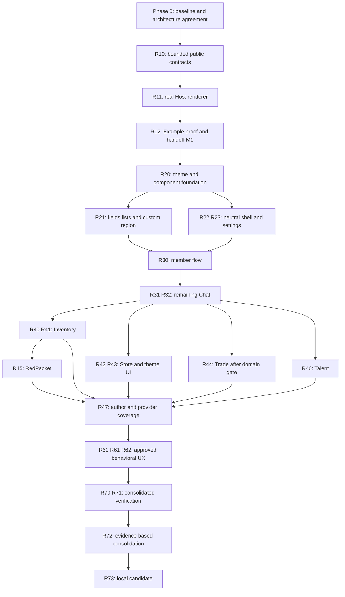

# Phinix Rework UX/UI 重设计 Roadmap

日期：2026-10-11，Asia/Singapore。状态：**待共同确认的实施计划；本次只写文档，不授权实现、部署或发布。**

依据：[UX/UI/theme 审计报告](/home/hunyuan2333/Phinix/Phinix-Rework/docs/branch-local/audits/UI-UX-Redesign-Audit-2026-10-11.md)、[在线 Figma frame 1:4](https://www.figma.com/design/Mqxq3scgyAjpLFXbGJv78n/Phinix-Rework-Redesign?node-id=1-4)、[本地 .fig](</home/hunyuan2333/下载/Phinix Rework Redesign.fig>)。源码定位与完整主题 key 清单见审计 E01–E16 与附录 A。

## 1. 执行摘要

采用增量迁移：**行为与交互架构基线 → 最小公共呈现契约、真实 Host renderer 与 Example → 共享组件/中立壳层 → 完整 Chat 切片 → 逐个业务模块 → 跨模块兼容、性能与本地候选验收。**

Host 负责导航、布局、通用控件/列表/表单/状态、确认/选择容器；插件提供只读投影、校验与操作意图绑定，保留业务权威。特殊游戏内容使用受控自绘区域。built-in 与第三方消费同一公共能力；不先写私有官方框架，再在最后补 SDK。

兼容连续进入每批。后期兼容阶段只汇总覆盖，不首次处理旧主题或插件。保留现有 `UiTheme`/registry/catalog/package、当前 providers、历史输入/恢复 readers 与维护插件内部 1.9 adapters。新 UI 不判断主题 schema/旧 API/协议模式。服务器、消息 wire、物品账本和交易确认规则默认不变。

T5 本地主题 ZIP 导出、安装/更新/卸载与恢复后处理**已经有实现**，安排验证和视图接入，不重新建系统。线上主题准入、投稿、上传、Index/publication 改造与新在线发行继续延期；现有在线功能保持。

不估算日历工期：实际游戏基线、renderer proof 与高风险 Trade 状态验证尚未完成。以下以可检查的交付边界排序，避免把未知量变成承诺日期。

## 2. 当前基线与推荐交互架构

### 2.1 已有、缺失、未验证

本次复查当前本地工作树，仍有大量既有 dirty/untracked 修改；未重置、更新 submodule 或以 remote main 替代。公开主题、typed actions、ApiDirectory、Task、Lifetime 与 Example 1.0.6 均已有源码。未发现已实现的通用页面/列表/表单 descriptor renderer。

`IMainTabProvider` 目前只有 TabLabel、TabOrder、Draw；sidebar 类似，没有稳定 page ID。ApiDirectory 有 registration identity 与可用性重验，但没有状态变化订阅。typed action collection不是业务 view 已接入，更不是内容 renderer。RimWorld 1.6/目标 net472 是源码声明，实际 Unity/Mono patch 和游戏内效果仍待基线记录。

T5/Example 文档的“已编译/打包”保留为历史记录，不能表述为本次测试通过。现有审计已列出的恢复/Trade 风险继续跟踪，不通过新外观掩盖。

### 2.2 信息架构：先作出建议，再拆组件

| 表面 | 推荐决策（待确认） | 保留用户流程 / 插件规则 |
| --- | --- | --- |
| 主导航 | 顶部 provider 驱动的 pill tabs + 通用 overflow；Chat 仍是公共聊天入口，不建立频道树 | numeric Order + owner/stable identity 确定顺序；第三方可添加，长文案/小窗仍可访问 |
| 设置 utility | Host 常驻“设置”，进入连接/快捷设置，并提供明确“完整客户端设置”“主题”“插件管理”入口 | 初期保留现有两个设置范围和保存时机；不假装已经统一所有设置页；Chat/Store 不启用也能进主题编辑 |
| 主内容/侧栏 | 双区域宽屏，窄屏沿用可访问 drawer；sidebar 仍是 provider 集合而非固定成员区 | Chat 提供成员页；Notice/第三方侧栏有独立入口、排序/溢出；0 provider 隐去区域 |
| 公告/状态 | banner placement 由 Host，内容与状态由 owner | 多条可滚动/收起且能再展开；系统状态不占据 composer；失败只隔离对应区域 |
| Chat | 保留消息流、回复、提及、URL/图像、发送失败草稿；成员搜索优先 | Enter/焦点/虚拟列表规则保留；无头像/私信/附件/消息全文搜索 |
| 成员操作 | 可发现的行操作入口+菜单；消息姓名处消费同一 owner-defined action point | trade/block 仍由业务拥有，第三方贡献公开；缺 Trade 不阻止其他动作 |
| Trade/Inventory/Store | 先迁移列表/状态/详情容器，再迁移高风险输入/确认部分，每部分交付闭环 | 不把更新报价/确认报价合并；不把安装、启用意图、运行、待重启合成成功 |
| 主题编辑/包管理 | 主题窗口维持选择、draft、preview、apply、export；本地 ZIP 管理维持 Store 入口 | “编辑中/使用中/安装完成/已应用”分开；无 Store 的 Host 安装 UI 是独立产品选择，不默认扩范围 |
| 特殊内容 | 当前 notice/image/reply 样式迁移；Figma 新 item/trade/battle 卡仅作为组件参考 | 没有真实业务 projection/integration 的卡不进入产品；不伪造字段或消息状态 |
| 窗口/在线信息 | 保持 Verse 打开、关闭、拖动、resize；在线数使用真实目录口径 | 不复制无语义的 OS 最小化/最大化；无真实来源不显示 idle/away/“通讯已加密” |

每个页面状态要区分：正常、真空列表、零命中、未连接、未登录、缺可选能力、加载中、插件失败、输入校验、已提交/等待、拒绝、结果未知、真实确认。只显示 owning API 真正能给的状态；不是要求给所有服务新增统一业务状态机。

### 2.3 需要确认的产品决策及默认建议

- D1：同意上述导航/设置结构；默认不合并保存规则，保留全部 provider。
- D2：同意“有界描述+共享组件+受控自绘”模型，以及首批 Example 计数/操作 proof；不用通用 UI 语言。
- D3：radius/spacing/control heights/Verse typography 初期固定受控 metrics；保留当前 color/float customization，不开放所有布局维度。
- D4：item/trade/battle 聊天卡及 presence 没真实能力时不排实施；保留 rich-text 昵称与配色偏好。
- D5：是否为无 Store 提供 Host ZIP 管理视图；默认维持现有能力边界，仅独立主题编辑入口必保留。
- D6：跨关窗重开保存 composer 草稿、成员 filter 等是否持久到 session；默认只保留现有行为，新增保持规则在 client-logic 批单审。

D1–D3 是相关架构/首批范围确认；D4 默认不新增行为；D5/D6 不阻塞 renderer proof。已有主题永久能力、插件同级、旧 adapter 边界及线上延期不需重新讨论。

## 3. 任务分类、文件区域与通用验收

类型：V Visual；U UX；C Client logic；T Theme system；P Plugin system；S Protocol/server；B Compatibility；I Testing/infrastructure。风险标记为 Low/Medium/High。独立性表示可在前置完成后独立评审，不代表允许并发编辑同一文件。

文件区域缩写（均相对当前 `Phinix-Rework`）：

| 区域 | 实际位置 / 归属 |
| --- | --- |
| A | `Client/ClientExtensionAbstractions/UI`、`Framework`；公共中立契约 |
| H | `Client/Source/UI`、`Framework`、`Client.cs`；Host 服务/启动/容器 |
| W | `Client/ClientExtensionAbstractions/UI/ClientWidgets.cs`、Responsive*、VirtualListLayout；公共 helper |
| SH | `Client/Source/GUI/Windows and panels/ServerTab.cs`、`ServerTabButtonWorker.cs`、`SettingsWindow.cs` |
| TH | `UiTheme.cs`、`ThemeInputAdapter.cs`、`ThemeLoader.cs`、`ThemeSettingsWindow.cs`、`ThemePackageExportWindow.cs`、`ClientThemePackageService.cs`及 theme XML |
| CH | `Extensions/Chat/Client` 与 `Contracts/ClientChatContracts.cs` |
| TR | `Extensions/Trade/Client` 与 `Contracts/ClientTradeContracts.cs` |
| IN | `Extensions/Inventory/Client` 与 `Contracts/InventoryContracts.cs` |
| ST | `Extensions/PluginStore/Client`；LocalThemePackagesWindow、ManagedPluginStoreView等 |
| CO | `Dependencies/Phinix.Common/Common/Utils/Framework/Themes`、ManagedExtensions；数据包/事务，非绘制代码 |
| EX | 同级 `Phinix-Example-Plugin/example`、`Api-Semantics-Example.md` |
| LP | 同级 `Phinix-Legacy-RedPacket/Client` 与 `Phinix-Legacy-TalentTrade/Client`、各内部 Compatibility |
| QA | `Tests` 对应现有 suites、`Client/Languages`、localizer资源、branch-local文档/本地候选 |

**所有迁移任务的公共门槛 G：** partial/旧主题、explicit inherit、unknown保留、plugin keys及热应用；缺/disabled/failed provider、贡献排序/overflow/长翻译/窄窗；actual-module lifetime、close/stop/stale guard、借用API不Dispose；measure/draw/collect无业务副作用；真实业务结果不被 callback/task 完成替代；保存数据/协议规则不变；受影响路径实机证据或明确未验证。下表的测试栏在 G 基础上增加任务专项，不能省掉 G。

## 4. 分阶段路线与任务明细

阶段验收按证据推进，不按日期。每个 task 都写目标/范围、模块、前置、分类风险、兼容、专项测试、独立性、产品决定、顺序。新文件/接口名只是工作范围，未声称存在。

### Phase 0 — 基线、安全与架构确认

| ID/顺序 | 目标与范围；文件 | 前置 / 风险类型 | 兼容影响与专项测试 | 独立 / 产品决定 |
| --- | --- | --- | --- | --- |
| R00 / 1 | 保存当前构建/dirty清单、程序集批次、游戏版本、当前flow截图与失败状态；QA，所有受影响views | 无；Low I/B | 不修改默认行为；记录发送/回复/@、名单、报价/确认/关窗、库存恢复、Store/T5、LP、Example；核对实际DLL | 可独立；无 |
| R01 / 2 | 形成信息架构/Host责任、各模块状态与能力保留表；SH/A/文档 | R00；Low U/P/B | 检查每个现provider可达，0/多provider/narrow、双设置范围；状态文案无假确认 | 可独立设计评审；D1–D4 |
| R02 / 3 | 冻结“下一批足够”的契约与验收清单，记录renderer proof范围、版本/测试组合；A/H/EX/QA | R01；Medium P/I/B | 冻结是证据快照，不做永久API稳定承诺；旧1.9、主题v1/v2/v3/package边界不混用 | 可独立评审；D2 |

出口 M0：架构与首批范围可确认，关键行为有游戏基线/明确缺证据；审计遗留标为阻断或另案，不能用截图代替业务安全测试。

### Phase 1 — 公共契约 + 最小 Host renderer 的可运行证明

| ID/顺序 | 目标与范围；文件 | 前置 / 风险类型 | 兼容影响与专项测试 | 独立 / 产品决定 |
| --- | --- | --- | --- | --- |
| R10 / 4 | 定义最小 presentation：稳定page/section/action ID、只读summary/status、revision、action绑定、确认request/view session；A，EX context沿用 | R02；Medium P/C/B | additive API，保留Draw；action语义继续IClientActionSet，不新建operation registry；draft/list暂不加入proof | 契约可单审但不算完成；D2 |
| R11 / 5 | 实现同一个Host renderer：summary、action toolbar、status、确认shell、窄窗布局、theme snapshot、view ownership、failure边界；H/W/启动wiring | R10；Medium C/P/T/B | 任意插件借用service，actual-module owned session；复用现registry/task/lifetime，缺provider/stop/repaint不可触发动作 | 不脱离R12交付；无额外产品决定 |
| R12 / 6 | Example现有计数/增量/重置确认通过公共模型由真实Host绘制；保留task示例“callback完成”；EX | R11；Medium P/C/I/B | 不改计数权威/保存语义、不造远端成功；关闭确认后stop、stale、主题热切、语言、窄窗、跨插件贡献 | 可独立proof包评审；D2范围内 |

出口 M1：**接口+真实renderer+Example+文档+检查证据同批交付**；不能仅声明interfaces就交接。renderer不用最终Figma全套外观，但必须真用theme、layout、state、lifetime。第一批可只使用已有ui.*与Example keys，新增role留R20。

### Phase 2 — 设计系统与中立壳层

| ID/顺序 | 目标与范围；文件 | 前置 / 风险类型 | 兼容影响与专项测试 | 独立 / 产品决定 |
| --- | --- | --- | --- | --- |
| R20 / 7 | 映射Figma semantic roles到现registry，增加必要keys/fallback；固定metrics/缓存rounded素材、button/field/row/card/state；TH/W/H/Languages | M1；Medium V/T/P/B | 不重写resolver、不rename旧keys；explicit values优先；primary accent不重定义success；旧主题+contrast/cache失效 | 角色与metrics可单审；D3 |
| R21 / 8 | 增补下一Chat切片需要的text field/virtual list、可控custom region、公共projection/session与input intents；A/H/W | R20；Medium C/P/B | row/field稳定ID、只读数据、draft/selection/scroll归Host；验证/commit归plugin；保留oldDraw | 与R22避开共享文件后可拆审；D2模型内 |
| R22 / 9 | 可选导航metadata与shell迁移：稳定identity、overflow、所有sidebar/banner、Host settings常驻、失败区域；A/SH/H | R20，R01；Medium V/U/C/P/B | 不按translated label识别；legacy providers有绑定adapter；registration失效选中安全回退；0/32tab、多sidebars、language/narrow测 | 可独立壳层批，R21不阻塞旧Draw页；D1 |
| R23 / 10 | 设置容器与主题/插件独立入口、连接状态文案；保留quick/full provider呈现和保存；SH/H/TH | R22；Medium U/C/P/T/B | 不假造server/room管理、不删Catalog Import/Export；禁Chat/Store后theme/edit/export可达，provider measure异常隔离 | 可独立；D5仅涉及额外Host安装页，不默认做 |

出口 M2：新壳层同时承载旧Draw和公共renderer；第三方页/侧栏/设置不丢失，主题编辑/导出仍独立可达。共享层已经足够下一真实flow，不等待所有API。

### Phase 3 — Core Chat：先完成一条真实切片，再扩展

| ID/顺序 | 目标与范围；文件 | 前置 / 风险类型 | 兼容影响与专项测试 | 独立 / 产品决定 |
| --- | --- | --- | --- | --- |
| R30 / 11 | 第一完整Chat切片：浏览成员→现子串搜索→row/menu→屏蔽/取消；由Chat投影名单，Host field/list/action画面；CH/A/H | R21–R23；Medium V/U/C/P/B | Member typed context在Chat Contracts，block保持原authority；第三方contribute，缺Trade解释；zero/offline/blocked/longname/lifecycle | 可独立评审；保留过滤口径，无新增presence |
| R31 / 12 | 消息rows+composer→发送→现pending/denied、回复/@/跳转、URL/image；Chat projection/受控specialregion；CH/W/H | R30；Medium V/U/C/P/B | 控件ID/焦点边界保留；accepted submission≠confirmed；原发送/协议adapter不替换；新增屏内反馈明确C/U | 可按rows/composer两个完整行为批分审；D6新增跨关窗草稿另R61 |
| R32 / 13 | message/name typed action integration与现notice/image/reply cards、load/fail fallback；CH Contracts/client；不新增item/trade/battle payload | R31；Medium V/U/P/C/B | collect/close释放，同member action语义复用；旧message形状fallback可读；图像owner和纹理清理 | 可独立；D4中新能力不安排实现 |

出口 M3：真实公共聊天室完整流程可用；主窗、消息、成员、filter、composer、nav、settings和已存在特殊内容迁移可评估。无新协议或socialfeatures。组件与公共契约若需调整，只扩展同一个M1 foundation，先审再扩大。

### Phase 4 — Secondary Modules：逐流迁移，按本地状态复杂度排序

默认顺序 Inventory → Store/主题 → Trade → RedPacket → Talent → 其余providers。相对原提示把Trade放后，是因其view持托管状态、Reset顺序和确认边界影响高；Trade的语义梳理R44可先开展但不能并发改同sharedcontract。每个模块内部先补所需contract/renderer，再交一条完整flow。

| ID/顺序 | 目标与范围；文件 | 前置 / 风险类型 | 兼容影响与专项测试 | 独立 / 产品决定 |
| --- | --- | --- | --- | --- |
| R40 / 14 | Inventory分组/可用量→提取表单→plugin校验→真实结果；public numeric field/field error/选择；IN/A/H | M3；Medium V/U/C/P/B | quantities long、不溢出、预留/codec由Inventory；entry stale不retarget；all-or-nothing提取/关窗/故障 | 独立垂直slice；无新增权威规则 |
| R41 / 15 | Inventory日计划/delivery choice、恢复/只读状态；公共form/selection/confirmation；IN/SH | R40；High C/U/P/B（数据敏感） | tick显示映射不改执行时间；恢复需原玩家确认、ledger不改；损坏/拒恢复/切存档/预留 | 可独立；新的时间选择行为需产品审阅，默认仅单位解释 |
| R42 / 16 | Store查询→list/detail→plan/confirm→install/update/manage/result；Store projection使用公共renderer；ST/A/H | M3；High V/U/C/P/B（安装事务） | installed/desired/active/restart区分、冻结摘要/来源/取消语义、DevMode DLL规则；optional/failed/inventory unknown | 独立模块批，复杂flow拆可评审slice；无在线流程新增 |
| R43 / 17 | Theme editor/preview/export与Store本地theme包视图迁移；按现T5闭环接入和验证；TH/ST，CO只被消费 | R42、R20/R23；High T/U/P/B/I（恢复敏感） | unknown/inherit/profile/selectedintent、export拒覆盖、uninstall vs loss、update移variant；三端路径+故障注入 | 视图/验证可分别评审；D5额外Host安装页另立项 |
| R44 / 18 | Trade projection/operation/lifetime语义梳理→list→offer selection/update/confirm/cancel；先确认pending owner如何与renderer分离；TR/IN接口边界 | M3；High C/P/U/V/B | 不提前确认/返还；现关窗pendinglistener行为保留；realack/重复/未知/断线/库存预留/整批codec；Reset漏洞判断另案 | R44a语义梳理可提前，R44b迁移依赖其验收；任何恢复规则改动另审 |
| R45 / 19 | RedPacket物品选择→发送/冷却/pending→领取/详情；公共form/list/state+itemcustomregion；LP | R40、M3，必要业务context完成；High V/U/P/C/B | 内部1.9adapter、新旧单包、relayaccept不等HTTPqueued、库存托管、迟到/重复回调；旧能力不隐藏 | 独立插件批；不改红包业务/relay历史核对 |
| R46 / 20 | Talent直接交易/市场/租赁的列表、表单、详情、确认；pawncustomregion；LP | M3，customregion完成；High V/U/P/C/B | 旧1.9adapter、pawnledger/归还ownership、optional modules/转场；完整3subflow独立验收 | 可按3flow拆审；不改租赁/结算规则 |
| R47 / 21 | 其他provider/设置/第三方access验证，更新作者指南与migration inventory；A/H/EX/QA，各实际consumer | 相关R40–R46完成；Medium P/B/I | 页面/section/form/action/theme/optional/close都可公开接入；未迁Draw继续可达；renderer失败仅局部 | 可逐consumer独立；没有无限API清单前置 |

出口 M4：每个选定模块的样式、状态、API开放、生命周期一起验收，不能仅证明Host外框变化。业务风险未解决时允许保留该旧区域，不宣布全模块迁移完成；缺口记录阻断该slice，其他module继续。

### Phase 5 — 明确的行为型 UX 改进

安全呈现改善在R20–R47随对应flow实施；这里专门安排需改变client/plugin逻辑的项，不把所有UX思考推迟到末尾。

| ID/顺序 | 目标与范围；文件 | 前置 / 风险类型 | 兼容影响与专项测试 | 独立 / 产品决定 |
| --- | --- | --- | --- | --- |
| R60 / 22 | 字段草稿与有效设置分离、空白发送禁用、非法数量/数字反馈、动作旁disabled reason；CH/IN/各settings及sharedform | 相应slice已迁；Medium U/C/P/B | 不改变persisted keys/ranges，按owner提交；非法临时输入不写0；repaint/locale/取消/保存 | 可按字段族独立；改变保存时机需先确认 |
| R61 / 23 | 按批准范围保留focus、filter/selection/scroll/draft，stale消失解释及转页返回；各plugin adapter/Hostsession | 相应slice与D6；Medium U/C/P/B | view/session状态不变业务authority；restart持久草稿默认不做；switchsave/disconnect/stop清理 | 独立；D6 |
| R62 / 24 | 通用action overflow/order/缺能力reason与快捷/完整设置discoverability一致化；A/H/EX/对应view | 各typed point完成；Medium U/C/P/B | 不扩权限/删贡献；缺点容忍、重复ID拒绝、stale不执行、longlocale/narrow | 可独立；无新增productfeature |

出口 M5：行为型 UX 改动逐项有 before/after、持久化/输入/结果语义差异及测试，不夹在“换配色”提交里。服务器/协议候选不计入M5完成。

### Phase 6 — 兼容汇总、Polish、测试与本地交付

| ID/顺序 | 目标与范围；文件 | 前置 / 风险类型 | 兼容影响与专项测试 | 独立 / 产品决定 |
| --- | --- | --- | --- | --- |
| R70 / 25 | 汇总旧主题/新role、optional providers、maintained1.9/current、数据reader与wire不变矩阵；QA/TH/LP/CO | 各slice已有局部证据；High B/I | 兼容不可首次到此才测；T5恢复故障注入、update/uninstall、profiles、oldreader与联机组合 | 可逐cell提前；无 |
| R71 / 26 | 跨模块scale/localization/state/长内容/performance+最终roundedstates校对；QA/W/H/pluginviews | M3起可持续，最终依赖M4/M5 | 1080p/1440p/4K、低分辨率fallback、中文/英文长文本、IMGUI多pass、虚拟化/资源回收 | 可分测试类别；无 |
| R72 / 27 | 根据实际consumer清单合并冗余helper/绘制路径；保留必要Drawadapter与内部1.9adapter；A/H/W/pluginviews | R70/R71及对应迁移证据；High P/B/C | 先查消费者、反编译/引用或静态build验证；未迁第三方不盲删publicAPI；旧数据reader不删除 | 独立清理批；breakingchange只转未来major |
| R73 / 28 | 同批Host/Contracts/plugins/Example本地candidate、验收记录、回退说明/knownissues；QA/打包文档 | R70/R71，R72可按必须清理项判 | 不混早期T3 SDK/currentHost；恢复数据先核对，不rollback抹unknownledger；游戏最终制品验证 | 独立交付；公开发行继续等待明确授权 |

出口 M6：本地候选可评审，矩阵有通过/失败/阻断/未测四种状态；没有隐含在线发布。路线实施完毕也不自动恢复线上工作。

## 5. 有界 API 依赖评估

| flow/surface | 已有public / actual implementation | 下一批缺口与归属 | 只消费还是扩展 / 阻断时点 |
| --- | --- | --- | --- |
| Example summary/actions/confirm | IExtensionPointService/ClientExtensionPointService，Task/Lifetime及实际ExampleActions | general presentation/session/renderer Host A/H；Example context复用；不新增businessAPI | R10–R12必要新能力；阻断首批，必须同时有implementation |
| shell page/sidebar/order | IMainTab/Sidebar/banner/hints与ServerTab | optional stablemetadata Host；owner绑定/legacy provider映射/刷新属于Host | R22前置；旧Draw不要求实现新接口 |
| member search/list/block | userDirectory、UserList.Filter、ChatUI context | general text/virtualrow Host；Member typedcontext/actionpoint属于CH Contracts/client | R30前补齐；不需要serversearchAPI，block仍原动作 |
| composer/message | Chat current sender/service/submission与acceptkey | Host field/customregion/session；Chat projection/Message typedcontexts/points在CH | R31/R32按需补；旧image/replycustom保留；新消息card不阻断 |
| settings/connection | full/quickproviders、SettingsWindow、Clientsession/window APIs | sharedsection/state Host；plugin field descriptors由各owner；session-stage query仅必要时补Host | R23可先包旧callbacks，R60字段才需formadapter |
| Inventory extract/plan/recovery | IInventoryReadApi/ReservationApi及currentInventory service/contracts | bounded numeric/field errors Host；库存readprojection/intent/outcome在IN | R40/R41前足够；现API有语义就仅适配，缺状态query才补Contracts |
| Trade list/offer/results | currentTrade contracts/service、Inventory reservation；pending尚部分在window | Trade-owned readonlyoperationprojection/closeownership，actioncontext在TR；Host不拿Thing | 高风险R44前必须补/验证，通用renderer不能代替domainrepair |
| Store install/detail | existingcontroller/snapshots/management API | Storepresentationadapter；Host通用list/detail/status/confirm | R42补对应renderer，planning/recovery不迁Host |
| theme editor/localpackages | ThemeReader/Registry/Catalog/Window/PackageService/Exporter及UiTheme/Common实际实现 | Viewadapter+componentpreview；error可读映射，交易层无新需求 | R43是消费/验证，不能排成“新建T5”；D5可后加 |
| RedPacket/Talent | ordinarytabs/settings、内部1.9binding/themeadapters与pluginbusiness | ownerprojection/actioncontexts、ownercustomitem/pawn；Host只contractualregion | R45/R46前按flow补，1.9旧路径不需newrenderer |
| thirdpartysection/content | main/sidebar/settings Draw；typedactions基础 | generalownedsectioncomposition/slots只覆盖真实needs；typedcontext在定义point插件 | 基础page/section R10/R22，贡献section在R47实际需求前补；不是action即content |
| resources/storage | LifetimeOwn、guardedsubscribe已有 | module-file/assets/storageAPI并未全实现 | rendererproof不用磁盘pluginasset，不阻断；特殊asset需求出现再立boundedAPI |

**准入规则：** 每批记录“已有方法与实际语义→missing→owner→consumer adapter→test”。公共contract需coherentownership/threading/result/failure，即使首个consumer是Example；真正迁businessflow必须另核其viewintegration。业务不把wireDTO提供给Host，不强求每个新增API都有built-inconsumer，也不建立无限API完工前置。

### 5.1 稳定identity的最小扩展建议

保留原IMainTab/Sidebar签名，优先独立optionalmetadata接口（最终名在R10/R22审），提供局部稳定presentationID、可读label/可选icon引用。Host结合actualOwnerId与局部ID唯一定位；label不参与identity。

没有metadata的当前Drawprovider由Host绑定adapter使用owner+exactregistration+同owner贡献序号维持本次绑定；不承诺跨注册/跨运行稳定restore。新增metadata重复ID可读报错并隔离，不能默默覆盖。相同order再按明确stableidentity排序；旧providers的原排序在baseline验证，改变tie-break属于C/P而非仅V。

## 6. 公共 renderer 的责任与作者接入

### 6.1 一套基础、多种受控呈现路径

| 插件提供 | Host负责 | 永远属于业务owner |
| --- | --- | --- |
| page/section/row/field/action稳定ID、readonlysnapshot/revision、localizedlabel、semanticrole、ownedthemekey、field约束及disabledreason | layout/measure、virtualization、控件、hover/focus/disabled/selected、commonstate、dialog/菜单/overflow | 库存/报价/物品/pawn/权限、authoritativevalidation、wire、持久账本、实际operationoutcome |
| typedcontext与用户intenthandler，回调结果/实际状态投影 | inputevent路由与guard、status呈现；不在render/collect执行命令 | 重试/取消是否可行，Unknown如何核对、确认如何生效 |
| specializedownedrenderer与assetlease | 测量合同、分配Rect/clip、theme snapshot、GUI恢复、失败占位 | 游戏对象/preview生成、安全引用与asset实际生命周期 |

Host view session保存focus/controlidentity、selection、scrollanchor、输入draft。plugin保存权威值与命令状态。revision、themeversion、locale、width/metrics改变失效cache；snapshot不每pass整份重建。列表row不存在时显示stale/安全关editor，不把未确认动作指到另条记录。

视图registration/scope在实际Activate绑定。关闭/替换/ownerstop释放actionset、viewsubscriptions、cache与ownedassets；ApiDirectory取得业务API为借用，每次操作重验registration/availability。关view不停止已经发生的businessoperation，task取消不undo。confirmation再验证owner/context/generation与值版本。

### 6.2 第三方作者完成哪些动作

1. 通过ordinaryCompose/Activate注册page或原mainprovider，并取得公共renderer借用service；无需Host新增自己的module名称。
2. 提供owner-boundpresentationidentity、section与snapshot；以公共field/list/action/status模型呈现commondata。首批只有summary/actions，form/list在R21扩展，作者文档准确注明当前支持集。
3. 通过现ThemeRegistry注册自己的namespace、fallback/labels/groups，再以theme reader/semanticrole使用颜色；缺optionalkey回退，热应用触发cache失效。
4. 对已定义typedpoint贡献action，context属于pointownerContracts；缺point是normaloptionalstate；disabledreason、order、stale guard公开。
5. Capture/TryGet可选provider，缺/registered/unavailable显式降级；不反射Host私有registry，borrowedAPI不Own。
6. Close/Stop释放ownedviews/sets/subscriptions；主线程执行userintent，状态由实际结果映射，不假confirmed。

contentsection贡献仅在实际页面需要时定义boundedslot，沿用同owner/lifecycle/ordering规则；不把actionfactory强行变成任意UI引擎。

### 6.3 旧 Draw 和 specialized custom 的过渡

`ServerTab`继续分配Rect承载ChatMainTab、TradeMainTab、InventoryTab、StoreMainTab、RedPacketTab、TalentTradeTab、Example及第三方。shell添加guard/isolation只能限制调用与GUI边界，不能自动转描述或控制callback内部所有逻辑。

迁移清单必须逐消费者写：旧entry→newprojectionadapter→publicrenderer支持范围→保留customregion→可移除privatehelper→未验证。当前legacyDisplayable、menus、modulewrappers只有对应consumer全迁/adapter替代且兼容边界验证后才删。不默认永久维护两套完整UI；也不立即删除publicDraw或内部1.9adapter。

custom区域规范：mainthread measure/draw、boundedsize、Rect clip、inputownership、theme reader、revision、assetownership、failure及dispose。render不得文件扫描/业务操作/重复订阅；GUI color/enabled/font/anchor/wrap以及group/scroll/clip均需finally恢复。R21先支持Chat现图像/特殊文本需要的边界，pawn专用需求到R46再扩同机制。

## 7. Theme loader 演进与兼容计划

### 7.1 保留与新增

保留审计附录全部canonical keys：`ui.text.primary/secondary`、`ui.background/surface/separator/hover/accent/pending/error/success/warning`、现button/input/disabled、`ext.*`、`chat.*`、`trade.*`、`inventory.*`、Store来源badge及第三方namespace。保留当前nameColorfloat，不以新设计重置用户偏好。

候选新keys由**R20统一拥有**，只在有consumer及测试时注册；名称待契约评审，不是已实现：

| 候选canonicalkey | 缺省fallback | 首个consumer / 目的 |
| --- | --- | --- |
| `ui.border` | `ui.separator` | rounded control/card边界与divider可分 |
| `ui.surface.selected` | `ui.hover` | navigation/list selection不固定官方颜色 |
| `ui.surface.elevated` | `ui.surface` | commondialog/card层次；若R20无需区分就不新增 |
| `ui.text.muted` | `ui.text.secondary` | 时间/辅助状态；对比度不足时仍可编辑 |
| `ui.button.primary.background` | `ui.accent` | filledprimary；normal/success/error语义保持 |
| `ui.button.primary.text` | `ui.text.primary` | text-on-accent；现代主题显式深文字，旧主题保可读并检查对比 |
| `chat.composer.background` | `ui.surface` | composercontainer；不是inputReplyBg |
| `chat.members.background` | `ui.surface` | Chat-ownedmembers面板；不是blockedBg |

card初期复用ui.surface及模块现有panel/editor keys，不并行引入camelCase `cardBackground`系统。基础proof使用现roles即可，新键不阻断R10–R12。

### 7.2 fallback、schema、编辑与导出

1. 使用现ResolveColor顺序：显式useroverride→theme值→built-inbaseline→declaredfallback→registrationdefault；explicitinherit影响跳过路径。新role不覆盖旧显式module值。
2. 新key在baseline缺省**保持省略或明确inherit**，避免baseline显式色先于fallback、遮掉旧用户surface/accent。现代视觉主题可显式填新值；测试要同时覆盖baseline、新主题、旧部分主题。
3. fallback只指Host或同owner已注册key，循环/未注册/跨optionalplugin依赖拒绝。不新增任意混色resolver；alphaoverlay先明确合成，不平均RGBA。
4. 保留unknownkeys、explicitvalues/inherit、per-themeoverrides；导出保留源的显式层而非铺平runtime有效值。插件暂缺时数据不丢。
5. 继续ThemeInputAdapter历史v1/v2/v3、canonicalmanagedv2/v3及公共Catalog XMLImport/Export；选择器import按钮移除不等于删除输入契约。
6. additivecolor/float不需要默认升XML版本。若将来增字体/asset/computedcolor/新元素，单独schema方案，不混产品0.9.7、SDK2.0、CLR1.9、package/catalog/receipt版本。
7. radius/spacing/heights/borderwidth/Versefontscale为initialfixedmetrics；主题仍可改已有colors/floats。不因GetFloat存在宣称任意layout主题化。animation初期即时反馈/必要最小效果，非主题能力前置。
8. renderer/helper/custompath都Capture同一palette；version/locale/metrics失效，注册只Activate一次，callbackexception隔离，不第二个loader。

### 7.3 T5保留与验证

R43测试editorZIPmetadata/path反馈、文件已存在拒覆盖、copy/openfolder失败不抹导出、本地theme非DevMode、DLL侧载仍DevMode、同版本不同digest允许/重复及降级拒绝、expectedartifact变化拒绝、整包卸载全部variants。

显式卸载选中包→default+保留profile；丢失/损坏/更新移variant→保留selectionintent+fallbackdisplay。存储/来源/recovery/settingspost-processing继续Host/Common职责；UI不可直接解压/删ownedfiles。故障注入安排R70汇总但R43开始：preparing/committing、文件写入、removalpostprocess与用户后续selection；不声称跨目录原子。slowdisk同步耗时需测，有问题再在原service边界评估，不把I/O挪进render。

## 8. UX 工作的五类分离

| 类别 | 排入哪些任务 | 具体范围 / 排除 |
| --- | --- | --- |
| 无业务行为变化 | R20–R23、各R30–R47 | placeholder、层级/文案、动作可发现、现state/disabledreason、设置入口；导航layout本身仍有C/P测试 |
| 客户端逻辑变化 | R22、R31、R60/R61 | stableproviderselection、focus/draft/filter保持、字段draft/非法输入；每项单独before/after，不混visualcommit |
| 插件变化 | R30/R32、R40–R47/R62 | 投影adapter、typedcontexts/points、真实viewintegrations；businessowner继续authority，不等于serverchange |
| server/protocol依赖 | 候选F01–F03（下表） | 未进入默认phase/M0–M6；先能力证明再另同意scope |
| future-only | richernewcontent、advancedlayouttheme、majorAPI | 只记录，不自动排实施或要求所有API提前完工 |

| Future ID | 候选与涉及owner | 风险/类型 | 进入实施前的证据与决定 |
| --- | --- | --- | --- |
| F01 | delivery/receipt/retry、真实presence；Chat/协议 | High U/C/P/S/B | 当前wire是否可表达、幂等/同名/重试/权限；新能力需明确产品授权，无自动安排 |
| F02 | TradeUnknown核对、Reset/Cancel恢复、跨会话pending；Trade/Inventory/protocol | High C/P/S/B | 不一定全部改server；先重现/证明当前能力边界、精确ack/恢复规则。UI迁移发现必要bug则另列domainfix阻断对应flow |
| F03 | 实际server/room管理；owningplugin/server | High U/P/S/B | 管理API/permission/result能力，用户明确需要；不把localsettings改名冒充 |
| F04 | item/trade/battle聊天内容集成；相应businessplugin/Chat | Medium–High P/C/S? | 数据/source/context/renderfallback已确定；无wire需求可client/plugin实现也须单审；Figma存在不授权 |
| F05 | 可配置density/fonts/assets、breakingpresentationprovider API | High T/P/B | consumer需求、三端/measure/版本退出条件及major计划；当前不开放所有metrics |

Future 候选的前置统一为：对应 owning 能力评估 + 明确产品决定 + 独立范围确认；不依赖 M6 自动启动，均不可作为 UI 完成的必要条件。可独立立项，不可在同一协议/Contracts 文件与迁移批并发。F01 专项验证发送、回执、重复请求及 presence 数据真实性；F02 验证断线/重启/重复或迟到回执与物品守恒；F03 验证权限、拒绝、stale 管理操作；F04 验证真实 payload/projection、旧客户端可读 fallback 与 renderer 缺失；F05 验证旧主题/插件迁移、字体资源、测量和版本退出。推荐次序仅在批准后依据必要性确定，目前全部 unscheduled。

无头像/头衔/emoji/reaction/附件/私信/全文搜索/roomhierarchy仍为明确非目标，不把它们列future来变相排队。上传/onlineadmission/publication不是F04的附带工作，继续延期。

## 9. 依赖图与顺序约束

图中branch表示依赖允许分开，不授权同时编辑同sharedfiles。R70/R71验收从首批起持续；终节点只是汇总。R44语义梳理可在其他非重叠批期间进行，renderer不会消除Trade安全gate。R73可在非必要cleanup仍pending时形成候选，但要明确未完成范围，不误宣称R72完成。没有任何通向自动onlinepublication的edge。

## 10. 跨会话责任与交接

负责人是角色，不在本次自动创建任务/调用子agent。

| 角色 / 唯一owner范围 | 拥有任务与文件 | 消费方 / 交接产物 | 并发限制 |
| --- | --- | --- | --- |
| API/renderer基础负责人 | R10/R11及后续A/Hostpresentationservice/session/registration契约 | R12 Example + publicdocs，列实际implemented/unsupported与thread/lifetime/outcome语义 | A、H启动wiring同一时段一个owner；最终UI扩同renderer，不新建框架 |
| Theme/components负责人 | R20，THresolver扩展（必要时）、W/metrics/roundedassets/新keys | 映射表、fallback tests、snapshot/measureinvalidations、preview组件 | UiTheme/ClientWidgets/ThemeInputAdapter由单owner；其他会话提出需求不同时改 |
| Host shell负责人 | R22/R23，SH、provideradapter/sectionnavigation | main/sidebar/banner/settingsempty/failed/overflow/reference状态 | 新metadata需先API评审；Client.cs服务注册与APIowner预约串行 |
| Business view负责人 | R30–R46各pluginContracts/projection/viewadapter | 每flow状态/intent/result、typedpoints/customregions与gameevidence | 同moduleContracts/依赖接口不交叉修改；Host不吸收business |
| QA/兼容负责人 | R00/R70/R71/R73，fixtures/playtest/候选记录 | oldtheme/optional/LP1.9/current/wire/lifecycle/perf矩阵 | commontransaction/adapter故障fix另由相应owner；QA不私改业务来过测 |

交接节奏：架构确认→**当前批足够的contract+workingrenderer+Example proof**→theme/shell→真实pluginflow→consolidation。每次交接记录文件/接口与版本、实际Example行为、支持组件、newkeys/fallback、deferredsurfaces、当前gameunverifiedcases及exactcandidate批次。不能等全部API做完或全部UI做完才交接。

API扩展中需要修正：consumer给具体不足和flow；APIowner评审同contract的additive修订；renderer/Example/相关adapter一起更新并跑受影响tests。否决在UI会话私建service/registry/palette解决公共缺口。非重叠资源/文档/独立API可继续，但先核文件与dependency overlap；本计划不派发并行agent任务。

## 11. 风险矩阵

| 风险 | 级别 / 任务 | 回归信号 | 防护 / 不通过时处理 |
| --- | --- | --- | --- |
| task/action完成被当业务confirmed | High，所有操作slice | 发送/报价未ack却成功；取消就返还 | owner投影，精确result tests；阻断该flow，不用UI补假确认 |
| Trade托管/Reset规则误改 | High R44 | 关窗listener丢失、未知自动返还、duplicateack双交付 | domaingate、真实服务/adapter测试；保留旧区域/另案fix |
| owned/borrrowed混淆、staleprovider | High R11/R22/各slice | stop后还能execute、borrowedAPI被dispose、latecallback复活 | actualmodule scope/exactregistration/generation；close/stop/部分激活失败测试 |
| 新rolebaseline遮住旧主题 | Medium R20/R43/R70 | 旧accent/surface被default覆盖、unknown/inherit导出丢失 | 缺省inherit、省略baseline新值、goldenfixtures/roundtrip；修同resolver映射 |
| shell只留官方内容 | High R22/R47 | 新插件须改Host、多sidebar/settings消失 | thirdpartyExample与多provider测试；blocked评审，不发布候选 |
| renderer变另一套业务/主题引擎 | High R10–R21 | Host引用Chat/TradeContracts、重复registry/loader | 编译依赖检查、publicExample、scope裁剪；合并到同foundation |
| T5视觉改动侵入recovery | High R43/R70 | UI直接ZIPextract/delete；卸载/损坏selection混同 | service消费+故障注入；只改view，数据变更另审 |
| 字体/scale/narrow/长中文 | Medium R20/R71 | action不可点击、负Rect、popover offscreen | UIscale矩阵、lengthfixtures、Measure/Draw同源 |
| 每passallocation/重复动作 | Medium R11/R21/R71 | repaint调用command、list每pass排序/texture新建 | input事件guard、revisioncache、profiling；回退单次slice组件，不回滚business结果 |
| 1.9adapter/程序集批次错配 | High R45/R46/R70/R73 | oldHost加载失败、当前Host引用旧SDK；CLR误升 | 版本分离、samepackage矩阵、exactbatch；不改旧reader/CLRidentity |

## 12. 测试策略与验收证据

### 12.1 层级和最小有效检查

- contract/纯几何/主题：有意义的不变量测试（ids/order/stale/ownership/fallback/roundtrip/multi-pass），不为简单配色写镜像测试。
- composition/runtime：复用实际registry/lifetime/action及renderer；Example用publicpath，另个普通contributor加入真实point。mock不能代替publicbinding与stop失效。
- business：现ChatRegression/TradeComposition/LegacyTrade/Inventory/Store等suite按影响运行；新增只补新风险，保留真实adapter/result语义。
- game：每批同批DLL/Example、RimWorld1.6实际版本、操作截图/录制与逐状态结果；net10测试runtime不证明Unity/Mono GUI通过。
- recovery/security边界：T5及已有账本/物品权威按相应owner做faultinjection和restart；不让renderer负责文件事务。
- perf：同机器、同列表/消息与UIscale、相同interaction/主题，比较baseline/new CPU/allocation、draw数量、themeapply/cache失效、texture占用；基线R00/R11测定后确认预算，不捏造绝对ms承诺。

### 12.2 覆盖矩阵

| 维度 | 必测集合 | 通过条件 |
| --- | --- | --- |
| 分辨率/UI scale | 1920×1080、2560×1440、3840×2160；1280×720/1024×768；游戏可用scale的默认与高值 | safearea内，composer/确认/cancel可达，narrowdrawer/overflow，非负Rect |
| 语言/文本 | 简中、英文、长译文/缺译fallback；长用户名/richtext、重名、长消息/URL、多行reply | 必要动作不被文字遮挡；截断有tooltip；nameformat偏好和searchstrip规则保留 |
| providers | 0/1/多，32tab压力，多sidebar/banner；缺/disabled/failed、sameowner多provider、stop/re-register | identity不靠label；全部可达，stalehandle不复活，局部failure不崩窗口 |
| themes | builtin/default、审计旧v1/v2/v3、部分theme、unknown/pluginmissing、explicitinherit/override、invalidfile、热切 | currentresolver结果与期望一致；editing/export不丢用户值；runtimecache更新 |
| interactionstates | hover/pressed/focused/disabled/selected，empty/loading/error/rejected/pending/unknown | 显示依据真实状态，文字可读，不color-only，不callback假confirmed |
| lifecycle | open/close/reopen、确认打开后stop、部分Activate失败、语言/themechange、主菜单/换存档、迟到callback | resources/sets/subscriptions释放，focus不漂移，业务托管不被viewcancel销毁 |
| Chat | send/blank/offline/reject/reply/@/incomingmessage、image加载失败/关闭 | Enter只当前input，失败草稿保留，按原协议降级，不加sendreadreceipt |
| Trade/Inventory | 空报价、真实ack/拒绝/重复/unknown、断线/close、atomiccodec、预留/恢复readonly | 不复制/丢失、不无证据返还，不ordinarysnapshot确认请求 |
| Store/T5 | plan/update/uninstall/restart/DevMode、export/installtheme/updatevariants/corruption、crashstages | 业务/事务现规则、selectionintent+profile保持、UI不直接storage |
| compatibility | current完整client+Example/两LP；preupgrade1.9+维护插件同包；current支持oldserverwire | 内部adapter负责版本；新UI/themeZIP无需/不承诺oldHost可用；wire不变 |
| platforms | Windows/Linux/macOS最终game候选及copy/openfolder/filebrowser | export文件结果与OSlaunch结果分离；未测平台明示不合格项，不假三端通过 |

证据记录：任务ID、源码/候选版本、环境与theme/provider组合、步骤/expected/actual、截图或日志、实际跑的测试、未测原因。Pass/Fail/Blocked/Not-run分开；编译不能代替game/recovery/perf。

## 13. 里程碑、rollout与回退

| 里程碑 | 可评审结果 | rollout边界 |
| --- | --- | --- |
| M0 | 基线+架构/首批范围确认 | 仅计划，没有implementation自动许可 |
| M1 | publiccontract+workingHostrenderer+Example | 本地APIproof候选；不替换allmodules、不宣布最终SDK稳定 |
| M2 | 同一foundation的themecomponents+neutral shell | 本地候选，新shell兼容oldDraw；维持theme/插件入口 |
| M3 | 完整现有Chat flow | 一条真实用户路径确认后再扩模块；unknownnewcards不计scope |
| M4 | 各选定module全flow完成 | 分slice本地候选与evidence；高风险未过的module旧区域可暂留，清单明示 |
| M5 | 逐项同意的behaviorUX | 分开提交与评审；不可夹带protocol变化 |
| M6 | compatibility/perf/lifecycle汇总与最终本地包 | 在线发行延期；任何公开发布是独立授权与gate |

迁移选择应在每个本地候选发布说明中明确：哪些provider走newrenderer、哪些仍imperative/custom。只保留一个业务状态源；过渡的渲染adapter不能双执行command、双订阅或同时打开两个竞争view。是否需要临时开发开关由R00/M1风险决定，不默认给用户永久“双UI设置”。

回退优先更换presentationadapter/同批候选；保留profiles、managedthemes、datareaders与业务ledger。不要覆盖dirtyworktree或降级未知交易/库存记录来回退UI。若candidate涉及新公共契约，Host/Contracts/Example/实际consumer必须整批回退；保持required1.9adapter包兼容。未来若持久format改变，另有独立备份/迁移/退出gate，不能用UIflag代替。

未来在线releasegate仅记录：明确恢复线上授权、当时远端状态复核、当前批客户端/插件/API适配、所有必需矩阵结果、knownissues/回退、主题catalog准入与publication安全审查。**本路线不安排GitHub上传/投稿/Index发布/新账号服务，也不禁用现在线功能。**

### 13.1 未来major版本区（未排实施）

如optionalmetadata/customregion扩展不能满足真实需求，才评估breakingprovidercontract/移除publicDraw、CLRidentity变化、终止1.9adapter。前置是consumerinventory、迁移指南、充分替代能力、真实thirdpartydemo、明确退出承诺与版本计划。仍需保留requiredwire/dataadapter；SDKmajor不等于所有schema统一升级。当前additiveAPI与internaladapter优先，不能把未来major当立即删旧入口依据。

## 14. 现在不改什么

不改协议、server/房间权限、交易/库存确认与返还、托管/codec/ledger格式、现持久keys、主题source/managedowned-file/recovery、CLRidentity、维护插件1.9adapter。发现安全bug可另案评估/阻断相关flow，不能在visualbatch暗改。

不重做T5、不另建loader/registry/私有renderer，不删除unknown/inherit/旧XML/publicCatalog方法。不中途硬编码官方tabs/colors/settings，不认为通用typedaction已覆盖真实viewcontent。不开WebView/CSS/universalUIengine，不加blur或每passasset生成。

不把未经证明的presence/加密/卡片/窗口按钮/socialfeatures当默认目标；不等待无限API扩张才开始UI，也不在全部UI私有实现后才公开接口。

## 15. 推荐首个实施批次：Example 的公共 Host 渲染闭环

**批次 B1 = R10 + R11 + R12，前置 M0/R02 及本路线范围另行同意。** 可见结果：用户在现Example入口打开一张由Host绘制的计数summary、原有增量/重置动作、重置确认与callbackstatus区域；主题切换/语言/窄窗在同一publicpath生效。Example不自行再画一套相同renderer。

### 精确API前置

- 已有且复用：IClientTheme/Registry、ClientThemeSnapshot、ClientWidgets、ResponsiveToolbar/SafeArea；IClientExtensionPointService及ExampleActionContext/point；ApiDirectory、Task、Lifetime。API2.0/CLR1.9、1.9binding与schema均不改变。
- 新的有界公共presentation契约：owner-boundpage/sectionidentity、readonlysummary/status+revision、通用action metadata绑定、confirmationrequest及ownedviewsession/renderer服务。接口名在R10定稿，**契约与实现同批**。
- Hostservice在Clientcomposition启动注册，由单owner维护；actual-module绑定scope。plugin提供intent/actualstate，Host绘制/守卫/布局。summarysnapshot不含mutableExampleState；render/measure/collect不写计数。
- 继续使用现Example同步计数写入/真实guard，callbackstatus说明不是count保存或remote确认；若原操作菜单语义不吻合新actionbar，修改只在Examplepresentationadapter，不扩大genericoperationAPI。
- publicfirst：相同contract允许另一个普通contributor使用typedpoint，缺optionalprovider正常显示；Host不引用Examplebusinesscontext。

### 精确修改范围与排除

允许的后续实现范围（本次未执行）：A中最小presentation文件；H中同一minimalrenderer/session及必要startupwiring；W只在缺helper时最小additive修改；EX的projectionadapter/现窗口entry和docs；QA中的lifecycle/action/thememeaningfultests及中文/英文文案。

首批不修改 `UiTheme` resolver/input/schema、managedpackage/recovery、Chat/Trade/Inventory/Storeviews或Contracts、LPadapters；不改ServerTab全部layout；不新增file/assetsAPI、不做Figma特殊卡或全设计系统。旧Example `IMainTabProvider.Draw`入口仍工作，可以委托publicrenderer打开/承载当前新section；待相关consumer验收后才讨论删除私有重复画法。

### 必需review证据

1. 同批Host/abstractions/Example编译及publiccomposition检查；引用方向证明Host不依赖Example/Chat/TradebusinessContracts，只有一个renderer注册。
2. 游戏截图：正常、零计数disabledreason、确认、callback失败、窄窗/长文案、主题热切；显示计数来自owningstate，成功只指真实动作/callback。
3. 行为测试：Layout/Repaint不重复执行；stalecontext拒绝、actionat-most-once；关闭确认/stop/latecallback不再写；ownedsets/session释放，borrowedservices不dispose。
4. 主题测试：旧/部分主题、Examplekeyfallback/customization、missingoptionalkey、hotapplication；首批不增加schema，也不扁平导出用户主题。
5. 当前imperativeproviders不受影响；缺/停止可选provider只使该区域可读降级。模块stop后re-register旧handle不复活。
6. 交接manifest：实际public接口、renderer支持集、Example行为、文件owner、未支持list/form/customregion、新scope/thread/result语义、已跑/未跑gamecases。缺game条件时可交代码proof，但不标M1游戏验收通过。

**首批完成标准是“一个真实可运行、可公开消费的 Host 渲染闭环”，不是完整框架，也不是全量主聊天重写。下一批在该基础上扩theme/controls与shell，并补真实成员列表flow所需的field/list能力。**
